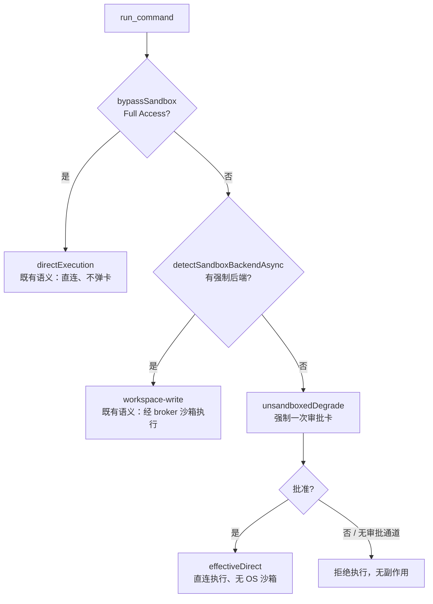

# Agent Note: 无强制沙箱后端时的审批式降级与子代理命令能力对齐

Status: implemented

## Problem

1. **命令执行在无沙箱后端的主机上死路**：Windows 主机既没有可验证的原生沙箱 helper（`sandbox/cwtools-agent-sandbox.exe` 不随扩展发布），WSL2 里也可能没有 bubblewrap 时，`detectSandboxBackendAsync()` 返回 `undefined`，`BrokeredSandboxRunner.spawn` 在 spawn 前抛 `SandboxUnavailableError`。模型只收到一段以 `Failed to start command in cwd "..."` 开头的双语长文案，系统提示里也没有任何该情形的处置指引，`recoveryCoordinator` 又把 `sandbox_unavailable` 的自动恢复预算设为 0，于是模型通常直接向用户汇报"当前没有沙箱"并停住。Paradox 域任务因为最依赖 shell（批量机械改写、批量校验、脚本执行）而最先暴露，但成因与域无关——探测只看平台、环境变量与探针结果。
2. **子代理命令权限在两层之间不一致**：`agentProfileCatalog.ts` 已为 `paradox-coder` 声明 `subagentCapabilities: { command: true }`，策略层 `effectiveToolPolicy.ts` 据此放行，但物理层 `enforceSubAgentSafety` 的豁免硬编码为 `sandbox.profileName === 'general-coder'`，导致被 `dispatch_agents` 派出的 paradox 子代理仍被拦死并收到 `run_command is disabled for orchestrator sub-agents`。
3. **离开沙箱可以复用沙箱内的记忆批准**：模型即便按错误文案自行传 `unsandboxed=true` + `requestEscalation=true`，只要该命令行此前被 `PermissionPolicyStore` 记忆为已批准，`requiresPermission` 会被算成 `false`，命令在**不弹卡**的情况下直接以无沙箱方式执行——审批边界在"离开沙箱"这个维度上是漏的。

## Decision

### 1. 无后端 → fail-open-with-consent（`client/extension/ai/tools/externalTools.ts`）

`runCommand` 在解析出 `detectedSandbox` 之后新增两个局部判定，不改动探测、WSL 判定与 shell 解析：

```ts
const unsandboxedDegrade = !directExecution && !detectedSandbox;
const effectiveDirect = directExecution || unsandboxedDegrade;
```

`effectiveDirect` 只替换**执行语义**的读取（`sandboxProfile.sandboxMode`/`networkAccess`/`authorization`），降级路径不会被强制成 `/bin/sh`。决策链现在是：



审批卡必须如实暴露"契约变化"，否则用户在不知情下批准一次无沙箱运行：`leavesOsSandbox` 含 `unsandboxedDegrade`、描述命中 `[UNSANDBOXED] ...` 分支、`preflight.sandboxMode = 'disabled'`、`preflight.unsandboxed = true`，并在 `reasons` 追加双语说明（"本机没有可用的强制命令沙箱后端；本次执行将在无 OS 沙箱的情况下运行。"）。

**强制逐次审批**是本次的安全核心，落在 `if (bypassSandbox) requiresPermission = false;` 之后：

```ts
if (unsandboxedDegrade || (args.unsandboxed === true && !bypassSandbox)) requiresPermission = true;
```

即：离开 OS 沙箱是另一个契约，自动安全命令与记忆批准都不能替代它。无人值守（`context.onPermissionRequest` 缺失）时保持 `run_command: no permission handler configured` 的 fail-closed 拒绝。`SandboxUnavailableError` 与 broker 的抛错**原样保留**为纵深防御，只是正常路径不再抵达。

### 2. 子代理命令能力由 profile 目录声明判定（`client/extension/ai/orchestrator/subAgentSandbox.ts`）

```ts
const profileDeclaresCommand = toolName === 'run_command'
    && agentProfileCatalog.get(sandbox.profileName)?.subagentCapabilities?.command === true;
```

用 `get()` 而非 `getRequired()`：未注册/自定义 profile 返回 `undefined` 后自然落回拦截，不会因异常路径意外放行，也无需 try/catch。registry 侧未动——`run_command` 仍在 `SUB_AGENT_EXCLUDES`，`allowSubAgent` 仍为 false，放行完全由目录声明授予；`manage_process`、`git_ops`、web/media/orchestration 等特权工具仍被物理拦截。报错文案一字未改。

### 3. 测试面

- `client/test/unit/agentToolSafety.test.ts`：新增 5 例——无后端 + 批准跑通（走真实 broker 路径）、记忆批准仍弹卡、拒绝无副作用、无审批通道 fail-closed、有后端时沙箱契约不变。既有 `run_command` 用例的断言零修改；为消除宿主依赖，该 describe 的 `beforeEach` 把后端探针固定为"存在"，降级用例自行替换为 `undefined` 并在 `afterEach` 统一 restore。
- `client/test/unit/subAgentSandbox.test.ts`：新增 3 例（`paradox-coder`/`general-coder` 放行、6 个受限 profile 拦截、未知 profile 与 `manage_process`/`git_ops` 仍拦）；原"paradox-coder 拦截"用例断言的正是本 bug 行为，改为 `gui-expert` 后断言主体原样保留。
- 该套件另补了 `module._load` 的 `vscode` 桩（沿用 `approvalBoundary.test.ts` 既有模式）：`subAgentSandbox.ts` 经 `toolScheduler`/`getConfiguredGameRoots` 传递性依赖 `vscode`，单跑该文件会 `Cannot find module 'vscode'`，此前仅靠全量套件按字母序先装桩而侥幸通过。

## Alternatives considered

1. **只改提示词，让模型自行带 `requestEscalation`+`unsandboxed` 重试**：否决为主方案。仍多一轮往返，是否离开沙箱取决于模型自觉，且完全不覆盖"记忆批准"漏洞；提示词与 schema 本次未改。
2. **无审批直接降级**：否决。这会把"缺少沙箱"静默变成"无沙箱执行"，删除用户唯一的知情同意点。
3. **继续 fail-closed，只优化错误文案**：否决。用户在此类主机上永远无法执行命令，等于功能不可用；文案改善不改变死路本质。
4. **自动改用 `executionMode='terminal'` 替代**：否决为主路径。终端不捕获 stdout/stderr，agent 读不回结果，依赖输出的工作流全断；terminal 仍作为模型可显式选择的路径保留（它先于降级分支返回）。
5. **再给 `paradox-coder` 加一条硬编码豁免**：否决。等于把同一个不一致复制一份，应按目录声明判定。
6. **给 localization/gui/只读 profile 一并放行 command**：否决。这些是窄角色，结构化工具已足够。

## Consequences

- **行为**：无强制后端的 Windows 主机上，第一次 `run_command` 会得到一张"仅本次无沙箱运行"审批卡；批准后按直连执行，网络随之不受限（这是无沙箱的事实，不是新引入的放宽），并在事件与审批载荷中都可见。
- **安全边界**：离开沙箱一律需要一次逐次显式同意，记忆批准与自动安全命令都不再能替代；无人值守仍拒绝执行。该"显式同意"后来扩展为"人或审批模型"，见 [审批模型可配置与无沙箱执行的审批归属](../architecture/2026-10-17-approval-reviewer-model-and-unsandboxed-review.md)。
- **探测缓存**：后端安装后仍需重启扩展宿主才生效（`cachedWindowsBackend` 负缓存是既有行为，本次未改）。
- **能力面**：子代理命令权限完全由 profile 目录声明驱动，策略层与物理层语义一致；若用户自定义 profile 源注册同名 `paradox-coder` 且未声明 `command`，其命令能力会随目录内容消失（目录驱动的固有语义，与策略层同源）。
- **未改**：`sandboxRunner.ts`/`sandboxBroker.ts`（错误与 broker 保留）、`definitions.ts` 与提示词、README/CHANGELOG（CHANGELOG 由发布流程生成）。
- **验证**：`npm run compile` 0 error；`npm run typecheck:test` 0 error；定向四套件（`agentToolSafety`/`subAgentSandbox`/`deepseekSupport`/`runLedger`）173 passing / 0 failing；`npm run test:unit` 3015 passing（含 `test:rules-sync` 46、`test:perf` 7）。
