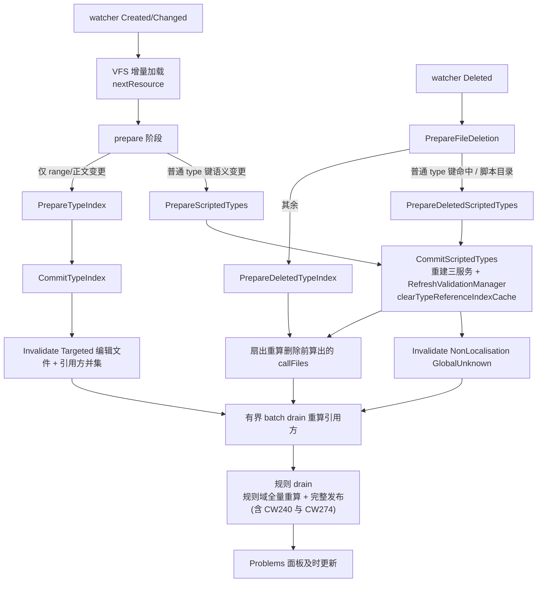

# Agent Note: 增量类型定义失效扇出与 ScriptedServices 升级

Status: implemented

## Problem

在 `common/technology/` 等普通 scripted type 定义目录里新增或修改定义后，**引用该定义的文件诊断不刷新**，
持续报「technology 不存在」，必须重启语言服务器才恢复。两条根因叠加造成该现象：

1. **依赖发现被路径白名单挡死。**
   `Program.fs` 的 `referenceFilesForChangedDefinitions` 只认两类路径：
   `isEventDefinitionPath`（含 `/events/`）走 `referenceFilesForDefinitionsFromIndex`，
   `isDynamicDefinitionPath`（`inline_scripts/scripted_effects/scripted_triggers/script_values/scripted_loc/static_modifiers`）
   走 `referenceFilesForDefinitions`，其余路径一律返回 `[]`。
   于是 `TypeIndexOnly` 分支的 `Targeted` 失效只标脏被编辑文件自己，
   提交后的 `currentCallFiles` 同样拿不到引用方，扇出链在入口就断了。

2. **`TypeIndexOnly` 提交不重建校验服务。**
   `Game.fs` 的 `CommitTypeIndexForFiles` 只调 `rulesManager.CommitTypeIndex`，
   而 `RuleValidationService` 的 `typesMap`（`type` 字段的合法取值集合）
   在构造函数里被 `ToFrozenDictionary` 冻结。提交类型索引不会重建它，
   校验器因此永远拿着旧取值集合。只有 `CommitScriptedTypesForFiles`
   才会重建 RuleValidationService / InfoService / CompletionService 三件套并 `RefreshValidationManager`。

同一根因还有两处未覆盖的相邻缺口，本笔记一并收口：

3. **删除路径没有同样的升级。** `DidChangeWatchedFiles` 的 `Deleted` 分支把
   `isDynamicDefinitionPath` 直接当 `PrepareFileDeletion` 的 `scripted` 标志，
   普通 type 文件一律拿到 `false`，走 `PrepareDeletedTypeIndex` →
   `CommitTypeIndexForFiles`，于是删掉一个 technology 定义后，
   被扇出重算的引用方仍对着含该值的旧服务算，不报「不存在」，直到重启。

4. **`cwtools.ai.revalidateAll` 的 Localisation 域没有消费者。**
   该命令对两域都做 `Invalidate(GlobalUnknown)`，但失效 tracker 被硬过滤为
   非本地化路径，`delayedLocUpdate` 的既有置位点也都不含本命令，
   因此 `.yml` 文件的 freshness 会长期挂在 pending。

**决策所有权说明**：按 `.agents/notes/README.md` 第 3.2 节的 Owning Note 规则，
变更前已检索 `.agents/notes/implemented/` 下全部笔记，
没有任何一篇拥有「增量 scripted-type 刷新」这项决策
（最近的邻近笔记 [2026-09-24-writer-wait-lock-starvation-freeze.md](2026-09-24-writer-wait-lock-starvation-freeze.md)
只覆盖增量提交的**锁**预算，不覆盖失效扇出与提交单元选择）。
因此按规则新建本 Note，而非重复既有决策。

## Decision

改动全部落在本仓 `src/Main/` 与 `src/LSP/Commands.fs`，不触碰 `submodules/cwtools`。

### 1. 依赖发现改为类型键驱动

`Main/SemanticDelta.fs` 新增纯函数 `referenceDiscoveryForPath`，
把原先散落在 `Program.fs` 的 if/elif 提升为可单测的判别联合：

```fsharp
type ReferenceDiscovery =
    | TypeReferenceIndexLookup
    | ExhaustiveReferenceScan
    | NoReferenceDiscovery
```

路由规则**保持原有顺序**，只在末尾追加一条：events → 索引；dynamic 目录 → 穷举扫描；
其余 **type 定义扩展名**（`.txt/.gui/.gfx/.asset`）→ 索引；其余 → 不参与。
这样 `events` 与 dynamic 的既有行为逐字不变，而普通 type 定义文件第一次能查到引用方。

选索引而非 `FindAllRefsByType` 的理由：`game.TypeReferenceIndex()` 的缓存键是
`(resourceManager 身份, ResourceManagerEager.currentResource())`（`LanguageFeatures.fs` 的 `getOrBuildTypeReferenceIndex`）。
新增文件必然走 `ResourceManager` 的 `UpdateFiles`，其中无条件调用 `nextResource()`，
因此「刚新增的文件」这一最需要查引用方的场景必定拿到新构建的索引，
不存在读到陈旧索引的窗口。

### 2. 定义集合改为「编辑前 ∪ 提交后」并集

新增 `definitionsInStagedMaps`：对 staged fold 的 `baseTypeDefInfo`（提交前）
与 `typeDefInfo`（提交后）两张映射分别按文件路径取定义，再求并集。

这是本次修复的关键一处：**新增定义天然只存在于提交后映射**，
只读提交前快照（`priorDefsForRevalidation`）会让新增文件对
「语义决策」和「引用方发现」同时失明。并集同时被三处消费：

- `incrementalSemanticDeltaCandidate` 的 `changedTypeKeys`（替代 `priorDefsForRevalidation |> Seq.map fst`）；
- `priorCallFiles`（其 `priorDefsForRevalidation.IsEmpty` 空集守卫改用并集，
  否则新增文件必然被这条守卫短路）；
- 提交后的 `currentCallFiles`（改用同一个并集，不再单独读 `typeDefinitionsForFiles`）。

`priorCallFiles` 的计算因此从 prepare 之前移到 prepare 之后（仍在提交写锁之前），
守卫条件与读锁纪律均保持不变。

### 3. 普通 type 键的语义变更升级为 ScriptedServices

```fsharp
let requiresScriptedServicesForTypeKeys (ordinaryTypeKeys: Set<string>) (changedTypeKeys: seq<string>) =
    changedTypeKeys |> Seq.exists (fun typeKey -> ordinaryTypeKeys.Contains(baseTypeKey typeKey))
```

`ordinaryTypeKeys` 来自 `game.TypeDefs()`（CWT 的 `type[...]` 声明名），
在提交前于读锁内取一次快照，仅在确有 staged 提交时才读取。升级发生在**prepare 阶段**：

```fsharp
| Some stagedIndex when stagedIndex.semanticChanged ->
    // 脚本目录：subtype / 本地化属性变更在廉价身份签名里看不见
    // 普通 type[...] 键：规则校验服务在构造时冻结了取值集合
    if isDynamicDefinitionPath name || ordinaryTypeKeyEscalation then
        game.PrepareScriptedTypes([ name ], true) |> Option.map ScriptedServices
    else
        Some(TypeIndexOnly(index, stagedIndex))
```

**升级必须发生在 prepare，不能只改决策函数。**
`decideCommittedSemanticDelta` 的候选决策在提交**之前**算好、提交成功后才应用；
若只扩展该函数，提交走的仍是 `index.CommitTypeIndex`（不重建服务），
决策说 ScriptedServices 而服务仍旧冻结，缺陷原样保留。
因此 prepare 是唯一能换掉提交单元的时机，决策函数里的升级作为一致性护栏保留：
一旦某个 TypeIndexOnly stage 被发现碰过普通 type 键，仍然升级为 ScriptedServices。

`decideCommittedSemanticDelta` 新增 `ordinaryTypeKeys` 参数；
`SemanticNoOp`（`semanticChanged = false`）路径逐字不变。
新的 prepare 升级分支补了一条 `monitorLog Refresh`（`upgrade=scripted-services reason=ordinary_type_key`）。

### 4. events 的性能权衡（本项的显式决定）

**决定：把 `event` 纳入升级范围，不设例外。**

- `event` 是 CWT `type[...]` 声明之一，其取值集合同样被 `typesMap` 冻结。
  排除它等于**明知缺陷仍然保留「新增 event 后引用方报不存在，重启才恢复」这一类问题**，
  交付的就不是修复而是部分修复。
- 真正的高频场景没有被拖慢：`semanticChanged` 由
  `typeDefInfoArraysSemanticallyEqual` 判定，只比较 `id/validate/explicitLocalisation/subtypes`，
  **明确忽略 range**。因此「改事件正文」这种绝大多数编辑 `semanticChanged = false`，
  仍走最廉价的 `TypeIndexOnly`，一次服务重建都不会发生。
- 升级只在**事件 id 集合变化**（新增/删除/改名）时触发。这类操作在 modding 中是分钟级，
  而 `PrepareScriptedTypes` 是在读锁外对克隆 lookup 计算的（服务构建在 prepare 阶段完成，
  写锁内只做受守卫的字段快照交换），成本与脚本目录既有语义变更同量级，
  而脚本目录的语义变更频率并不低于事件增删。
- 排除方案还会引入一处长期不一致：`event` 会成为唯一「同样是 type 键、却不享受服务重建」的定义容器，
  未来任何人排查诊断陈旧都要先记得这个特例。

若后续实测显示大型 Stellaris 工作区的事件增删确实成为瓶颈，
正确做法是把 `PrepareScriptedTypes` 的 prepare 阶段移出读锁或加去抖，
而不是重新引入一个语义上说不通的例外集合。

### 5. `cwtools.ai.getDiagnosticsFresh` 增加 `validated` 字段

`fileDiagnosticStates` 无条目的文件，响应新增 `"validated": false`。
无条目与「有陈旧快照」两种情况都只能报 `freshness = "stale"`，
客户端此前无从区分「从未校验」和「已校验但陈旧」。
同时在有条目分支补 `"validated": true`，使两个分支的契约对称
（纯增量字段，今天没有任何消费方读 `validated`，既有字段一律未改名未改值）。

### 6. 新增 `cwtools.ai.revalidateAll` 命令

在 `src/LSP/Commands.fs` 注册为 `writeCmd`（**不**进只读白名单 `isReadCmd`）：
它不改写文件，但会驱动失效 tracker 的全局失效，属于有副作用的写性命令，
调用方不能按只读语义缓存或并发复用。

`Program.fs` 的 `executeCommand` 处理：

```fsharp
diagnosticInvalidation.Invalidate(Domain.NonLocalisation, GlobalUnknown)
diagnosticInvalidation.Invalidate(Domain.Localisation, GlobalUnknown)
delayedLocUpdate <- true                 // 本地化域的消费者
addPendingRefreshDomains [ "localisation" ]
let queued = trackerPendingKnownPaths () |> Set.count
scheduleDeferredDynamicRevalidation []   // 空请求也会从 tracker 播种并启动排空循环
postRefreshWake None                     // 让上面两个置位被下一次 refresh 轮次消费
// => { ok: true, queued: <数量> }
```

不新建第二套调度器：把原本闭包在 `scheduleDeferredDynamicRevalidationImpl` 内的
`trackerPendingKnownPaths` 提升为模块级函数并复用，
排空仍由既有的**有界批处理 drain**（每轮从 tracker 补货、不截断总体待处理集）完成，
原有的防抖、批大小上限与 heavy-analysis 闸门全部保留。

**两个域的消费者不同，必须分别接上。** NonLocalisation 域由 `trackerPendingKnownPaths`
播种的有界 drain 消费；而该 tracker 硬过滤掉本地化路径，所以 Localisation 域的全局
pending 在本命令下**没有任何后台消费者**，`.yml` 文件的 freshness 会一直挂 pending。
补上的置位点是既有的 `delayedLocUpdate`（→ `PrepareLocalisationRefresh` →
`TryCommitLocalisationRefresh`）：本地化域的失效单位本来就是「整批重算」，
不为它另造一条逐文件 drain。`postRefreshWake None` 只是让该置位被下一次 refresh
轮次取走；`doRefresh` 不依赖它（`needsTypeRefresh` 未置位），因此不会因此触发
全量 `RefreshCaches`。
Localisation 域不另加 `delayedScriptLocUpdate`：那条路径是「从磁盘重算本地化」，
而本命令的语义是「用现有模型重新校验」，两者不应混同。

### 7. 删除路径与编辑路径对称升级

`DidChangeWatchedFiles` 的 `Deleted` 分支此前只把 `isDynamicDefinitionPath path`
作为 `PrepareFileDeletion` 的 `scripted` 标志，普通 type 文件一律拿到 `false`，
走 `PrepareDeletedTypeIndex` → `CommitTypeIndexForFiles`，不重建 `RuleValidationService`。
引用方虽被删除前算出的 `callFiles`（`referenceFilesForChangedDefinitions`）扇出重算，
却是对着含已删值的旧服务在算：
删掉一个 technology 定义后不报「不存在」，直到重启。

新增纯函数（`SemanticDelta.fs`，与 `referenceDiscoveryForPath` 同风格）：

```fsharp
let deletionRequiresScriptedServices
    (path: string)
    (ordinaryTypeKeys: Set<string>)
    (definitions: (string * string) list) =
    isDynamicDefinitionPath path
    || requiresScriptedServicesForTypeKeys
        ordinaryTypeKeys
        (definitions |> Seq.map fst)
```

删除前已算好的 `definitionsForRevalidation` 就是判据来源：其 `typeName` 命中
`ordinaryTypeKeysForGame game`（`TypeDefs()` 的 `type[...]` 声明名）即升级为
`scripted = true`。空定义列表命名不出任何键，保持廉价路径。

**锁纪律。** 该分支在 `tryEnterGameStateWriteLock`（`:8053`）之前以**不持锁**的方式
调用 `typeDefinitionsForFiles` / `referenceFilesForChangedDefinitions` /
`PrepareFileDeletion`。新增的 `ordinaryTypeKeysForGame` 调用按编辑路径的口径
包进 `gameStateLock.EnterReadLock()`，并在两个廉价信号（脚本目录、定义列表为空）
命中时直接跳过读取。此处不持有任何锁，写锁此刻也还没取，
因此读锁不会嵌套、不会与后续 `tryEnterGameStateWriteLock` 构成升级死锁。

**分流一致性。** `:8098` 的 `isTypeIndexOnlyRefreshPath` 分流加上 `not deletionScripted`，
否则一次走 `CommitScriptedTypes` 的删除仍会被记成 `incremental_type_index_delete`。
脚本目录本就 `isTypeIndexOnlyRefreshPath = false`，行为逐字不变；
变的只有普通 type 键命中的那次删除。

### 8a. 定义引用方改为后台 drain 驱动

**所有能产生引用方的路径**（events、脚本目录、普通 type 定义目录）的引用方
统一改走一条新的**延迟 drain 变体**（`revalidateDeferredRuleFiles`），
由后台自动重算并发布，不再依赖聚焦时的补算。
用户明确要求 Problems 面板的及时性，这条链放弃的是「等用户切过去看再刷新」的成本取舍。

**为什么不能沿用 `scheduleDeferredDynamicRevalidation`。**
关键不在于它「过滤丢光」诊断——`replaceDomain` 是按域替换，**不会丢任何东西**——
而在于**规则域诊断根本不在它的发布域里**，于是后台重算跑完也不会重发它。
`revalidateDeferredDynamicFiles` 的发布走 `mergeDeferredDefinitionDiagnostics`
= `replaceDomain isDynamicExpansionDiagnostic`，只替换**动态展开域**
（判据：CW274/CW274D 前缀、消息含 `results in an error`、或 related 含 `Related source`）。
而「technology 不存在」是 `FieldValidators.fs` 的 `ConfigRulesUnexpectedValue`，
其 `ID = "CW240"`——三个判据全不满足，**属于规则域**。
于是它被 `replaceDomain` 原样保留，后台重算多少次面板都不会变，
只有聚焦触发的即时 lint（完整发布）才会清掉它。

这正是本 Note 的 headline 场景：修好引用发现与提交单元之后，
**若把引用方交给动态 drain，整条修复链在后台这一环仍然是断的**。
因此两个分叉点**全部**改为直接调 `scheduleDeferredRuleRevalidation`，
没有按路径分流——按路径分流只会把这条缺口留给普通 type 定义。

因此新增**延迟 drain 的变体**（`revalidateDeferredRuleFiles`）：

| 维度 | 现有动态 drain | 新增规则 drain |
|---|---|---|
| 调度骨架 | 单飞标志 + 防抖 + 批快照 | **同一套**（`deferredRevalidationLock` / `dynamicDeferDelayMs` / `boundedSnapshot dynamicDeferMaxFiles`） |
| 单飞标志 | `deferredRevalidationInFlight` | `deferredRuleRevalidationInFlight`（**独立**，理由见下） |
| 批内重算 | `ForceDynamicParameterDataForFiles` + `ValidateFilesLocalCancellable` | 同左，**且预热按需门控**（见下） |
| 结果过滤 | `isDynamicParameterError` | **无**，取该文件全部非本地化诊断 |
| 合并发布 | `mergeDeferredDefinitionDiagnostics`（展开域） | `DiagnosticMerge.mergeDeferredRuleDiagnostics`（规则域，含 CW274） |
| 展开诊断承载文件并入同批 | `planDeferredDynamicRevalidationBatch` | **同样移植**（理由见下） |
| 补货范围 | 全量 `trackerPendingKnownPaths` | 仅本 drain 拥有过的 `deferredRuleOwnedPaths` |

**为什么共用同一循环、但单飞标志独立。**
两者的**取消纪律完全一致**（同样的 `batchStillCurrent` 模型/文档版本快照、同样的
`TryAdmit` → 发布前重取 → `sameAdmission` 比对、同样失配时重新排程），
差别只在「结果怎么算、怎么发布」，而那部分每批有实质差异（动态展开预热、按哪个域合并）。
把两者塞进同一条循环会让每批要么都付预热、要么都只替换展开域，
因此拆成两条独立 drain，但防抖时长、批大小、懒补货与重试纪律逐字复用现成常量与调用点。

**规则 drain 也拥有展开域，因此必须移植动态 drain 的两件一致性机制。**
`isDeferredRuleDiagnostic` 只排除 parser 域与本地化域，**CW274 落在规则域之内**，
所以这条 drain 发布时会把展开域一并替换掉。既然如此，动态 drain 配套的两件事必须跟过来：

1. **展开诊断承载文件并入同批**（`planDeferredDynamicRevalidationBatch`）。
   两组各自稳定的真实展开错误若每轮互相重排，会无限交替、分配无止境。
   并入的文件额外做 `clearFileCaches` + `markFilePendingGlobalRevalidation`，
   否则它们的完成态无人记账。
2. **按需预热动态参数数据**（`warmRuleRevalidationBatch`）。
   未 force 的实体不报展开错误，而本 drain 会发布展开域——不预热就可能把一个真实 CW274 清空。
   **预热成本不是零**：`forceDynamicParameterDataForFiles` 遍历整个 `entitiesMap`
   逐条做 HashSet 查找，与文件是否为动态目录无关，是 O(实体总数) 的全表扫描。
   因此用 `batchCarriesExpansionDiagnostics` 门控——只读已缓存的诊断状态，
   仅当批内确有文件携带展开诊断时才预热。

**为什么补货要收窄到「自有路径」。**
若像动态 drain 那样每轮全量并入 `trackerPendingKnownPaths`，
一次 `GlobalUnknown`（例如 `cwtools.ai.revalidateAll`）会把**整个工作区**灌进这条 drain，
对每个引用方做一次完整的非局部化诊断重算并发布——代价远超收益。
`deferredRuleOwnedPaths` 只记录本 drain 入过队的路径（每轮结束后与仍待处理的集合取交集，
长期会话不留历史），全量失效期间这些路径自然仍 pending，会被重新入队；
其余文件继续由动态 drain 与全量后台校验负责，职责边界不变。

**pendingKinds 语义。**
入队用既有的 `markFilePendingGlobalRevalidation`（其 kind 取自
`refreshDomainsForPath path @ [ "types"; "rules" ]`），**不使用** `dynamicParameters`——
引用方不是动态参数派生物，标错 kind 会让 `effectiveDiagnosticFreshness` / `getDiagnosticsFresh`
报出与语义不符的 pending 来源。出队发布时清掉 `types`/`rules`
（本次重算已满足），保留 `dynamicParameters`/`localisation`（属于别的消费者）。

**没有按路径分流。** 曾试过抽一个 `deferredRevalidationRouteForPath` 纯函数，
把 events 与脚本目录分到规则 drain、其余走动态 drain；**这是错的**，
因为普通 type 定义目录的引用方报 CW240（规则域），走动态 drain 就永远清不掉。
判别联合已删除，两个分叉点直接调 `scheduleDeferredRuleRevalidation`。

（补充一点与直觉相反的事实：`referenceFilesForChangedDefinitions` 对
`NoReferenceDiscovery` 路径返回 `[]`，但 `revalidateFiles` 仍可能非空——
`fastDefinitionIndex` 会把编辑文件自己 `[ name ]` 塞进去（`:4407`），
而 `.cwt`/`.fxh` 属 `NoReferenceDiscovery` 却能通过 `isIncrementalContributionCandidate`。
所以「else 分支根本不可达」并不成立，统一路由同时也简化了这条推理。）

`markDeferredRevalidationStale` **已删除**：改造后没有任何调用方
（两个分叉点都改走新调度入口），保留一个只标脏不驱动的空壳只会让人再次误用。
原先只标脏不驱动的 event 分叉尤其危险：它让事件引用方长期挂在 `Pending`，
而其余路径至少还有个会跑（但发布域不对）的后台 drain。

旧的 expansion-only drain **保留不动**，它仍服务真正的触发点
`refreshDynamicCallSitesForDefinition`（CW274D 提示与 inline 调用方刷新）

### 8b. `DiagnosticMerge` 新增规则域合并

```fsharp
let isDeferredRuleDiagnostic (diagnostic: Diagnostic) =
    isDeferredValidationDiagnostic diagnostic
    && not (isLocalisationDiagnostic diagnostic)

let mergeDeferredRuleDiagnostics existing refreshed =
    replaceDomain isDeferredRuleDiagnostic existing refreshed
```

`publishDiagnostics` 会替换整个 URI 的列表，而规则 drain 的批内结果不覆盖两个域：
**parser 诊断**（`CW001*`，来自即时逐文件 lint）与
**本地化诊断**（`CW100/CW225…`，来自 Localisation 域，本轮根本不算）。
因此只能在「有 code、非 parser、非本地化」的规则域内整体替换，
否则会清掉别的生产者的结果。

**注意这个域同时含 CW240 与 CW274。** 前者是本 drain 的存在理由，
后者使它也接管了展开域的发布——这也是 Decision 8a 必须移植预热与并批的原因。
换一个更窄的域（比如排除 CW274）并不能让动态 drain 变得可用：
CW240 依然在它的发布域之外。



### 9. `FindAllRefsByType` 兜底遍历加同纪元记忆化（submodule）

`findAllRefsByType`（`LanguageFeatures.fs`）先查 `getOrBuildTypeReferenceIndex`，
未命中时对 `resourceManager.Api.ValidatableEntities()` 做**全量递归 AST 遍历**，
无预算、无缓存。调用方 `referenceFilesForDefinitions`（`Program.fs`）
对被改文件的**每个定义各调一次**，脚本目录最坏是 O(定义数 × 全库) 的重复遍历。

新增 `typeReferenceFallbackCache`，挂在索引缓存旁边、与 `clearTypeReferenceIndexCache`
同生命周期：

```fsharp
// LanguageFeatures.fs
let getOrBuildTypeReferenceFallback
    (resourceManager: ResourceManager<_>)
    (typename: string)          // 已按 '\\.' 截断
    (typeValue: string)         // 已 trimReferenceValue
    (buildFallback: unit -> range list)
    =
    let managerId = ...GetHashCode(resourceManager)
    let version = ResourceManagerEager.currentResource ()
    let cacheKey = struct (managerId, version, typename, typeValue)
    ...
```

**键包含两个归一化后的查询维度**，与索引同款纪元键 `(managerId, currentResource())`，
纪元一变即失效。返回语义**逐字不变**：兜底仍只按值文本匹配
（含跨类型误配的可能），记忆化不改变任何一条结果，只是把「同纪元同查询」的
重复遍历折叠成一次。

**有界性。** 容量上限 `TypeReferenceFallbackCacheMaxEntries = 512`
（与既有 `ScriptedEffectParamMapCacheMaxEntries` 同风格），
超限时整体 `Clear()`：每条条目都带纪元，被清掉的条目本来就已失效，
整体丢弃是最便宜的有界策略。

**纪元不变式是既有的，不是新引入的。** 遍历只读 `entitiesMap` 里的实体 AST，
而 `ResourceManager` 里每一处 `entitiesMap[..] <- ..` 都紧跟一次
`nextResource()`（`saveResults`/`updateOverwrite`/`forceRecompute`/
`commitPreparedFile`/`commitInlineScriptCallers`/`commitRemoveFiles`/`removeFile`），
因此该键的不变量强度与既有 `typeReferenceIndexCache` **完全相同**。

### 10. `CommitTypeIndexForFiles` 成功后清类型引用索引缓存（submodule）

```fsharp
// Game.fs
member _.CommitTypeIndexForFiles(staged) =
    let committed = rulesManager.CommitTypeIndex(staged)
    if committed then
        LanguageFeatures.clearTypeReferenceIndexCache ()
    committed
```

放在**提交单元内部**而不是各调用点，因此同时覆盖三条入口：
`RemoveTypeIndexForFiles`（`Game.fs:1307-1312`）、暂存删除提交
（`Game.fs:1368-1376`）与 LSP 的 `TypeIndexOnly` 提交。
`clearTypeReferenceIndexCache` 本身也一并清掉 Decision 9 的兜底记忆，
两个缓存从此**同生共死**，不再各自漂移。

**决策前核实的两件事。**

① **索引重建是惰性的，没有更热的同步重建路径。**
`getOrBuildTypeReferenceIndex` 用 `GetOrAdd`，只在键未命中时调
`buildTypeReferenceIndex`；全仓仅 3 个调用点
（`BaseGame.fs` / `STLGame.fs` 的 `TypeReferenceIndex()` 成员与
`findAllRefsByType` 自身），没有任何提交路径会同步强制重建。

② **删除路径确实被覆盖。** `RemoveTypeIndexForFiles` 与暂存删除提交
都以 `this.CommitTypeIndexForFiles` 收尾，清缓存随之下沉。

**成本核算（否掉原否决理由的关键）。**
原否决理由是「把每个纯类型索引提交都变成一次全局索引重建」。
经核实这不成立：清理成本是一次 `ConcurrentDictionary.Clear()`，
重建仍然惰性；而每条现存调用路径在该提交**之前或之后**都已经推进过资源纪元——
LSP 编辑路径是 `CommitUpdateFileInteractive`（`commitPreparedFile` 调
`nextResource()`）先于 `CommitTypeIndex`，`RemoveTypeIndexForFiles` 先调
`RemoveFile`（`removeFile` 调 `nextResource()`），
暂存删除则是 `CommitRemoveFiles` 在提交**之后**推进。
也就是说被丢掉的条目**本来就已经是死条目**，这条清理在今天几乎是零成本。

**它是加固，不是今天的缺陷修复——这一点必须说清楚。**
`CommitTypeIndex` 虽然不推进资源纪元，但它也**改不动索引的输入**：
实体 AST 没变、实体的 computed-data `Lazy` 没被 `ForceRecompute` 重建、
`InfoService` 也没有被重建（只有 `CommitScriptedTypesForFiles` 重建它）。
因此本轮**未能通过公开 API 构造出可观测的分歧**（回归测试的负控制验证：
移除这条清理后测试仍然通过）。它的价值是把原来那条「靠 `src/Main` 升级分支
兜底的隐性耦合」变成提交单元自身承担的不变式——
若将来出现「提交类型索引但不触碰 VFS」的调用方，它不会读到陈旧索引。

`Program.fs` 里 `ordinaryTypeKeyEscalation` 分支旁的注释已随之改写：
派生缓存不再是该分支存在理由的一部分，剩下的理由只有
「`CommitTypeIndex` 不重建构造时冻结了取值集合的 `RuleValidationService`」。

### 11. 校验结果记忆化与服务输入缓存复用（submodule 性能加固，工作区待提交）

**动机。** Decision 4 接受了「普通 type 键语义变更升级为 `PrepareScriptedTypes`」的服务重建成本；
本轮把这条热路上的重复计算折叠掉。全部改动位于 `submodules/cwtools`
（`RulesManager.fs` / `ValidationManager.fs` / `LocalisationManager.fs` /
`ResourceManager.fs` / `Game.fs` / `GameTypes.fs`），主仓 `src/Main` 与 `src/LSP`
零改动；按仓库边界，交付时需先在 submodule 内提交、再 bump 根指针。

**(a) 已完成规则校验结果记忆化（`ValidationManager.fs`）。**
新增 `RuleResultMemoKey(path, entity, service, resourceEpoch, localisationEpoch, lazyCreated)`：
path 走规范化路径比较，`entity` 与 `service` 按引用相等，
`resourceEpoch` / `localisationEpoch` 固定结果所见的资源与本地化纪元，
`lazyCreated` 记录落账时该实体 computed-data `Lazy` 是否已被强制求值
（同一实体 forced 前后结果可能不同，必须入键区分）。
容量上限 `maxRuleResultMemoEntries = 1024` 条，LinkedList 维护 LRU 顺序、
超限逐出最旧；既有按文件清理路径同步调用 `cleanupRuleResultMemo` 剔除已删文件。编辑失效时还会删除同路径下不属于当前 Entity 的旧条目，避免旧 AST/诊断等到 LRU 淘汰才释放；当前 Entity 的正常复用不受影响。
每实体的查询顺序为「一次性 detached 缓存 → memo → `runRuleValidation`」；
**memo 命中仍执行 `addToCache`、nonSelf/impacted 汇总与全部下游过滤器**，
被跳过的只有 `RuleValidateEntity` 本体；结果只在 `addToCache` 消费完之后才入 memo，
被取消或中途被取代的运行永不入 memo。观测计数 `RuleResultMemoStats`
（hits/misses/stores/evictions）仅供验证使用，诊断等价性以公开校验结果为准。

**(b) 动态校验器工作区快照按 resource 纪元复用。**
dynamic validators 的整工作区 `EntitySet` 原为每批全量重建；现为**单槽快照**，
键为 `ResourceManagerEager.currentResource()`——工作区未变则同一纪元复用同一个
`EntitySet`；`changedEntities` 仍按批构建，**dynamic validators 每一批照常执行**，
快照复用不影响其结果。观测计数 `DynamicWorkspaceSnapshotStats`（builds/reuses）。

**(c) 服务输入缓存按引用共享（`RulesManager.fs`）。**
`RulesWrapper`、冻结 type map、var map、alias key map 四个派生输入全部改为
按不可变源的引用相等做缓存键，由同一把 `serviceInputCacheLock` 守卫；
live lookup、staged clone 与 overlay 物化共用同一份缓存，每个 helper 只从
调用方递给它的源引用计算——**staged clone 只能命中自己的源**，
永远不会读到 live lookup 的当前字段。观测计数 `ServiceInputCacheStats`（hits/misses）。

**(d) staged processed-localisation 候选的三层守卫。**
`StagedCacheRefresh` 新增 `processedLocCandidate`、`baseProcessedLoc`、
`baseLocalisationSources`、`localisationEpoch` 四个字段：prepare 阶段对
staged clone 的索引解析候选（`PrepareProcessedLocalisationCommands`，
不动 live lookup 与 delta journal），并把 live `lookup.proccessedLoc` 引用、
`LocalisationSourceIdentity`（parsed-source 引用身份）与
`ResourceManagerEager.currentLocalisation()` 纪元一并冻结进 staged。
提交时在既有 `typeDefInfo`/`varDefInfo`/`configRules` 引用守卫之外新增
**本地化三层守卫**：live `proccessedLoc` 引用仍等于 prepare 所见、
parsed-source 身份未变、本地化纪元未变——三层全过才
`CommitProcessedLocalisationCommands` 发布候选并 `rebuildProcessedReferenceIndex()`
（delta journal 刻意不动），任一不过则整次 staged 提交放弃（返回 `None`），
不会把陈旧命令诊断复活。`CommitConfigRules` 与
`CommitRefreshCaches` 里既有的 `refreshProcessedLocalisation()`
全量重算随之移除——staged 提交已在 prepare 解析过候选，提交只发布。
观测计数 `ProcessedLocalisationCommandStats()`（prepare/commit 次数）。

**(e) `forceRecompute` 只替换已创建的 Lazy（`ResourceManager.fs`）。**
服务重建后，仅 `IsValueCreated = true` 的 computed-data `Lazy` 换新实例，
使下次访问按需重算；从未创建的 `Lazy` 保留原实例、**绝不强制求值**——
全表预热只会放大峰值分配。观测计数 `ForceRecomputeStats()`（replaced/skipped）。

## Alternatives considered

1. **在 `submodules/cwtools` 让 `CommitTypeIndex` 也重建服务。**
   否决：会把每个纯类型索引提交都变成全服务重建，性能回退远大于收益；
   且按 `AGENTS.md` 的仓库边界，submodule 改动必须先在其仓库内提交，
   与「改动全在本仓 `src/Main`」的既定方向冲突。

2. **只扩展 `decideCommittedSemanticDelta`、不动 prepare。**
   否决：见「Decision 3」。决策函数在提交前求值、提交后才应用，
   它无法改变已经选定的提交单元，只会得到「决策与服务状态不一致」。

3. **把 events 排除在升级之外。**
   否决：见「Decision 4」。会保留同一类缺陷且制造长期特例；
   实测口径上事件正文编辑根本不会触发升级。

4. **为 `revalidateAll` 新建一条独立的全量重算路径。**
   否决：与既有 `RefreshCoordinator` 节流、patch 预算、写锁等待预算相互打架，
   且会产生第二套失效状态机。复用既有 drain 是唯一不削弱护栏的做法。

5. **把 `validated` 响应构造抽到 `DiagnosticMerge.fs` 以便单测。**
   否决：`JsonValue` 来自 FSharp.Data 类型提供程序，
   而 `src/**` 下 `*.Tests.fsx` 的 `#r artifacts/bin/Main/debug/FSharp.Data.dll`
   无法加载其设计时程序集（见下方「已知环境问题」），
   放进任何被 `#load` 的模块都会让该模块的既有测试套件直接崩掉。
   最终改为：响应保持内联，另在 `DiagnosticInvalidation.Tests.fsx` 用
   `Program.fs` 源码守卫（沿用 `RefreshLockIntegration.Tests.fsx` 已有的 Source guards 模式）
   断言两个分支都发出 `validated`。

6. **依赖 `nextResource()` 自动重建类型引用索引，无需额外失效。**
   否决为**不成立的简报前置条件**（详见 Consequences「与简报冲突的发现」），
   实现改用并集 + 读锁内取声明名，不依赖该假设。

--- 以下三条为已评估、当前不采纳的未来候选 ---

7. ~~**让 events 失效驱动本地化重算（events drain 驱动）。**~~
   **已采纳其「后台 drain 驱动刷新」一半，移入 Decision 8**（措辞随之修正）；
   **「驱动本地化重算」那一半继续不采纳**：事件语义与本地化缓存无因果关系，
   这条耦合会引入一类无法解释的耦合；`revalidateAll` 的本地化需求仍由既有的
   整批 `delayedLocUpdate` 链路直接覆盖（见 Decision 6）。

8. ~~**穷举记忆化（把 `referenceFilesForDefinitions` 的扫描结果缓存下来）。**~~
   **已采纳，移入 Decision 9**：原否决理由（「脚本目录已升级为服务重建」）
   只覆盖了**提交**一侧，没有覆盖**读取**一侧——
   `FindAllRefsByType` 的索引未命中兜底遍历无预算无缓存，
   而 `referenceFilesForDefinitions` 对被改文件的每个定义各调一次，
   最坏是 O(定义数 × 全库) 的重复全量 AST 遍历。

9. ~~**在 `CommitTypeIndexForFiles` 里直接清类型引用索引缓存。**~~
   **已采纳，移入 Decision 10**：原否决理由（性能回退）经核实**不成立**——
   索引重建是惰性的（`getOrBuildTypeReferenceIndex` 只在未命中时构建），
   且每条现存提交路径在该提交之前或之后都已经推进过资源纪元，
   因此这条清理在今天几乎是零成本（详见 Decision 10 的成本核算）。

10. **event namespace 扇出（按 events 目录做命名空间级失效）。**
    未采纳：**已核实无缺口**，四条证据都指向「event 的值空间是扁平的，没有命名空间维度」：
    - `RulesHelpers.fs` 的定义注入键直接读 id 的叶子文本，无任何前缀拼接；
    - `TypeDefInfo` 没有 `namespace` 字段（`Constants.fs` 的定义处只有 id/range 等）；
    - `getNodeForTypeDefAndType` 是裸 id 精确匹配（`LanguageFeatures.fs` 的 `Array.tryFind (fun tdi -> tdi.id = typename)`），不存在命名空间前缀参与查找；
    - `submodules/cwtools-stellaris-config/config` 全目录 grep `namespace` **零命中**；
      且 `CW222` 在 `Validation.fs` 只有一处出现，且不发射该错误。

    即命名空间级扇出没有可作用的对象：加了也只会重复已有的类型键信号，
    并让「哪些 event 属于哪个命名空间」变成新的、无来源的判定。

## Consequences

- 新增/修改 `common/technology/`、`common/buildings/` 等普通 type 定义后，
  引用方不再需要重启即可清除「technology 不存在」。完整链路见上方流程图，
  **全程不触发 `RefreshCaches`**。
- 事件 id 集合变更现在会多付一次服务重建成本（见 Decision 4 的取舍）；
  事件正文编辑的成本完全不变。
- `changedTypeKeys` 的来源从「提交前快照」变为「staged 折叠的并集」。
  对新增文件而言这是新增信息，对被删除的键则是仍可见的旧信息——
  两者都只会让决策更保守（更容易升级），不会放宽任何护栏。
- `decideCommittedSemanticDelta` 的签名多了一个 `ordinaryTypeKeys` 参数，
  两个既有调用点与 `SemanticDelta.Tests.fsx` 的既有断言已同步更新。
- `cwtools.ai.getDiagnosticsFresh` 的响应新增 `validated` 字段（两个分支都有），
  属纯增量，现有消费方不受影响。
- `referenceFilesForChangedDefinitions` 现在对普通 type 定义文件也走类型引用索引，
  引用方发现从「一个都查不到」变为「按类型键精确查找」，同时多一次
  `TypeReferenceIndex()` 的 `Map.tryFind`（已缓存，O(定义数)）。
- **删除路径与编辑路径对称**（Decision 7）：删掉 `common/technology/` 等普通 type
  定义文件后，`PrepareFileDeletion` 以 `scripted = true` 准备，提交走
  `CommitScriptedTypesForFiles`，重建的 `RuleValidationService` 不含已删取值；
  引用方被扇出重算后立刻出现「technology 不存在」，不再需要重启。
  代价与 Decision 4 同量级：删除一个普通 type 键定义会多付一次服务重建。
- 删除路径现在会调用 `ordinaryTypeKeysForGame`（`TypeDefs()`）一次。
  它只在非脚本目录且该文件确实拥有定义时才读取，且在读锁内完成；
  脚本目录与无定义文件的删除成本完全不变。
- `:8098` 的 `isTypeIndexOnlyRefreshPath` 分流加上 `not deletionScripted` 前置条件，
  因此一次升级过的删除不再被记成 `incremental_type_index_delete`，
  而是进入 patch 预算分支——与它实际跑的提交单元一致。
- **`revalidateAll` 的 Localisation 域现在真的有消费者了**（Decision 6）：
  `delayedLocUpdate <- true` + `addPendingRefreshDomains [ "localisation" ]` +
  `postRefreshWake None` 把它交给既有的 `PrepareLocalisationRefresh` 链路，
  `.yml` 文件的 freshness 不再长期挂 pending。
  该置位不触发全量 `RefreshCaches`（`needsTypeRefresh` 未置位），
  也不改变 NonLocalisation 域的有界 drain 行为与响应字段。
- `SemanticDelta.fs` 新增纯函数 `deletionRequiresScriptedServices`，
  判定逻辑可单测，与 `referenceDiscoveryForPath` 同风格；
  `SemanticDelta.Tests.fsx` 覆盖普通 type 键、event 键、子类型限定键、
  大小写/空白归一、键未声明、定义列表为空、脚本目录与 inline_scripts。
- `DiagnosticInvalidation.Tests.fsx` 的源码守卫新增一条：
  `revalidateAll` 分支必须包含 `delayedLocUpdate <- true`，
  防止两域消费者再次分叉。
- **与简报冲突的发现（明示，不绕开）**：简报称「索引缓存随 `nextResource()` 自动重建，无需额外失效」。
  实测不成立——`getOrBuildTypeReferenceIndex` 的缓存键用的是
  `ResourceManagerEager.currentResource()`（`resourceEpoch`），
  而 `commitTypeIndex` 在 `semanticChanged` 时只推进 `nextTypeRules()`（`typeRulesEpoch`），
  两者是不同计数器。即：**TypeIndexOnly 提交路径不会失效该索引**。
  本次实现不依赖这条假设：普通 type 键的语义变更现在一律走
  `CommitScriptedTypesForFiles`，而后者显式调用 `LanguageFeatures.clearTypeReferenceIndexCache()`
  （`Game.fs` 的 `CommitScriptedTypesForFiles`），索引缓存因此一定被清空。
- **该耦合已从 `src/Main` 移进 submodule 的提交单元**（Decision 10）：
  `CommitTypeIndexForFiles` 现在自己清 `TypeReferenceIndex` 缓存，
  `Program.fs` 的 `ordinaryTypeKeyEscalation` 分支不再需要为派生缓存负责，
  其注释已改写为只剩「`RuleValidationService` 的 `typesMap` 在构造时冻结取值集合」这一条理由。
  **本轮按仓库边界未提交 submodule**，交付时需「先在 submodule 内提交，再 bump 根指针」。
- **`FindAllRefsByType` 的索引未命中兜底现在有界且带缓存**（Decision 9）：
  同一纪元内对同一 `(typename, typevalue)` 的重复全量 AST 遍历折叠为一次，
  纪元一变即失效，缓存上限 512 条、超限整体清空（被清条目本就已失效）。
  返回语义逐字不变（含兜底只按值文本匹配、可能跨类型误配这一既有行为）。
- 新增 submodule 回归测试 `typeReferenceInvalidationTests`（`ContractTests.fs`）：
  覆盖同纪元重复查询逐字一致、纪元推进后兜底必须重新遍历、
  以及 `TypeIndexOnly` 提交后 `TypeReferenceIndex` 与兜底查询都等于全量刷新。
  **兜底纪元键有负控制验证**（把 `version` 冻结为常量后测试立即失败）。
  `CWToolsTests` 因此从 313 通过变为 **314 通过 / 0 失败 / 2 跳过**。
- **所有引用方统一改由后台规则 drain 驱动**（Decision 8a）：改/删**任意**定义文件后，
  其引用方在 300ms 防抖、最多 500 文件一批的后台重算中完成**规则域全量重算与发布**，
  不再需要用户切到该文件才补算。
  **这补上了整条修复链在后台的最后一环**：此前普通 type 定义的引用方走动态 drain，
  而 CW240「technology 不存在」不在该 drain 的发布域内（它只替换动态展开域），
  后台重算多少次面板都不会变——headline 场景实际上只靠聚焦补算在兜底。
  代价：每个引用方多付一次 `ValidateFilesLocalCancellable`（对标 DidSave 的 `deepLintRequest`），
  因此批次仍然走 `acquireHeavyAnalysisGate`、`isCompletionHeavyInteractiveWindow` 让位、
  单飞标志与有界快照；补货只覆盖本 drain 拥有过的路径，
  一次 `GlobalUnknown` 不会把整个工作区灌进这条 drain。
- **规则 drain 同时接管 CW274 展开域**（`isDeferredRuleDiagnostic` 不排除它），
  因此移植了动态 drain 的两件一致性机制：展开诊断承载文件并入同批（并对其
  `clearFileCaches` + 标 pending），以及批内预热动态参数数据。
  **预热按 `batchCarriesExpansionDiagnostics` 门控**——预热是 O(实体总数) 的全表扫描，
  不是零成本，只在批内确有文件携带展开诊断时才付。
- 旧的 expansion-only drain **保留不动**，继续服务 `refreshDynamicCallSitesForDefinition`
  （CW274D 提示与 inline 调用方刷新）这个真正的触发点。
- `markDeferredRevalidationStale` 已删除（改造后无调用方）；
  曾设计的 `DeferredRevalidationRoute` 判别联合也已删除——按路径分流会把 CW240 缺口
  留给普通 type 定义，两个分叉点因此直接调 `scheduleDeferredRuleRevalidation`。
- `DiagnosticMerge.fs` 新增 `isDeferredRuleDiagnostic` / `mergeDeferredRuleDiagnostics`：
  只在「有 code、非 `CW001*`、非本地化」的规则域内整体替换，
  保住即时 lint 的 parser 诊断与 Localisation 域的诊断。
- `DiagnosticInvalidation.Tests.fsx` 的源码守卫覆盖
  「标脏后必须排程」「标脏用 types/rules 而非 dynamicParameters」
  「批内不套用动态参数过滤器」「完整发布」「沿用同一防抖与批大小」
  「独立单飞标志」「受控补货」「两个分叉点都直调规则 drain」
  「分叉点不再出现动态 drain」「路由判别联合已彻底删除」
  「展开承载文件并入同批」「按需预热且预热确实 force 了批内文件」「旧标记已无调用方」。
- **已知环境问题（非本次改动引入）**：7 个 `src/Main/*.Tests.fsx` 套件
  （`DiagnosticMerge`、`InlineGraph`、`LanguageServerFeatures`、`LocalisationLanguages`、
  `PdxFlowAnalysis`、`ProjectKnowledge`、`SemanticGraph`）在本机
  `dotnet fsi` 下全部以同一条错误失败：
  `FSharp.Data.DesignTime.dll` 在 `artifacts/bin/Main/debug` 下缺失，
  导致 `#r .../FSharp.Data.dll` 的类型提供程序无法装载。
  这 7 个套件及其加载的脚本均未被本次改动触及
  （`src/Main/DiagnosticMerge.Tests.fsx` 与 HEAD 逐字一致；
  本次只向 `DiagnosticMerge.fs` **追加**了纯函数，未改动既有函数）。
  CI 侧不受影响：`ci.yml` 的 `.NET server build` 作业显式把
  `FSharp.Data.DesignTime.dll` 复制进 `artifacts/bin/Main/debug` 之后才跑脚本。
  本机复现该套件时应先执行同样的复制，否则看到的是环境缺失而非代码缺陷。
- **本轮 submodule 性能加固的验证证据**（Decision 11，均为当前工作区状态下测得）：
  `ruleResultMemoTests` 定向 11/11 通过（memo 命中诊断逐字等价、`lazyCreated`
  翻转必 miss、纪元推进必失效），staged processed-loc 定向 5/5 通过；
  主仓相关 F# 定向 7/7 通过，TS compile/typecheck 通过；
  完整 CWTools 回归 **329 通过 / 2 跳过 / 0 失败**（16 秒），
  进程退出码 1 与基线一致，源于既有 `trigger_docs.log`/`setup.log` 缺失，非新增失败。
- **同口径前后测量（Windows 小 fixture，不代表 Linux 14GB 大项目）**：
  20 次编辑、100ms 迭代延迟、5 秒沉降，`client/test/sample`，未载入原版数据。
  基线末尾 `alloc=1052MB`/`working=174MB`，优化后 `alloc=931MB`/`working=172MB`，
  累计分配（`GC.GetTotalAllocatedBytes` 口径）下降约 11.5%；
  post-full-background-validation 基线 `alloc=1002MB`，优化后 `881MB`，下降约 12.1%；
  两侧诊断计数完全一致（errors=572、warnings=749）。
  工作集口径基本不变，收益集中在累计分配；该 fixture 远小于真实模组工作区，
  **不得外推 Linux 14GB 场景**；Linux 同口径复测流程见 `tools/perf/README-lsp.md`，尚待执行。

## 交叉平台回归修复（源码守卫改用 `Path.Combine` 分段）

上述新增的 `commandsSource` 源码守卫最初写作：

```fsharp
System.IO.Path.Combine(__SOURCE_DIRECTORY__, "..\LSP\Commands.fs")
```

这在 Windows 下可解析，但在 CI 的 Linux 运行器上
`Path.Combine` **不会**把 `\` 当分隔符，于是整串被当成单个文件名，
求值出 `.../src/Main/..\LSP\Commands.fs`，直接
`System.IO.FileNotFoundException` 让 `DiagnosticInvalidation.Tests.fsx` 崩溃，
`.NET server build` 作业失败（`ci.yml` 的 F# 脚本步骤用 `bash -e` 逐个执行，
首个失败即中断整步）。由于该步骤排在 `CwtProjectIndex.Tests.fsx` 之后，
同批后续脚本在 Linux 上从未被执行过。

**决定：路径一律按段传给 `Path.Combine`，不在字符串字面量里内嵌任何分隔符。**

```fsharp
System.IO.Path.Combine(__SOURCE_DIRECTORY__, "..", "LSP", "Commands.fs")
```

这是本仓既有的书写惯例（`CwtLanguageSemantics.Tests.fsx`、
`LocalisationLanguages.Tests.fsx` 等 10 余处同款调用均如此），
本次只是把漏网的一处对齐到既有惯例，不引入新的约定或辅助函数。

选它而非另两种写法的原因：

- **改用 `Path.DirectorySeparatorChar` 拼接**：把一个可读的字面路径拆成
  运行期字符串运算，只为掩盖一个字面量错误，反而更难审查。
- **改成 `"/"` 单斜杠字面量**：Windows 上确实能跑，但把「依赖 Windows 也接受
  `/`」这条隐式前提写进了测试；`Path.Combine` 的分段形式对两种平台都是精确语义。

**验证**：`npm run test:fsx` 全量 35 个脚本通过（`DiagnosticInvalidation.Tests.fsx`
内含该守卫的 3 条 `writeCmd`/`readCmd` 断言仍全绿）。
另以静态扫描确认 `src/**/*.fsx` 中已不存在「`Path.Combine` 实参内嵌
反斜杠路径」的写法，杜绝同类漏网点。

**教训（写给后续新增源码守卫的人）**：用 `File.ReadAllText` +
`string.Contains` 做源码守卫时，被读取的文件**路径**本身也是测试代码的一部分，
必须与断言内容同等对待地保证跨平台可解析。
这类缺陷在 Windows 开发机与 Linux CI 之间呈现为「本机全绿、CI 必红」的
不对称失败，且因 `bash -e` 的短路语义还会掩盖同批后续脚本的真实状态。
