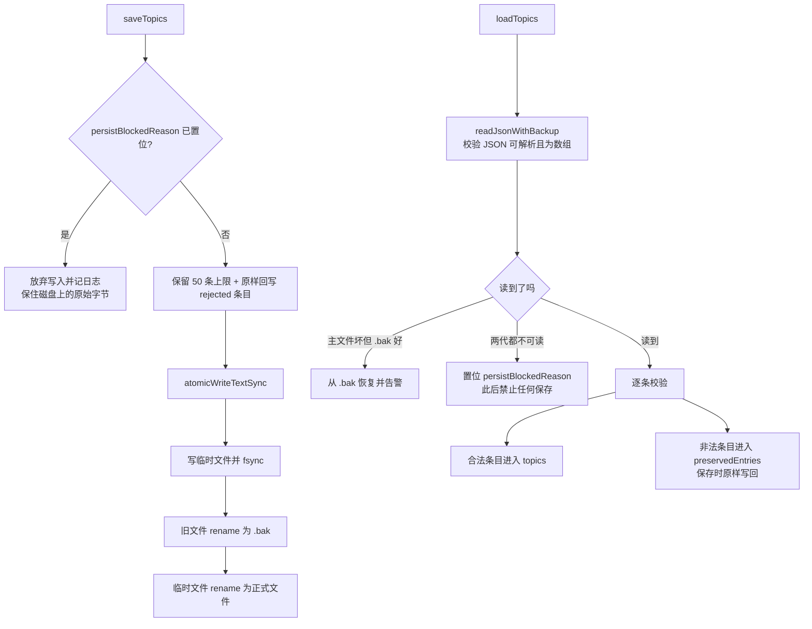

# Agent Note: 话题历史存储的原子写入与读取失败保护

Status: implemented

## Problem

用户反馈「重启后已归档的对话消失」。排查后确认这不是 UI 筛选问题，而是**话题历史被真实抹除**。

`ai-chat-topics.json` 是用户在 GUI 里看到的全部话题（含已归档）的唯一副本：`archived` 只是 `ChatTopic` 上的一个布尔字段，和普通话题共用同一个数组，没有独立的归档存储。因此「归档消失」与「整个话题库被清空」是同一件事。

原实现（`chatTopics.ts`）中存在三个叠加缺陷：

1. **非原子写入**：`saveTopics()` 直接 `fs.writeFileSync` 覆盖目标文件。Extension Host 或机器在写入途中停止时，磁盘上留下的是被截断的 JSON。
2. **读取失败被静默吞掉**：`loadTopics()` 的 `catch { /* ignore */ }` 让任何解析失败都表现为「话题列表为空」，而内存中的空列表会在下一次保存时被写回磁盘，形成**「解析失败 → 内存空 → 覆盖写空」**的不可逆链路。
3. **单条损坏被永久删除**：`readStoredTopic` 校验不通过就直接丢弃该条，且丢弃结果会随下一次保存落盘，原始条目再无痕迹。

现场证据：一台机器上 11 个工作区话题文件中，8 个是 2 字节的 `[]`。全新安装不会创建该文件，所以这些 `[]` 只可能由 `saveTopics()` 写出，即「先读空、后覆盖」。

由于运行中的 manager 把话题保存在内存，UI 在会话期间始终正常；用户只有在重启、Host 重新执行 `loadTopics()` 之后才看到丢失——这正是「重启后才发现」的成因。

## Decision

1. **新增同步原子写 `atomicWriteTextSync`**（`client/extension/ai/runner/durableStorage.ts`）
   `saveTopics()` 被大量同步路径调用（归档、重命名、dispose、标题回写等），无法改成异步。新增的同步版本与既有 `atomicWriteText` 保持同一语义：临时文件 → `fsync` → 把旧文件 `rename` 成 `<file>.bak` → 把临时文件 `rename` 成正式文件。任何中断点上都只会留下「完整的上一代」或「完整的新一代」，绝不会留下半截 JSON。

2. **读取改为带校验的世代回退**
   使用 `readJsonWithBackup(filePath, Array.isArray)`，**校验器是读取的一部分而不是事后步骤**。这一点是回归测试逼出来的：初版用 `readTextWithBackup` 只判断「文件能否读出字节」，主文件损坏时会直接返回损坏内容并短路掉 `.bak` 回退，等于备份机制形同虚设。

3. **读取失败时锁死写入**
   `persistBlockedReason` 记录「文件存在但两代都不可读」。此后 `saveTopics()` 直接放弃写入并记录 debug 日志，不再用内存中的空列表覆盖用户可见但暂时读不出的历史。

4. **单条非法条目「隐藏但不删除」**
   校验失败的原始条目进入 `preservedEntries`，被排除在话题列表之外，但每次保存都会**逐字原样写回**。损坏的单条不再连锁导致其余话题不可用，也不会自我删除。

5. **归档标志先落盘再切换视图**
   `archiveTopic` 原先在 `startNewTopic()`（会清空当前话题并重绘列表）之后才保存。现改为先 `saveTopics()` 再切换，保证面板重新打开时归档标志已经在磁盘上。

## Alternatives considered

- **把 `saveTopics` 整体改成异步、复用既有 `atomicWriteText`**：否决。调用点遍布归档、重命名、标题生成、`dispose()` 等同步路径，改异步会波及至少 14 处调用并引入未 await 的竞态，收益仅是省掉一个约 40 行的同步函数。
- **读取失败时自动把损坏文件改名归档并重建空库**：否决。应用启动时用户可能并不知道自己丢了数据，静默改名会让「看起来好了」掩盖真实损失；保留原文件并拒绝写入，用户仍可用备份或手工修复取回内容。
- **只加 `.bak` 而不做写入锁**：否决。备份只能应对「写入被中断」，无法应对「读取失败后覆盖写空」这一真实发生过的路径；两者防的是不同故障。
- **对单条非法条目执行"尽力修复"（补齐缺失字段后重新入库）**：否决。非法条目往往正是因为语义不可信（如调度状态未知），强行补默认值会让用户以为话题完好却丢掉了关键状态。原样保留既有字节，把判断权留给人和后续版本。

## Consequences

- 把「重启后话题与归档一起消失」从**不可逆的数据丢失**降级为可恢复故障：主文件损坏时自动从 `.bak` 取回上一代，两代都坏时至少不再继续扩大损失。
- **已知代价：回退会丢失最后一代的改动**。备份只保留一代，若损坏发生在「归档」这次写入刚完成之后，恢复出来的仍是归档前的状态（实测：话题与消息全部回来，`archived` 重回 `false`）。原子写本身不会产生截断文件，因此这一路径只适用于历史遗留的损坏文件或外部破坏；如未来需要更强保证，可扩展到两代备份。
- 单条话题损坏不再连坐：其余话题照常可用，损坏条目仍留在磁盘上等待人工或后续版本处理。
- 归档操作在面板重开后保持可见，不再出现「归档完重启就找不到」的错觉。
- 代价：每次保存多一次 `fsync` 与一次 `rename`（同步 I/O），并对保留的非法条目做无操作的透传写回；这些开销发生在用户可见操作上，量级可忽略。
- 新增 `client/test/unit/chatTopicsDurability.test.ts`（6 例）锁定：截断文件不被覆盖、`.bak` 世代恢复、单条损坏不删除、归档跨重启保持、原子写不残留临时文件、`persistence: 'off'` 不写盘。
- 已知未解决：`ai-chat-topics.json` 仍然只保留最近 50 条话题（超出部分在会话内可见但不落盘）。这是既有的存储上限，本次未改变。
