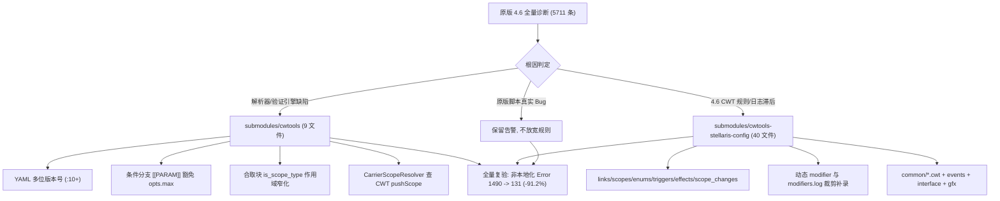

# Agent Note: Stellaris 4.6 原版报错归因与解析器/引擎/CWT 规则修复

Status: implemented

## Problem

在 Stellaris 原版 `v4.6.0 (3d1a)` 全量脚本校验中，CWTools 最新规则基线共报告 5711 条诊断，其中包括 1490 条非本地化 Error、618 条非 `CW100` Warning、283 条 `CW274`（`inline_script` 展开报错）与 7 条 `CW268`（YAML 本地化解析中断）。这些报错混合了三类完全不同性质的问题：

1. **CWTools 解析器与验证引擎真实缺陷**：例如无法解析 `:10` 及以上多位本地化版本号、条件参数宏分支 `[[PARAM] ...]` 触发误报最大基数 `CW242`、合取触发器内 `is_scope_type` 未执行运行时作用域窄化、以及事件图谱 `CarrierScopeResolver` 未查询 CWT 规则迭代器的 `pushScope`。
2. **Stellaris 4.6 CWT 规则与日志滞后/缺陷**：4.6 新增 `ideology` / `advocate` / `cultural_envoy_target` 等作用域链接、`scope[ideology]` 被误标为类型引用 `<ideology>`、98 个 `ordered_*` 迭代器缺少可选基数 `position`、以及 4.6 新增修饰符、触发器、效果、类型字段与图形/GUI 字段漏配。
3. **Stellaris 原版脚本自身真实缺陷**：语法缺少 `}`、错别字、失效建筑/事件/贴图引用、跨作用域误调命令以及重复定义键。

需要在严守强类型校验与规则边界的前提下，逐类核实并修复真正的解析器/引擎漏洞与 CWT 规则缺陷，同时保留对原版脚本真实 Bug 的准确告警。

## Decision

建立三层归因分流并分别在 `submodules/cwtools` 与 `submodules/cwtools-stellaris-config` 落地最小精确修复：

### 1. 解析器与验证引擎修复（`submodules/cwtools`）

1. **支持 YAML 本地化多位数版本号（`CW268`）**：
   - 将 `CWTools/Localisation/LocalisationDomain.fs` 中 `Entry.value` 与 `CWTools/Process/Localisation/ChangeLocScope.fs` 中 `LocEntry.value` 由 `char option` 升级为 `string option`。
   - 将 `CWTools/Localisation/YAMLLocalisationParser.fs` 的 `value` 解析器由单字符 `digit` 改为 `many1Satisfy isDigit .>> spaces`，避免 `:10`~`:14` 截断并恢复后续所有本地化行校验。
   - 在 `CWToolsTests/LocalisationValidationTests.fs` 新增回归测试。
2. **修复条件参数分支 `[[PARAM] ...]` 触发最大基数误报（`CW242`）**：
   - 在 `CWTools/Rules/RuleValidationService.fs` 的 `applyClauseField` 外层一次性计算 `hasConditionalBranch`（识别 `[[` / `\[` 前缀节点、叶节点与叶值），并在 `checkCardinality` 中复用外层 `hasMacro` 与 `hasConditionalBranch`，对全部 5 处 `opts.max < total` 判定增加 `&& not hasConditionalBranch`，同时保持无条件块重复键告警不变。
   - 在 `CWToolsTests/ScopeRegressionTests.fs` 新增正反双断言测试。
3. **支持合取触发器块内 `is_scope_type` 运行时作用域窄化（`CW247`）**：
   - 在 `CWTools/Common/Constants.fs` 的 `ScopeManager` 新增无日志副作用的 `TryParseScope(x: string)`。
   - 在 `CWTools/Rules/RuleValidationService.fs` 的 `applyClauseField` 中，仅当块处于 trigger 规则上下文（`leafSpecificDict.ContainsKey isScopeTypeId.lower`）、不含条件参数分支、非 `OR`/`NOR`/`NOT`/`NAND`/`calc_true_if` 合取块、且恰好存在一条 `is_scope_type = <concrete_scope>`（`CWTools.Parser.Types.Operator.Equals`）时，将当前栈顶窄化为 `narrowed :: ctx.scopes.PopScope`（完整保留 `prev` 栈链）。
   - 在 `CWToolsTests/ScopeRegressionTests.fs` 新增合取窄化与 `OR`/`NOT` 不窄化三重断言测试。
4. **修复事件图谱 `CarrierScopeResolver` 缺失 CWT 规则迭代器 `pushScope`（`CW243`）**：
   - 在 `CWTools/Game/Stellaris/STLGame.fs` 的 `CarrierScopeResolver` 中（与 [CarrierSnapshot 节点遍历分配优化](./2026-11-26-carrier-snapshot-node-cache.md) 共享快照链路），按 `lookup.configRules` 引用惰性缓存 `AliasRule(("effect" | "trigger"), (NodeRule(SpecificField(SpecificValue name), _), opts))` 的 `opts.pushScope`。
   - 当 `changeScope.Invoke` 未命中硬编码/静态作用域切换时，回退查询 `rulePushScopes` 并执行 `context.PushScopeReset pushScope`，使 `random_revealed_ideology` 等 CWT 迭代器正确传递 `prev = Ideology` 至事件目标推导。
   - 在 `CWToolsTests/CarrierEventTests.fs` 新增跨事件 `scopes = { from = prev }` 回归测试。

### 2. Stellaris 4.6 CWT 规则与日志修复（`submodules/cwtools-stellaris-config`）

共更新 40 个规则/日志文件，严守强类型约束（除既有 `gfx/particles.cwt` 粒子曲线表达式外零新增 `scalar`）：

- **作用域链接与日志**：`config/links.cwt` 补齐 `ideology`、`advocate`、`cultural_envoy_target`（输出 `Colony`），为 `owner`/`owner_species`/`owner_main_species`/`ruler`/`heir` 补充 `ideology` 输入作用域；修正 `config/logs/scopes.log` 中 4.6 同步时错置在分隔符 `=================` 外部的条目格式。
- **触发器、效果、枚举与迭代器**：
  - `config/effects.cwt` 与 `config/triggers.cwt` 将 19 处 4.6 ideology 命令由 `<ideology>` 修正为 `scope[ideology]`，修正 `combined_emitter_reach` 拼写错误（`ildeology -> ideology`），为 `pop_ideology_amount` / `pop_ideology_percentage` 补全 `ideology = any`，并补齐 `remove_trait = random_negative`、`has_trait = any_negative`、`create_message` 的强类型 `enum[message_onclick]` 与 `type = resources`、`activate_saved_leader.in_training`、`total_workforce_with_job_tag.bonus_workforce`、`get_tenet_tier.value` 等字段。
  - `config/enums.cwt` 补充 `scope_type_tokens` / `federation_succession_types` 的 `ideology`、`federation_settings` 新项与强类型 `enum[message_onclick]`。
  - `config/scope_changes.cwt` 为全部 98 个缺少可选基数的 `ordered_*` 迭代器 `position = int[0..inf]` 补齐 `## cardinality = 0..1`。
- **修饰符边界治理**：严格遵循 [引擎文档日志与 CWT 生成边界](../process/2026-10-07-engine-doc-log-generated-boundary.md) 与 [Stellaris v4.5 规则同步与 CWT 更新](../feature/2026-09-23-stellaris-v4.5-rules-sync-and-cwt-updates.md)：
  - 动态模式生成的修饰符写入对应 CWT `modifiers` 块：`config/common/governments.cwt`（`$_finishing_effect_strength_mult`）与 `config/common/ethics.cwt`（`pop_$_attraction_add`）。
  - 无法动态生成的 18 条 4.6 静态修饰符（9 条 `shipclass_cultural_envoy_*` 与 9 条独立静态 modifier）经与本机 `script_documentation/modifiers.log` 逐字核对后精准追加至裁剪基线 `config/logs/modifiers.log`。
- **类型、GUI 与图形规则**：同步修复 `common/`（26 个文件，含 `crisis.cwt`、`ideologies.cwt`、`galactic_community.cwt` 的 `subtype[target_ideology]`、`common_economic_templates.cwt`、`traits.cwt`、`pop_faction.cwt`、`buildings.cwt`/`zones.cwt`、`jobs_and_social_strata.cwt`、`deposits_and_planetary_features.cwt` 等）、`events.cwt`、`prescripted_countries.cwt`、`interface/gui_types.cwt`、`interface/sprites.cwt`（利用 `SharedParsers` 对 `rgb { ... }` 生成匿名 `ValueClause` 的语义支持）、`gfx/portraits.cwt`、`gfx/particles.cwt` 与 `gfx/model_entities.cwt`。

## Alternatives considered

1. **为压低原版报错总数而放宽 CWT 规则（如放开 `Colony` 接受 `Planet`-only 命令、在 `on_unlock` effect 块接受 `potential`、或放宽 `enum`/`scalar` 约束）**：否决。这些均已通过读取原版脚本源码证实为 Stellaris 原版真实 Bug 或脚本边界误用；放宽规则会导致 Mod 作者编写同类错误时失去静态检查保护。
2. **用本机生成的 `script_documentation/modifiers.log` 整量覆盖 `config/logs/modifiers.log`**：否决。违反 [引擎文档日志与 CWT 生成边界](../process/2026-10-07-engine-doc-log-generated-boundary.md) 所确立的“动态模式归 CWT、静态基线精确裁剪”边界，会破坏 `StellarisConfigLogs.Tests.fsx` 回归约束并引入动态修饰符重复声明。
3. **在 `RuleValidationService.fs` 对 `OR`/`NOR`/`NOT` 块也执行 `is_scope_type` 作用域窄化，或在存在多条 `is_scope_type` 时取首条**：否决。析取或否定块内 `is_scope_type` 不构成兄弟条件的合取前置条件，盲目窄化会产生假阴性与错误类型推导；仅在单一确定合取块执行窄化才能保持声音性（soundness）。
4. **在 `interface/sprites.cwt` 放宽 `piechart.colors` 为 `scalar` 或硬写带前缀键 `rgb`**：否决。带裸前缀键 `rgb` 会破坏 CWT 语法解析（触发 `CWT001` 级联失效），而放宽为 `scalar` 会丢失 RGB 整数范围校验；利用 `SharedParsers` 将 `rgb { r g b }` 直接解析为匿名 `ValueClause` 的特性，以匿名 `{ ## cardinality = 3..4 int }` 精确匹配。

## Consequences

- **全量原版 `v4.6.0 (3d1a)` 校验降噪效果**：
  - 总诊断数：`5711 -> 3959`（净消 1752 条，降幅 30.7%）。
  - 非本地化 Error：`1490 -> 131`（净消 1359 条，降幅 91.2%，另保留 2 条原版 `.gfx` 缺 `}` 的解析错误）。
  - 非 `CW100` Warning：`618 -> 258`（净消 360 条，降幅 58.3%）。
  - `CW274`（`inline_script` 报错）：Error `217 -> 0`、Warning `66 -> 0`（100% 清零）。
  - `CW268`（YAML 多位版本号中断）：`7 -> 0`（100% 清零，且恢复后续行解析后正常检出 `forceofwill_l_english.yml:2142` 原版缺失命令 `GetLastTenetName`）。
  - 因 `galactic_community.cwt` 正确拆分 `subtype[target_ideology]`，新暴露出原版 `06_resolutions_forceofwill.txt` 3 处 `Ideology` 作用域下漏切 scope 直接调用 `add_modifier` 的真实脚本 Bug。
- **全套测试与规则门禁验证通过**：
  - `dotnet test submodules/cwtools/CWToolsTests/CWToolsTests.fsproj -c Release`：333 通过，0 失败，2 跳过（含本次 4 项新增回归单测）。
  - `dotnet build src/LSP/ -c Release` 与 `dotnet build src/Main/ -c Release`：0 警告，0 错误。
  - `npm run test:fsx`：36/36 全部通过（含 `CwtLanguageSemantics.Tests.fsx` 92/92、`StellarisConfigLogs.Tests.fsx` 8/8）。
  - `npm run test:rules-sync`：60/60 全部通过；`stellaris-rules-sync.js stale-fields --ci` 与 `gui --ci` 均退出码 0；`report` 中 `trigger/effect/scope` 差异均为 `+0 -0 ~0`。
- **后续约束**：
  - 本次验证并固化的“原版全量 `CWToolsCLI` 实跑 → 雪崩自检 → 三分类归因 → 差集审计 → 跨仓库测试门禁”闭环流程已同步沉淀至 [stellaris-rules-sync/SKILL.md](../../../skills/stellaris-rules-sync/SKILL.md)，作为后续版本规则同步的第三阶段标准作业步骤。
  - `submodules/cwtools` 与 `submodules/cwtools-stellaris-config` 为独立子模块仓库，提交与发版时需按子模块先行、主仓库同步指针及打包更新 `release/rules` 的顺序推进。
  - 剩余 131 条非本地化 Error 与 258 条非 `CW100` Warning 均对应 Stellaris 原版真实缺陷或既有引擎警告（如 `CW272`、`CW259`/`CW260`），后续规则升级不得为其降低校验严格度。
