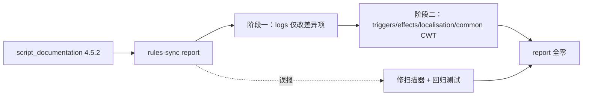
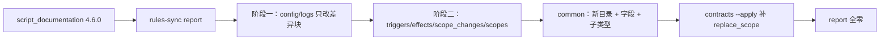

# Agent Note: Stellaris v4.5.x 规则同步与 CWT 规则补全

Status: implemented

## Problem

在 Stellaris v4.5.0 规则检查中，`rules-sync` 报告（`.rules-sync/stellaris/report/rules-sync-report.json`）发现当前脚本文档基线及 CWT 规则库存在以下漂移与未覆盖字段：

1. **游戏脚本文档命令漂移**：
   - **Triggers**：12 项新增（`can_add_random_non_blocker_deposit`, `can_spawn_random_anomaly`, `has_ethos`, `has_overclock`, `pop_ethic_amount`, `trade_action_value` 等），3 项移除，16 项变更；
   - **Effects**：19 项新增（AI 装甲/护盾/武器偏好设置与重置命令、`pop_force_remove_ethic`、`pop_force_transfer_ethic`、`set_overclock`、`transfer_resources_to_empire` 等），1 项移除，15 项变更；
   - **Modifiers**：7 项新增，4 项移除，11 项分类变更（归入 `Ships`）。
2. **命令参数类型严谨性问题**：
   - 部分新增条目初期使用了 `scalar` 通用占位符，未强类型绑定至原版对应的规则定义（如超频模式 `<mega_overclock>`、舰船角色 `value[ship_size_ship_roles]`、交易行动 `<tradable_actions>`）。
3. **Common 字段级参数未覆盖（共 47 个）**：
   - 缺少类型覆盖目录：`common/policy_categories`（政策分类，6 项定义）、`common/resource_regions`（资源区域，4 项定义）；
   - 缺失 Subtype：`common/game_rules` 缺失 `can_pop_group_auto_migrate_abroad`；`common/on_actions` 缺失 `on_cosmogenesis_exodus_fleet_reached`；
   - 缺少字段定义：`common/megastructure_overclock_types`（3 项）、`common/megastructures`（4 项）、`common/planet_classes`（2 项）、`common/policies`（1 项）、`common/pop_faction_types`（3 项）、`common/ship_sizes`（1 项）、`common/starbase_modules`（1 项）、`common/defines`（28 项）。

## Decision

严格按照两阶段与深入原版定义查验的原则执行同步与重构：

1. **阶段一（Log 文档基线同步）**：
   - 仅针对 report 报告的条目，精确同步 `config/logs/trigger_docs.log`、`config/logs/modifiers.log` 与 `config/logs/localizations.log`（补全 `GetPopsGuidingEthic`），不整量替换以避免引入原版日志格式噪音。
2. **阶段二（CWT 强类型化与字段级全面覆盖）**：
    - **全面清除残余 `scalar` 引用，强化原版类型校验**：
      - `has_overclock` 与 `set_overclock` 强绑定 `<mega_overclock>`；
      - `is_ai_ship_role` 与 `set_ai_ship_roles` 强绑定 `value[ship_size_ship_roles]`；
      - `trade_action_value` 强绑定 `<tradable_actions>`；
      - `AGREEMENT_PRESET_DEFAULT`（`defines.cwt`）强绑定 `<agreement_preset>`，并移动到 `AGREEMENT_PRESET_VASSAL` 相邻位置；
      - `overclock_group`（`megastructures.cwt`）强绑定 `value_set[megastructure_overclock_group]`；
      - `overclock_loc_key`（`megastructures.cwt`）强绑定 `localisation`；
      - `icon`（`policy_categories.cwt`）移除冗余的 `icon = scalar`，保留 `icon = <sprite>`。
    - **纠正巨构（`megastructures.cwt`）字段层级**：
      - 将误嵌在 `overclock_types = { ... }` 内的顶层字段（`nomad_reactivatable`、`custom_tooltip_with_modifiers`、`overclock_loc_key`、`overclock_cooldown`）移至 `megastructure` 顶层属性，`overclock_types` 内仅保留模式引用 `<mega_overclock>`。
    - **补全缺失的 CWT 目录定义**：
      - 新建 `common/policy_categories.cwt`，定义 `type[policy_category]` 与图标配置；
      - 新建 `common/resource_regions.cwt`，定义 `type[resource_region]` 与资源上限参数。
    - **补齐 Subtype 过滤**：
      - `common/game_rules.cwt` 补充 `can_pop_group_auto_migrate_abroad`（作用域：`this = pop_group, root = colony`）；
      - `common/on_actions.cwt` 补充 `on_cosmogenesis_exodus_fleet_reached`。
    - **补齐 47 个未覆盖字段定义**：
      - `common/megastructures.cwt`：补齐 `mega_overclock` 的 `overclock_group`, `system_modifier`, `megastructure_modifier`，以及 `megastructure` 的 `nomad_reactivatable`, `custom_tooltip_with_modifiers`, `overclock_loc_key`, `overclock_cooldown`；
      - `common/planet_classes.cwt`：补齐 `can_be_capital`, `inherit_country_district_modifiers`；
      - `common/policies.cwt`：补齐 `category` 引用 `<policy_category>`；
      - `common/pop_faction.cwt`：补齐 `use_guiding_ethic_as_growth_factor`, `pop_ethics_filter`, `pop_attraction_tag`；
      - `common/ship_sizes.cwt`：补齐 `use_ai_design_role_from = <ship_size>`；
      - `common/starbases_consolidated.cwt`：补齐 `triggered_component_set`；
      - `common/defines.cwt`：在 `NGraphics`、`NCombat`、`NGameplay`、`NAI` 各模块补齐 28 项全局参数。

### v4.5.2 增量同步

- **命令**：新增 `pop_ethics_divergence`、`is_preferred_platform_weapons` 与 6 个 `set_/clear_ai_platform_*` effect，类型与同族 starbase 命令一致（`enum[weapon_type]`、`value_field[0.0..1.0]`、`bool`）。`ethos` 原版仍可解析，仅在描述中标注废弃，不删除。
- **作用域收窄只改 log**：`is_archetype`、`is_ship_category/class/size`、`prevent_anomaly` 的 `Supported Scopes` 变化只写入 `trigger_docs.log`，CWT alias 不加 `## scopes`，保持由 log 驱动。
- **本地化**：`GetPopsGuidingEthic` 迁至 `pop_faction`；`Faction` 提升不再接受 `pop_group`（原版文档与本地化均无此用法）。`localisation.cwt` 中手工维护的 `GetIcon = any` 与宽范围 `GetNamePlural` 保留，因为原版大量使用 `[job.GetIcon]` 等职业目标写法；`config/logs/localizations.log` 只作为 report 的 diff 基线，按原版文档同步，不参与运行时校验（详见 v4.5.3 增量）。
- **Common**：`on_actions.cwt` 补 `on_arkship_knights_detox{,_start,_cancelled}`（`this/root = planet, from = fleet`）；`defines.cwt` 补 `NShip.DESIGNER_STARBASE_WEAPON_PREF_MUL = float`；`num_buildings` 补可选 `category = any | enum[building_categories]`。
- **扫描器误报改修工具而不是改规则**：
  - `report.ts` 字段扫描跨行追踪双引号状态：`inline_script` 的 `TRIGGER = "...{` 多行字符串曾让括号深度少算一层，把 `AMOUNT` 及若干修饰符误报为建筑/职业字段。只跨行携带 `"`，避免裸撇号吞掉后续内容。
  - `scope-contracts.ts` 中“中心名词 + 关系从句”（`starbase that changed controller`）优先解析为中心名词，不再因从句中的 `controller` 被判为 `country`；现有 `on_starbase_occupied` 的 `from = starbase` 本就正确。

### v4.5.3 增量同步

v4.5.2 → 4.5.3 是小版本更新，Trigger / Effect / Modifier / Scope 四类命令与 Common 字段级覆盖均无漂移（`folders with findings: 0`），实际变动只有基线与作用域契约两处：

- **本地化文档基线**：4.5.3 原版 `localizations.log` 把 `GetIcon` 与 `GetNamePlural` 从 Country 段移除（`GetNamePlural` 仅保留在 Species 段），`config/logs/localizations.log` 随之删除两行，其余内容与头部时间戳保持原样。
- **`config/localisation.cwt` 不变**：`GetIcon = any` 与宽范围 `GetNamePlural` 继续兜底。原版当前本地化仍有 341 处 `[xxx.GetIcon]` 调用（如 `[enforcer.GetIcon]`、`[coordinator.GetIcon]`），命令本身未被废弃，只是文档不再列出；按废弃删除会产生大量假阳性。
- **作用域契约**：`common/game_rules.cwt` 的 `species_has_uncapped_habitability_on_planet` 与 `species_has_uncapped_habitability_on_ship` 补 `from = country`，与 4.5.3 原版 `#Root/#From/#This` 注释及其体内 `from? = { is_mutation_authority = yes }` 调用一致。
- **Shader ABI 随扫描自动重锚**：`config/shader/` 三份目录由 `shader-abi-sync` 自动改写，471 条 catalog 全部 carried（added=0、dropped=0），13 条 renderer contract 全部保留，差异只有版本戳与 exe 指纹。

### 参数级漂移：扫描器补上命令块参数比对

4.5.3 公告写明 `transfer_pop_amount` 新增 `keep_automodding` 参数，但扫描器当时报 `effect: +0 -0 ~0`。原因是两层：

1. **原版文档根本没更新**：4.5.3 的 `script_documentation/effects.log` 中 `transfer_pop_amount` 仍只有 source / target / amount / percentage / random / growth_category，`keep_automodding` 在文档与脚本中均不存在——Paradox 只改了引擎与 changelog。
2. **扫描器结构上也不可能发现**：`diffKind` 只比对 name / scopes / targetScopes / category / description，`DocRule` 没有 parameters 字段，纯参数变化在任何版本都不可见。

修法与落地：

- `report.ts` 新增 `extractBlockParameters`（导出，供回归测试）：以字符级状态机扫描命令块第一层花括号内的 `key =`，跳注释与引号内容，忽略 `or/and/not/nor/nand` 这类语法词；同一行并列多个块（`{ owner } or { id event_chain owner }`）合并取并集。
- `DocRule.parameters` 与 `addDocRule` 的并集合并负责多段重复条目的累积；`diffKind` 输出独立的 `parameterDrift` 列表，控制台打印 `trigger parameters: ~N` / `effect parameters: ~N`，HTML 报告新增"参数变更"筛选。
- 参数漂移**不进** `changed`，也不作为必须清零的硬门禁：基线日志是人工维护的镜像，允许比原版文档更全，逐条复核比强制归零更符合事实。
- 新增 5 条回归测试（`tools/rules-sync/report.test.ts`）：块内第一层键收集、同一行并列块并集（`is_point_of_interest` 的 `{ owner } or { id event_chain owner }` 形态）、嵌套块与语法词过滤、纯参数变化只进 `parameterDrift`、参数一致时静默。

启用后立刻暴露 5 条历史漏检，逐条处置：

| 条目 | 漂移 | 处置 |
| --- | --- | --- |
| `total_system_workforce_with_job_tag` | 原版文档与脚本（`07_script_values_shroud.txt`）均有 `limit`，规则缺失 | **补规则**：`limit = { alias_name[trigger] = alias_match_left[trigger] }`，与同族 `num_neighbor_systems` 一致；这是玩家照原版书写会被误报的真实缺陷 |
| `create_country` | 4.5.3 文档块被重写：新增 `ruler`、`day_zero_contact`、`exclude_day_zero_contact`、`default_ships`、`randomize_ethos`、`ignore_initial_colony_error`、`released_by/from_country`、`use_hostilities_from`、`origin` 与 flag 内 `use_ship_color`；移除 `nomadic`/`ship_kinds`/`room`/等（原版脚本仍在用，规则保留） | **补规则**：`ruler = scalar \| random`（自由字符串，与同块 `name`/`ship_prefix` 同写法）、flag 内 `use_ship_color = bool`；基线块同步为 4.5.3 原文 |
| `modify_species` | `add_random_trait` → `add_random_species_trait`（含描述） | 基线同步；规则本已正确 |
| `spawn_random_anomaly` | 新增 `surveyor` | 基线同步；规则本已正确 |
| `is_point_of_interest` | 解析器只取第一组花括号，漏掉 `{ } or { }` 第二组 | 修解析器（并列块并集），规则本已正确 |
| `transfer_pop_amount` | 公告新增 `keep_automodding`，文档与脚本均无 | **补规则**：`keep_automodding = bool`（可选），保留在 `alias[effect:transfer_pop_amount]` 内 |

### v4.6.0 增量同步（测试版 Corona Borealis）

4.6.0 是近年变动最大的一次：新增整套 **ideology（意识形态）子系统**，命令层、作用域层与 `common/` 目录同时扩张。同步按同一两阶段路径执行。

- **阶段一（日志基线）**：`trigger_docs.log` 按块替换 49 条、追加 72 条 trigger 与 63 条 effect；`modifiers.log` 追加 61 行并改 3 条分类；`localizations.log` 插入 18 行含新增 `--Ideology--` 段；`scopes.log` 追加 3 条作用域并改 6 条。追加/替换的块直接取自原版文档，不整文件覆盖，因此人工维护的排版与更全的历史字段（如 `transfer_pop_amount.keep_automodding`）保持不变。顺带修好镜像自身丢失空行的 3 条块（`is_majority_species`、`set_timed_carrier_flag`、`set_timed_pop_faction_flag`）。

- **命令层强类型化（无 `scalar`）**：
  - 新作用域 `ideology` 进 `scopes.cwt`（`Ideology` 类型），命令统一绑定 `<ideology>` / `<ideology_tenet>` / `<ideology_action>` / `<ideology_reach_type>` / `<megastructure_module>`，其余沿用既有类型（`<ethos>`、`<bombardment_stance>`、`<council_agenda>`、`<message_type>`、`<precursors>`、`<district>`）。
  - `triggers.cwt` 新增 53 条 trigger；`any_/count_/every_/ordered_/random_` 共 46 条遍历器进 `scope_changes.cwt`（带 `## push_scope`），因为遍历器由 `scope_changes.cwt` 负责，不属于 `triggers.cwt` / `effects.cwt`。
  - `effects.cwt` 新增 36 条 effect。
  - 参数级收敛（34 条）：`set_timed_*_flag` 家族 27 条补可选 `random = int_value_field`；`add_opinion_modifier` 补 `mult`、`add_random_research_option` 补 `research_instantly`、`add_trait`/`remove_trait` 补 `message_type`+`custom_description`、`delete_ship`/`destroy_ship` 补 `{ target kill_leader }` 块写法、`count_starbase_buildings`/`count_starbase_modules` 补 `limit`。

- **Common 目录**：
  - 新建 `common/ideologies.cwt`：`type[ideology]`（`path_strict`，避免子目录重复解析）、`type[ideology_tenet]`、`type[ideology_action]`、`type[ideology_reach_type]`，并按原版头注释建模 `strength_level`/`monthly_increase`/`on_*`/`swappable_data`/`inline_script` 等字段。
  - 新建 `common/megastructure_modules.cwt`：`type[megastructure_module]` 与建造、资源、触发修饰符字段。
  - 既有目录补齐 149 个字段：`defines` 最多（`NAI` 28 条 AI 优先级常量、`NGameplay`/`NGraphics`/`NPop`/`NEconomy` 的 `ideology_*`/`tenet_*`/`reach_*`/`ideological_*`），其余散落在 `megastructures`、`traits`、`zones`、`resolutions`、`jobs_and_social_strata`、`pop_faction`、`governments` 等。
  - `triggered_station_modifier`（巨构）与 `triggered_advocate_modifier`（特质）没有可复用的别名组，写成显式块；其余 `triggered_*_modifier` 复用既有别名组（组名即字段名）。
  - 子类型：`game_rules.cwt` 补 28 条（`ideology` 相关规则 + `ruler_can_*` 领袖任职规则），`on_actions.cwt` 补 20 条（`on_ideology_*`、`on_golden_generation_*`、`on_system_affected_by_ideology` 等），27 条 `replace_scope` 由 `contracts --apply` 依据原版注释自动写入。
  - 另有 10 条契约 `contracts` 工具**按设计不落笔**（`unresolved`，原版注释用的是描述性名字而非作用域 token，如 `# This = ruler`、`# from = fanatic faction`、`# This = New Custodian`），按原版语义手工补齐：`ruler_can_*` 8 条按 `scopes.log` 的链接定义 `this = leader root = leader`（`ruler` 的输出作用域是 `leader`），`from` 分别为 fleet / country / federation / ideology / colony；`on_fanatic_faction_consequence_event` 仅补 `from = pop_faction`（原版未给出 this）；`on_ideology_custodian_changed` 补 `this/root = country`、`from = country`、`fromfrom = ideology`。`unresolved` 计数因此仍是 10——它度量的是原版注释可归一化程度，不是规则覆盖度。

- **原版重命名**：`on_entering_war` 在 4.6.0 改名 `on_war_entered`（原版仅剩脚本注释提到旧名）。旧 `subtype` 删除，并在 `on_actions.cwt` 的 `obsolete_keys` 登记 `on_entering_war = "renamed to on_war_entered"`，保留迁移提示而不是静默失效。

### v4.6.0 正式版补全（Corona Borealis 3d1a）

在 4.6.0 测试版同步的基础上，对照正式版 `Corona Borealis v4.6.0 (3d1a)` 的最新 `script_documentation`、原版 `common/`、`unchecked_defines/`、`dlc_metadata/`、`inline_scripts/` 与官方 README 做了全量核对并补齐三类缺口，同时修复了测试版提交遗留的一处关键日志格式故障：

- **修复 `trigger_docs.log` 的 FParsec `=================` 分隔符错位（关键回归）**：
  - `CWTools.Parser.DocsParser` 按 `twoDocs = docFile .>>. docFile` 解析，每个 `docFile` 以 `DOCUMENTATION ==` 开头、以 `=================` 结尾，且 `header` 向前查找 `DOCUMENTATION ==` 的字符上限为 `maxChars = 4000`。
  - 前序测试版提交把 72 条新 trigger 错插在第一个 `=================` 与 `== EFFECT DOCUMENTATION ==` 之间、把 63 条新 effect 错插在第二个 `=================` 之后，导致 `DocsParser.parseDocsFile` 在第 4956 行直接解析失败（`Could not find the string 'DOCUMENTATION =='`）。
  - 将两处 `=================` 分别归位至 Trigger 段落末尾（`== EFFECT DOCUMENTATION ==` 之前）与文件末尾，同时按正式版补入 `country_defeats_nomads_in_war`（`Supported Scopes: war`）并同步 `add_building` 扩充后的详细文档说明。
- **正式版 `rules-sync` 增量**：
  - `triggers.cwt`：新增 `alias[trigger:country_defeats_nomads_in_war] = scope[country]`（作用域仍由 `trigger_docs.log` 驱动，不冗余声明 `## scopes`）。
  - `common/defines.cwt`：`NAI` 新增 7 个市场交易参数（`AI_MARKET_SELL_STOCKPILE_FULFILLMENT`、`AI_MARKET_SELL_MONTHS_TO_FULL`、`AI_MARKET_SELL_MAX_STOCKPILE_SHARE`、`AI_MARKET_SURPLUS_MONTHS_OF_COVER`、`AI_MARKET_SURPLUS_BUY_FULFILLMENT`、`AI_MARKET_RESERVE_BUY_FULFILLMENT`、`AI_MARKET_RESERVE_TARGET_FULFILLMENT`）。
  - `common/casus_belli_and_war_goals.cwt`：新增 `defeat_nomad_on_all_arkships_lost = bool`（原版 34 处调用）及文档记录的 `available_in_proxy_wars_only = bool`、`galactic_community_joins_defender`。
  - `config/shader/abi-audit.json`：随 `rules-sync report` 自动刷新为正式版 `stellaris.exe` 指纹（479 条 catalog 与 13 条 renderer contracts 均未变动）。
- **扫描器盲区（枚举、`unchecked_defines`、`inline_scripts` 与嵌套块）实装项补齐**：
  - `dlc_list.cwt`：`enum[DLCs]` 补入 `"Willpower"`（原版 `00_scripted_triggers.txt` 已使用 `host_has_dlc = "Willpower"`）。
  - `common/defines.cwt`：`Unchecked_NInterface` 补入 `unchecked_defines/00_interface.txt` 新增的 5 个字段——`ADVOCATE_MOUSE_OVER_OPACITY`、`POP_TOOLTIP_MAX_COLONIES`、`TENET_SELECT_MIN_WIDTH`，以及强类型绑定至 `<Paragon_UI_NAME_type>`（而非 `scalar`）的 `PORTRAIT_GUI_NAME_DELEGATE` 与 `PORTRAIT_GUI_NAME_GESTALT_FACTION_IDEOLOGY`。
  - `common/governments.cwt`：在 `alias[government_trigger:*]` 的 `OR`/`NOT`/`NOR` 块补入原版 `00_authorities.txt` 使用的 `show_at_empire_creation = bool`，并在 `civic_or_origin` 补入 `homeworld = <planet_class>`。
  - `common/megastructures.cwt`：补齐原版 `inline_scripts/megastructures/galactic_halls.txt` 使用的 5 个顶层字段：`scoped_name`、`modules`（`<megastructure_module>`）、`initial_module_capacity`、`max_module_capacity`、`locked_module_custom_tooltip`。
  - `common/ideologies.cwt`、`common/common_economic_templates.cwt`、`modifier_rule.cwt`：
    - `ideology` 补齐 `resources`、`intel`、`ideology_affinity`，`strength_level` 与 `ideology_tenet.tier` 放宽为 `cardinality = 0..inf`；修正 `monthly_increase` 与 `category` 内直接复用 `alias_name[modifier_rule]`（支持 `base` 与 `modifier` 内 `max_decimals`/`polarity`/`display_level`，强类型枚举 `enum[modifier_polarity]` 与 `enum[modifier_display_level]`）；
    - 将 `ideology`/`ideology_tenet.tier` 中误引用的 `triggered_modifier_system`（键名为 `triggered_modifier`）修正为新增的 `triggered_system_modifier_system`（键名为 `triggered_system_modifier`），新增 `triggered_colony_modifier`（原版 `00_tenets.txt` 使用 30 次），并为相关 `triggered_*_modifier` 补齐原版使用的 `possible`、`fix_key`、`should_mult_desc`、`show_if_trigger_false`、`show_trigger_if_false`、`show_trigger_if_true`、`trigger_true_key_override`、`trigger_false_key_override`；
    - `ideology_reach_type` 的 `value`/`weight` 块补齐 `possible`。
- **原版官方 README 文档新增可选字段补齐**：
  - `common/ethics.cwt`：`pop_group_modifier`；
  - `common/traits.cwt`：`subtype[leader_trait]` 补齐 `allowed_civics`、`forbidden_civics`、`advocate_modifier`；
  - `common/pop_faction.cwt`：`skip_creation_cooldown`、`hidden`、`allow_natural_spawn`；
  - `common/situations.cwt`：`custom_tooltip`、`custom_tooltip_with_modifiers`、`override_active_title`、`override_active_desc`；
  - `common/zones.cwt`：`excluded_buildings`（及 `triggered_buildings` 完整 4 列表）、`destroy_trigger`、`is_capped_by_modifier`、`desc`、`empire_limit`、`planet_limit` modifier 规则、`on_built`/`on_queued`/`on_unqueued`、`additional_ai_weight`、`ai_estimate_without_unemployment`。
- **Interface GUI 属性补全**：`interface/gui_types.cwt` 为 `containerWindowType` 补齐 `scroll_wheel_factor = float`，为 `gridBoxType` 补齐 `max_slots = { x = int y = int }`（原版 `galaxy_view.gui` 与 `main_bottom.gui` 已使用）。
- **修复提交 `55fb233` 误删 `trigger_docs.log` 28 行**：子模块提交 `55fb233` 中意外丢失 `random_attacker`、`ordered_attacker`、`every_attacker` 与 `random_defender` 首部 3 行导致 FParsec 解析 `weights = {` 失败；已从原基线 `574648e` 完整恢复并通过 `StellarisConfigLogs.Tests.fsx`。

### GUI 控件覆盖与外交窗口基线审计纳入检查流程

原先 `rules-sync` 只扫描 `script_documentation`、`common/` 与 `gfx/FX`，原版 `interface/**/*.gui` 新增属性（如 4.6 顺手查出的 `scroll_wheel_factor`、`max_slots`）以及外交界面新增引擎绑定控件（如 `diplomacy_view.gui` 的 `ideology_window`）无法被自动化检查发现。本次将 GUI 审计正式纳入 `tools/rules-sync/`：

- **独立审计模块（`tools/rules-sync/gui-audit.ts`）**：
  - 扫描原版 `interface/**/*.gui` 内所有 `guiTypes = { ... }` 块的控件类型与属性键，大小写不敏感地对照 `config/interface/gui_types.cwt`，精确输出未覆盖类型/属性的出现次数与示例行号；显式跳过 `guiTypes` 块外的文件顶层全局键（如 `core.gui` 的 `default_clicksound`、`default_ime_text_color`），与 `gui_types.cwt` 的 `## type_key_filter = guiTypes` 边界一致。
  - 追踪 7 个关键窗口的命名控件层级（`parentPath|type|name`）：4 个 Mod `custom_gui` 事件契约窗口（`diplomacy_event_view.gui` 的 `DiplomaticEventWindow`、`event_option_entry`，`eventwindow.gui` 的 `EventWindow`、`event_window_option_entry`）与 3 个核心外交界面（`diplomacy_view`、`federation_view`、`galactic_community_view`），透传 `if_resolution` 等无名布局包装块并支持单行块声明。
- **基线与 CLI/报告集成**：
  - 生成并落盘 4.6.0 基线 `tools/rules-sync/gui-window-baseline.json`（不放入规则子模块，避免污染语言服务器运行时配置）。
  - `stellaris-rules-sync.js` 新增 `gui` 模式（含 `--update-baseline`、`--vanilla-interface`、`--gui-baseline`、`--no-gui-audit`、`--ci`）及 `npm run rules:stellaris:gui` 脚本；`report` 模式探测到原版 `interface/` 目录时自动执行并在控制台摘要、JSON 与 HTML 报告中新增「GUI 控件审计」标签页与告警卡片。
  - 更新 `tools/rules-sync/tsconfig.test.json`、`tools/rules-sync/gui-audit.test.ts`、`tools/rules-sync/README.md` 与 `.agents/skills/stellaris-rules-sync/SKILL.md`。

### 反向陈旧 / 引擎已移除字段审计与废弃迁移警告

原版升级不仅会新增字段，还会废弃或改名旧字段（如 4.0 起 `common/districts/` 将 `is_capped_by_modifier` 替换为逻辑相反的 `is_uncapped = { ... }`、将 `inherits_capped_modifiers_from` 替换为 `shared_capacity_modifier`，以及 `pop_jobs`/`pop_categories`/`ship_sizes`/`zones`/`megastructures` 等多处移除或改名）。此前 `rules-sync` 仅检查正向缺失，规则库里残留的死字段会静默放行甚至被自动补全推荐。本次从引擎、规则与扫描器三层闭环解决：

- **F# 规则引擎增强（`submodules/cwtools`）**：
  - `RuleValidationService.fs` 的 `applyNodeRule` 补齐 `options.errorIfOnlyMatch` 诊断（与 `applyLeafRule` 对称），使块级废弃字段（如 `zones` 的 `include`/`exclude`、`ship_sizes` 的 `possible_starbase`/`potential_starbase`/`potential_planet`/`possible_planet`、`pop_categories` 的 `assign_to_pop`/`unemployment_resources`）与叶子字段一样按 `## severity = warning` 发出自定义迁移提示；
  - `CompletionService.fs` 过滤掉带 `o.errorIfOnlyMatch.IsSome` 的废弃规则，避免补全继续推荐旧键。
- **CWT 规则库补齐废弃与迁移提示（`submodules/cwtools-stellaris-config`）**：
  - 经原版脚本、官方文档（`00_DOCUMENTATION.txt`、`00_README.txt`、`99_HOW_TO_ZONE.txt`）与 `stellaris.exe` 字符串表双重核实，为 13 个 CWT 文件中 31 个废弃/引擎移除字段添加 `## severity = warning` + `## error_if_only_match = "..."`（含 `districts.cwt` 的 `is_capped_by_modifier`、`inherits_capped_modifiers_from`、`base_cap_amount` 并移除依赖旧键的零引用 `subtype[capped]`/`subtype[uncapped]`，`zones.cwt` 的 `include`/`exclude`，`jobs_and_social_strata.cwt` 的 12 个 4.0 移除字段，`ship_sizes.cwt` 的 4 个 `*_starbase`/`*_planet` 构造块，`megastructures.cwt`、`megastructure_modules.cwt`、`00_small_types_consolidated.cwt`、`bypass.cwt`、`starbases_consolidated.cwt`、`country_types.cwt`、`pop_faction.cwt`、`governments.cwt`、`planet_classes.cwt`）；
  - 顺手修复 `country_types.cwt:265` 漏写 `## ` 的 `replace_scope = { this = country root = country }` 伪字段笔误，以及 `ideologies.cwt` 四处带多余引号的 `filepath["common/inline_scripts/",".txt"]`（触发 `CWT200`）。
- **反向审计工具纳入检查流程（`tools/rules-sync/stale-fields.ts`）**：
  - 扫描 `config/common/*.cwt` 非 `type_per_file` 的顶层具名字段，对比原版 `common/<folder>/`、官方文档注释、`inline_scripts/` 与可执行文件非标识符边界提取的引擎键集合（避免漏掉相邻 NUL 串或 `.set.custom_portraits` 等点分键）；
  - 区分高置信度 `removed_from_engine`（CI 退出码 2 阻断）与待人工复核 `unused_in_vanilla`（覆盖跨系统同名键如 `is_capped_by_modifier`），自动豁免已标 `## error_if_only_match` 的字段；
  - 接入 `npm run rules:stellaris:stale-fields`、`report.ts`（控制台摘要 + HTML「陈旧/废弃字段」标签页与告警卡片）、`stale-fields.test.ts`、`README.md` 与 `SKILL.md`。

## Alternatives considered

1. **将 `overclock` / `role` / `action` 保持为 `scalar`**：
   - 被否决。原版 `common/` 目录下存在明确的类型系统支持（`<mega_overclock>`、`<tradable_actions>` 与 `value_set[ship_size_ship_roles]`），使用精确引用才能发挥 LSP 补全与校验的最大价值。
2. **忽略 Common 字段级报告**：
   - 被否决。Common 参数漂移会导致语言服务器报出未知属性假阳性警告，覆盖至 0 findings 能确保规则库与 v4.5.0 原版完全同步。
3. **为 `amount` 等误报字段补 CWT 规则，或为 `on_starbase_occupied` 加 errata**：
   - 被否决。前者会在规则中写入并不存在的定义字段；后者只掩盖单点，同类关系从句注释仍会误判。修正扫描器并加回归测试才能根治。
4. **从 `localisation.cwt` 同步删除 `GetIcon` / 收窄 `GetNamePlural`**：
   - 被否决。原版本地化在职业等动态目标上广泛使用这两个命令，删除会产生大量假阳性。
5. **把参数漂移塞进 `changed`，与描述/作用域变更同等归零**：
   - 被否决。基线是人工维护的镜像，允许比原版文档更全（`create_country` 的 `nomadic`、`ship_kinds` 原版脚本仍在用，文档却不再列出）；强行归零会删掉真实字段或把噪声训练成"看到也不看"。
6. **等原版文档更新后靠扫描器自动发现 `keep_automodding`**：
   - 被否决（也不可能）。4.5.3 文档未更新，扫描器对"只存在于公告与引擎"的变更天然失明，必须按公告人工补规则并记录在案。
7. **把 `gui-window-baseline.json` 放进 `submodules/cwtools-stellaris-config/config/` 或全量扫描 `.gui` 顶层键**：
   - 被否决。窗口基线是 `rules-sync` 工具侧漂移快照，不属于语言服务器运行时规则数据；全量扫描文件深度 0 会把 `core.gui` 的 `default_clicksound` 等非 `guiTypes` 引擎配置误报为 `gui_types.cwt` 缺失属性。

## Verification

- 运行 `node tools/rules-sync/stellaris-rules-sync.js report --no-open`：
  - `folders with findings: 0`（所有 47 个字段与未覆盖类型全部清零）；
  - `scope contracts missing: 0`；
  - `effect: +0 -0 ~0`；
  - `modifier: +0 -0 ~0`；
  - `scope: +0 -0 ~0`。
- 运行 `npm run compile`：前端 Webview 与 Extension Host 编译全部通过。
- 运行 `npm run typecheck:test`：全量 TypeScript 类型检查通过。
- 参数级漂移：修好后 `report --no-open` 报 `trigger parameters: ~0`、`effect parameters: ~0`（修前为 `~2` / `~3`，其中 5 条是历史漏检）；`npm run test:rules-sync` 50 项通过（含 4 条新增参数回归）；`dotnet fsi src/Main/StellarisConfigLogs.Tests.fsx` 8 项通过（基线日志仍可被 F# 解析）；`npm run typecheck:test` 通过；规则 diff 中新增的 `scalar` 只有 `create_country.ruler`（自由字符串，与同块 `name`/`ship_prefix` 一致）。
- **反向陈旧字段审计与块级废弃警告接入**：
  - `node tools/rules-sync/stellaris-rules-sync.js stale-fields --ci`（退出码 0）：`files=76 checked=2216 annotated_deprecated=31 removed_from_engine=0 unused_in_vanilla=80 exe=yes`；
  - `node tools/rules-sync/stellaris-rules-sync.js report --no-open --no-shader-abi`：全部正向/反向/GUI 指标清零；
  - `dotnet build src/LSP/` 与 `dotnet build src/Main/` 0 错 0 警告；`npm run test:fsx` 全部 36 个 F# 回归脚本通过（含 `CwtLanguageSemantics.Tests.fsx` 92/92 零 `CWT200` 诊断与 `StellarisConfigLogs.Tests.fsx` 8/8）；108 个 `.cwt` 全量零错加载；`CWToolsTests` 新增 `error_if_only_match` 叶子+块级警告及补全过滤测试通过；
  - `npm run test:rules-sync` 60 passing（含 `stale-fields.test.ts` 新增 4 条回归）、`npm run test:perf` 7/7 passing、`npm run typecheck:test` 与 `npm run compile` 全部通过；子模块新增 `scalar` 为 0。
- **GUI 控件审计与外交窗口基线接入**：
  - `node tools/rules-sync/stellaris-rules-sync.js gui --ci`（退出码 0）：`files=181 widget_types=19 uncovered_types=0 uncovered_props=0 tracked_windows=7 (+0 -0)`；
  - `node tools/rules-sync/stellaris-rules-sync.js report --no-open`：全指标清零且输出 `[report] gui: files=181 widget_types=19 uncovered_types=0 uncovered_props=0 tracked_windows=7 (+0 -0)`；
  - `dotnet fsi src/Main/StellarisConfigLogs.Tests.fsx` 8/8 通过（确认 `trigger_docs.log` 恢复 28 行后 `DocsParser` 完整解析 1171 triggers + 1143 effects，全部 108 个 CWT 文件零错加载）；
  - `npm run test:rules-sync` 56 passing（含 `gui-audit.test.ts` 新增 5 条回归测试），`npm run test:perf` 7/7 passing，`npm run compile` 与 `npm run typecheck:test` 通过；
  - `npm run test:unit` 中 `client/test/unit` 2802 passing / 2 failing（均为本次改动无关项：`shaderCwtContract.test.ts` 仍断言 4.5.x 旧 Shader 统计 `49/473/438`，以及 `claudeSubscription.test.ts` 本机回调端口 `53692` 竞争）；子模块新增 `scalar` 为 0。
- v4.6.0 正式版补全：`report --no-open` 全部 diff 为 `+0 -0 ~0`，`trigger parameters: ~0`、`effect parameters: ~0`，`folders with findings: 0`，`scope contracts missing=0 mismatch=0 unresolved=10`，`documented-but-required=0`、`documented-but-unmodeled=0`，shader-abi `carried=479 added=0 dropped=0`、`contracts kept=13 dropped=0`；`dotnet fsi src/Main/StellarisConfigLogs.Tests.fsx` 8/8 通过（`DocsParser` 完整解析 1171 triggers + 1143 effects，含 `country_defeats_nomads_in_war`、`abandon_adopted_ideology`、`validate_species_rights`）；`EngineCostRuleParsing.Tests.fsx` 30/30 通过；`ModifierDocumentationRuleParsing.Tests.fsx` 8/8 通过；全部 108 个 CWT 文件经 `CKParser` 与 `RulesParser.parseConfigs` 零错误加载（3760 rules / 260 types / 194 enums / 29 complexEnums）；`npm run compile`、`npm run typecheck:test`、`npm run test:rules-sync`（51 passing）全部通过；规则 diff 新增 `scalar` 计数为 0；原版 DLC 使用项与 `common/defines`、`unchecked_defines` 缺失项均为 0。
- v4.6.0：`report --no-open` 全部 diff 为 `+0 -0 ~0`，`trigger parameters: ~0`、`effect parameters: ~0`，`folders with findings: 0`，`scope contracts missing=0 mismatch=0 unresolved=10`，`documented-but-required=0`、`documented-but-unmodeled=0`；shader-abi `carried=479 added=8 dropped=0`、contracts `kept=13 dropped=0`；`npm run compile`、`npm run typecheck:test`、`npm test`（19 passing，语言服务器成功加载新规则）均通过；规则 diff 中 `scalar` 新增计数为 0。
- v4.5.3：`report --no-open` 的 trigger / effect / modifier / scope / localisation_command 全为 `+0 -0 ~0`，`folders with findings: 0`，`scope contracts missing=0 mismatch=0 unresolved=0`，`documented-but-required=0`、`documented-but-unmodeled=0`，shader-abi `carried=471 added=0 dropped=0`、contracts `kept=13 dropped=0`。
- v4.5.2：`report --no-open` 所有 diff 均为 `+0 -0 ~0`，`folders with findings: 0`，`scope contracts missing=0 mismatch=0`，`documented-but-unmodeled=0`；`npm run test:rules-sync` 通过（新增多行字符串字段扫描与关系从句作用域两条回归测试）；规则 diff 中无新增 `scalar`。
