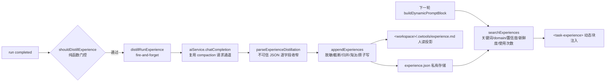

# Agent Note: 工作区级经验沉淀与召回（experience store）

Status: implemented

## Problem

用户痛点：做重复的任务时，Agent 喜欢从头再来、另辟蹊径，最后搞出 bug。结构化记忆（`MemoryParser`）虽已完善，但存在两个结构性缺口：

1. **只读当前话题**：`memory.json` 按 topic 隔离（`getStructuredMemoryFilePath`），A 话题踩过的坑，B 话题的 run 完全看不到；`scope: 'project'` 字段没有消费方。
2. **写入全靠模型自觉**：唯一写入路径是 `save_memory` 工具，提示词几乎没有引导，模型在任务结束时极少主动沉淀——痛点根源在此。

run 终态数据（目标、工具序列、失败调用、writtenFiles、最终答复）其实已经完整持久化在 runLedger，但没有任何机制把它们提炼成可复用的经验。

## Decision

新增「经验沉淀与召回」闭环，三个环节全部由宿主自动完成，不依赖模型自觉：

1. **存储（`client/extension/ai/experienceStore.ts`）**：私有存储根下按 workspace 划分 `<privateRoot>/experience/<basename>-<pathHash>/experience.json`（`getExperienceStoreFilePath`，回退路径即 `<ws>/.cwtools/experience/...`），`version: 1`，上限 200 条，超出按 `usageCount*2 + 置信度 + 新鲜度衰减` 淘汰最低分。条目含 `id/title/lesson/approach?/pitfalls?/fileAnchors?/domain?/createdAt/usageCount/lastUsedAt?/sourceRunId?/confidence`。写入走 tmp+rename 原子写（与 MemoryParser 同模式），每条逐字段长度截断 + 脱敏（复用 memoryParser 新导出的 `redactSensitiveText` 与 `tokenizeTaskKeywords`，原私有方法改为委托，行为不变）。人读投影 `<ws>/.cwtools/experience.md` 头部注明自动生成、每次结构性写入全量重写（store 为准，手改会被覆盖）。
2. **提炼钩子（`agentRunner.ts`）**：在 completed 分支（`autoCompleteTodos` 旁）调用 `distillExperienceFromCompletedRun`，纯函数 `shouldDistillExperience` 门控：status=completed、工具调用数 ≥5（`MIN_TOOL_CALLS_FOR_EXPERIENCE`）、非纯问答（writtenFiles 非空或含动作类工具——纯只读调研的发现归属于项目记忆/知识而非做法经验）、`getHistoryPolicy().persistence === 'full'`、非子代理/slim run（父 run 会提炼整个任务，避免双重提炼）、同 runId 只提炼一次（有界 LRU Set 256）、`experience.enabled` 开关。提炼经 `experienceRequesterFromChatCompletion` 复用 `aiService.chatCompletion`（temperature 0.1、maxTokens 1024，与 compaction 同通道同参数风格），提示词输入为用户原始目标、最终答复、工具序列与失败计数、writtenFiles（均有界截断），要求输出 ≤3 条严格 JSON。整个流程 fire-and-forget + try/catch：解析失败静默存 0 条，请求失败仅 `ErrorReporter.debug`，绝不影响 run 状态机与返回结果。成功后经既有 `emitStep` 发 thinking 步进（双语「已沉淀 N 条经验」），随 runEventSink/onStep 广播到两个对话窗口。归并：新草稿与已有条目 title+lesson 关键词 Jaccard ≥ 0.6 时更新而非追加（文本字段取新、pitfalls/fileAnchors 并集去重、usageCount 继承）。
3. **召回注入（`promptBuilder.buildDynamicPromptBlock`，memory 注入旁）**：`searchExperiences(workspaceRoot, { taskText, domain, limit: 3, maxChars: 1500 })`，打分为关键词重合(×4) + 置信度(high 2/medium 1.2/low 0.5) + 新鲜度 30 天半衰 + usageCount(≤5 ×0.3) + lastUsedAt 衰减；**相似性下限**：taskText 产出关键词时至少命中 1 个才召回（无关经验永不注入）。命中条目批量回写 usageCount/lastUsedAt（仅 JSON 统计写，不刷新投影）。输出 `<task-experience>` 块刻意不用 `^## ` 标题（既有 memory 动态块测试按 `^## ` 计数断言），空结果不输出块；domain 为 'general'/'paradox' 时过滤，其它（hybrid）按 'both' 不过滤。
4. **引导语（`modePrompts.ts`）**：新增共享 `TASK_EXPERIENCE_USAGE_RULE`（一句：存在 `<task-experience>` 时优先沿用验证过的做法与避坑，确需偏离时在可见过程更新中说明理由），追加到 generalRules 与 paradox build/plan/explore/utility/review/script/orchestrator 的非 slim 规则串。slim 子代理不加（任务是聚焦切片），但仍可能看到注入块，块头自带使用说明。
5. **开关**：`stellarisLanguageServices.ai.experience.enabled`（默认 true）同时门控提炼与召回（`isExperienceEnabled()`）。`PROMPT_TEMPLATE_VERSION` 7 → 8（冻结提示词文本结构变化，遵循 §7.1 契约）。

## Alternatives considered

- **复用 `knowledge.sqlite`（项目知识库）存经验**：否决。知识库是 `/init` 导出的项目语义索引（符号/实体），schema 与查询路径都为结构化项目事实设计；经验是跨话题的过程性做法，写入频次与检索方式（按任务文本相关性）完全不同，混入会污染知识库契约。
- **向量/嵌入检索**：否决。需要嵌入模型调用或本地向量库，引入新依赖与不确定性；当前条目上限 200、每轮 top-3 的规模下，关键词重合 + 置信度/新鲜度/使用次数加权已足够（与 MemoryParser top-k 同构且经过验证）。
- **继续依赖模型自觉 `save_memory`**：否决。这正是痛点根源——提示词几乎没有引导时模型极少主动沉淀；且 save_memory 写在当前 topic，跨话题不可见。改为宿主在 run 终态自动提炼，模型只负责输出 JSON。
- **在 updateRunStatus 闭包内提炼**：否决。该闭包还要串行跑 ledger/status 持久化，提炼是付费 LLM 调用，塞进去会拖慢终态事件；且它需要捕获后声明的 `messages`/`runMetrics`（TDZ 敏感），放在 completed 调用点（runRecord/runMetrics/finalMessage 均在作用域）显式传参更稳。
- **提炼子代理/slim run 的经验**：否决。子代理执行的是父任务切片，父子都提炼会重复；父 run 的终态上下文（目标+全量工具序列）更完整。
- **失败 run 也提炼（"坑"价值）**：本次未做。失败 run 的终态路径（catch 分支）没有稳定的 finalMessage，且失败原因混杂（用户中断/配额/工具 bug），信噪比低；留作后续增量。
- **读取时懒刷新投影 / 增量更新投影**：否决。全量重写 200 条内的 md 是亚毫秒级，「store 为准、投影全量重写」语义最简单且不会漂移。

## Consequences

- 相似任务自动获得 `<task-experience>` 注入（≤3 条、≤1500 字符、动态块内不破坏冻结前缀缓存），模型被明确要求优先沿用验证过的做法；重复工作减少，「另辟蹊径搞成 bug」的概率下降。
- 每条经验都可溯源（sourceRunId）、可人读（experience.md）、可淘汰（200 条上限 + 使用/新鲜度淘汰）；密钥类内容写入前必脱敏。
- 提炼是付费调用但有严格门控（≥5 工具调用 + 有实质动作 + 每 run 一次）且有界输出（≤3 条）；失败零副作用。
- 已知权衡：提炼调用的 token 未计入 runMetrics/UsageTracker（提炼在终态 metrics 事件追加之后才异步完成）；中文任务文本按 `[^\p{L}\p{N}_]+` 切分会产生长词，关键词命中率低于英文（与 MemoryParser 检索同源限制）；召回统计回写是每轮一次小 JSON 原子写，与 MemoryParser「提示构建只读」的严格契约不同——这是本特性的显式设计（命中即计数用于淘汰与排序）。
- 回归覆盖：`client/test/unit/experienceStore.test.ts`（12 例：append/脱敏/截断/归并/淘汰/版本拒绝/不可信条目收窄/排序/domain 过滤/maxChars/使用计数/只读模式）、`experienceDistill.test.ts`（15 例：门控全部分支、JSON 解析收窄、fake requester 全流程、失败静默、错误传播）、`promptBuilderExperience.test.ts`（4 例：注入/空库/相似性下限/开关门控）。memoryTools.test.ts 存在存量加载失败（`orchestrator/blackboard` ESM 解析，HEAD 干净 worktree 复现确认与本次无关）。
