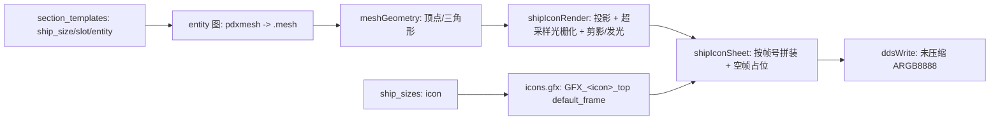

# Agent Note: 从舰船模型渲染舰船顶部图标表

Status: implemented

## Problem

Stellaris 在舰船设计器与舰队视图中读取 `gfx/interface/icons/ship_parts/ship_sizes/ship_sizes_top.dds` 作为舰船尺寸图标，每个尺寸占 80×40 的一帧。自制舰船组（新模型、新文化、新尺寸）没有对应的美术资源时，只能借用原版图标，观感与自家模型脱节；手工从三维模型出这类图标既慢又依赖画师。

仓库里已有相关基础设施，但缺关键一段：`client/webview/pdxMeshParser.ts` 能在 webview 里完整解析 pdxmesh（含动画与材质），`client/extension/pdxMeshAnchors.ts` 只能在宿主侧读出 locator/bone 名字，`client/extension/ddsDecoder.ts` 只解码不编码。也就是说，「几何 → 剪影 → 可被游戏加载的 DDS」这条链路在宿主侧并不存在。

同目录的 `example/main.cpp` 是一份可用的参考实现（独立 C++ 命令行工具），但它无法随 VS Code 扩展分发，也不参与扩展的编辑器上下文。

## Decision

新增命令 `cwtools.shipIcons.generateSheet`（标题「Generate Ship Icon Sheet from Models / 从模型生成舰船顶部图标表」），在宿主侧用纯 TypeScript 重写整条链路，按原版精灵表的帧位直接产出可替换的 DDS。

模块边界（均在 `client/extension/`）：

| 文件 | 职责 |
| --- | --- |
| `shipIcon/meshGeometry.ts` | 二进制 pdxmesh → 顶点/三角形；按对象树解析，跳过碰撞与特效子网格 |
| `shipIcon/shipIconRender.ts` | 俯视正交投影、超采样光栅化、原版风格底板（留白/边框/渐变）、剪影与发光、破损配色、横向拼帧 |
| `shipIcon/ddsWrite.ts` | 未压缩 ARGB8888 DDS 编码（128 字节头 + BGRA 像素） |
| `shipIcon/shipIconDefinitions.ts` | 解析 ship_sizes / section_templates / entity / pdxmesh / sprite 帧位，产出「第几帧画哪条船、由哪些 mesh 拼成」 |
| `shipIcon/shipIconSheet.ts` | 纯逻辑：解析结果 + 二进制读取器 + 样式 → 整张 sheet（不 import vscode） |
| `shipIcon/shipIconSelection.ts` | 纯逻辑：按 `class` 分类、手动覆盖值的解析与规范化（不 import vscode） |
| `shipIconCommand.ts` | 命令注册、分层数据源、QuickPick 交互、保存与汇报 |

关键约定：

- **帧位对齐**：尺寸的 `icon` 经 `GFX_<icon>_top` 的 `default_frame` 决定帧号（1 基），整张宽度取该精灵表声明的 `noOfFrames`。空帧保留为透明占位，因此替换 `ship_sizes_top.dds` 后不需要改动任何 `.gfx`。
- **帧位冲突（真实 mod 的主要场景）**：多条尺寸共用一个图标键时只按「先到先得」会丢掉其余船（实测用户 mod 33 条船只有 4 个 icon 键，只画出 4 条）。现在改为三级排布：先按定义帧位放（`aligned`），冲突的塞进最小空闲帧（`packed`），整张用尽后加宽（`widened`）并继续追加，结果里给出 `alignment` 统计与每帧 `kind`。
- **attach 链解析**：实体自身的 pdxmesh 排在最前，随后按定义顺序递归 `attach` 子实体（`MAX_ATTACH_DEPTH = 4`、按小写实体名防环、子实体同样支持 `<culture>_<entity>` 前缀回退）。即使实体自己有 pdxmesh 也继续追——这是用户明确要求，用于「船体帧 + 若干挂载零件」拼装的模型。只有整条链都没有可解析几何时才告警。
- **mesh 去重**：同一尺寸的 meshFiles 按「正斜杠 + 小写」去重并保留首次顺序；真实 mod 里 `X308_Titan`、`kuat_eclipse`、`knight_hammer_executor` 会把同一个 locator 载体重复引用 4 次，去重后 5 条变 2 条。
- **`.gfx` 片段**：命令生成一段可直接粘贴的 `spriteTypes`：两条 sheet 精灵（`noOfFrames` 用实际帧数）+ 每尺寸一对 `GFX_<shipSize>_top` / `_top_damaged`（名字按尺寸派生，非法字符转 `_`，大小写撞名加 `_2`/`_3`），并附「把 `icon =` 改成同名」的清单。之所以按尺寸派生而不是按 icon 键：共用 icon 的尺寸不可能各自寻址。
- **分段选择**：严格解析 `common/section_templates`（`ship_size` / `fits_on_slot` / `entity`）与实体图（`pdxmesh` → `.gfx` 里的 `file`），实体名按 `<culture>_<entity>` 回退到裸名。每个槽位默认取首个候选，命令提供「手动指定」逐槽覆盖。
- **分段变换**：不施加 locator 平移。原版核心实体（如 `humanoid_01_battleship_frame.mesh`）的 `part1/2/3_locator` 基本位于原点（实测 z 约 ±0.1），分段几何本身已按船体坐标建模，直接合并即为游戏所见。
- **投影上方轴**：群星模型 Y 向上，因此上方轴固定取 Y；长度轴在 X/Z 里取较长者、屏幕 x = 长度轴。参考实现的「包围盒最小的轴视为上方」只对原版舰船成立（它们的 Y 本来就最小），遇到高瘦模型会把最长的 Y 映射到屏幕 x、退化成侧视（实测用户 mod `eternal_battleship` 包围盒 x=13.0 / y=26.9 / z=24.1，旧规则画出竖立三叉）。当 Y 向退化（薄片）或 X/Z 投影面退化（投影成一条线）时回退旧启发式。
- **风格（仿原版面板）**：每格 80×40，横向首末 1px 为透明留白（`alpha = 0`），紧贴留白的一圈 1px 边框与发光同用 accent 色，边框以内是竖向渐变的内部底板（上亮下暗），近黑剪影叠在底板之上、覆盖率 > 110。正常态 accent `55,105,84`、内部渐变 `40,58,53 → 17,27,24`、剪影 `9,9,9`；破损态 `99,26,26`、`60,16,16 → 27,7,7`、剪影 `11,3,3`。数值来自对原版 `ship_sizes_top.dds` / `ship_sizes_top_damaged.dds` 的逐像素采样（每格 x=0/x=79 为透明列、y=0/y=39 为整行边框色、内部 y=3→y=36 单调变暗）。全部整数运算、无随机与时间依赖，保证跨平台逐位一致。
- **破损态**：与正常态共用同一剪影 mask，仅切换 palette（红色系），不再压暗发光、不挖缺口。原版破损图本身就是同一轮廓换红色系，早期实现里的「xorshift 缺口 + FNV-1a 种子」已随该决定删除。
- **分类选择**：命令先按 `ship_sizes` 的 `class` 把可选尺寸分组（军舰 / 军用空间站 / 特殊军舰 / 星港与基地 / 工程船 / 殖民船 / 科研船 / 运输船 / 站点 / 其他，固定顺序、空分组不显示），再在所选分组内多选尺寸；解析不出模型的尺寸不列出、也不产生空白帧。
- **人工指定模型**：设置项 `stellarisLanguageServices.shipIcons.meshOverrides`（`scope: resource`）把「尺寸 → 实体名或 `.mesh` 路径数组」持久化到工作区设置；`resolveShipIcons` 的 `overrides` 命中某尺寸时跳过 section/entity 链，逐条使用覆盖项（以 `.mesh` 结尾按路径，否则按实体名解析，含文化前缀回退）。清空条目即恢复自动解析。
- **文化归属**：`graphical_culture = no` / `= yes` 是布尔覆写而非文化名，解析时剔除并视为「不限文化」；原版 308 个尺寸里有 202 个属于这一类。
- **分层数据源**：每个文件先查工作区各根，再回退原版根；目录列举是各层并集并按同样优先级排序，使 mod 覆盖生效。
- **DDS 格式**：未压缩 ARGB8888（与原版 sheet 的实际格式一致），不依赖 ImageMagick 等外部二进制，保证命令在只装了扩展的机器上可用。

### 与参考实现的实质偏离（附证据）

1. **发光模糊**：`example/main.cpp` 的 `box_blur` 把垂直结果写进被 `std::swap` 丢弃的缓冲，三轮后实际只保留水平模糊。本实现按「半径 2 的可分离盒式模糊三趟」补齐垂直方向，光晕才是各向同性的。
2. **碰撞代理过滤**：参考实现只按名字跳过 Glass/Shadow/Decal，抓不到物理碰撞代理。原版舰船子网格带材质 `shader` 名，碰撞盒的 `shader = Collision`（2271 个 `.mesh` 中 1461 个含此类子网格，总计 1466 个；按 80px 宽折算，其中 333 个若不排除会让剪影多出 ≥3px，最坏多 25px）。因此几何解析改为按对象树行走，按 shader 名排除。
3. **特效面片过滤与分层回退**：alpha/additive 系子网格（`AlphaBlend_00`、`PdxMeshAlphaAdditive*` 等，共 504 个）里有大量发光面片，`mindwarden_01_enclave_station` 不含它时宽度从 470.87 回落到 59.65（按 80px 帧折算 +324.9 → 0）。处理方式不是整族丢弃：先取非特效子网格，若一条模型只剩特效子网格则回退使用它们——全树 0 个文件因此丢掉几何。

4. **风格从「参考工具剪影」改为「仿原版面板」**：参考工具产出透明底 + 薄荷绿发光，替换进游戏后与原版帧并排观感割裂；按用户提供的原版对照，改为原版面板（留白 / 边框 / 渐变 / 近黑剪影 / 同色系发光），破损态改为红色 palette。
5. **破损态不再挖缺口**：早期实现用 xorshift 在剪影上挖洞，原版破损图只是换红色系，故删除该逻辑与种子。

一条过程教训：**判断「特效是否还在污染剪影」不能用像素面积或黑像素数**，因为投影会按剩余几何重新铺满 80×40，过滤后面积反而可能变大；必须看世界坐标 extent。

另一条：**对比基准必须是游戏目录里的真文件**。临时目录里同名 `ship_sizes_top.dds` 是本功能自己的输出，误把它当原版基准会得出「原版没有底板、帧 6 全透明」这类完全相反的结论。

一处预期落空需记录：支持 `compatible_with_all_ship_sizes = yes` 并不能救回 `starbase_hatchery` / `starfire_cannon` / `training_target`——原版唯一的通用模板是 `fits_on_slot = mutations`，而这三个尺寸的槽位叫 `core` / `mid`；该支持真正影响的是 24 个带 `mutations` 槽位的模型，而它们的分段实体 `empty_section_entity` 没有 pdxmesh，仍然出不了图。

## Alternatives considered

- **照搬参考实现、编译 C++ 二进制随扩展分发**：跨平台（Win/macOS/Linux × x64/arm64）分发成本高，且无法复用扩展的类型与测试体系，最终放弃。
- **把入口做在 Entity 3D 预览面板里**：离使用场景近，但该 webview 已有 5000+ 行，宿主侧仍要重算几何，改动面与回归面都更大；用独立命令并以 QuickPick 交互更可控。
- **按名字前缀过滤碰撞网格（`c_` 开头）**：实测不成立——`aquatic_01_research_station.mesh` 里可见船体与碰撞盒都叫 `c_bodyShape`（5676 v 与 56 v）。名字不可靠，材质 shader 才可靠。
- **整族排除 alpha/additive shader**：会误伤 `PdxMeshShipDiffuseEmissive` 这类可见船体细节，因此改为「优先可见集 + 空集回退」。
- **跟随原版默认舰船设计挑分段**：`common/global_ship_designs/` 中军事尺寸的设计全部带 `is_event_design = yes`，玩家开局设计由引擎生成、文件里没有权威组合，规则无法落地，改为「默认首候选 + 手动覆盖」。
- **复用 webview 的 `pdxMeshParser`**：它位于 webview 浏览器沙箱，且解析动画与材质等图标用不到的内容；宿主侧另写精简读取器，与 `pdxMeshAnchors` 的分工是「名字 vs 几何」。
- **用 ImageMagick 压成 DXT5**：能减小体积，但把必装的外部二进制引成硬依赖，且原版 sheet 本身就是未压缩 ARGB8888，放弃。
- **保持透明底剪影**：叠在任意背景上都干净，但用户实际替换进游戏后与相邻原版帧观感割裂，最终改为仿原版面板；透明底能力作为 `background: 'transparent'` 保留给未来导出用途。
- **破损态「压暗 + 挖缺口」**：比原版更强烈地表达受损，但与原版素材的红色系约定不一致，改为纯 palette 切换。
- **把解析不出模型的尺寸也列出来**：便于一眼看到坏数据，但一次生成十几条船时列表噪音太大；改为不列出，缺模型的情况通过「手动指定模型」按名补齐，并在输出通道留告警。
- **手动指定只在本次运行有效 / 落到 Mod 内清单文件**：前者每次出图都要重来，后者把工具配置混进 Mod 内容；最终选择写入工作区设置（`meshOverrides`），可随工程保存又不污染 Mod。
- **按文化关系或「能否出图」分类**：文化维度正好对应那 202 个文化无关尺寸，但会把军事/民用差别埋掉；「能否出图」只适合排查。最终按 `class` 分主类，缺模型项直接不进列表。

## Consequences

- 新增一条用户可见命令、`release/package.json` 的命令条目与三份 `package.nls*.json` 标题；`extension.ts` 仅增加 import 与一处注册调用。
- 命令在编辑区右上角工具栏有入口：`editor/title` 的 `navigation@10` 项，`when` 为 `cwtools.workspaceIsMod && config.stellarisLanguageServices.cache.stellaris`。它复用 `workshopUpload` 已发布的 `cwtools.workspaceIsMod` 上下文键，并额外要求已配置 Stellaris 游戏目录，避免在命令必然失败的工作区里出现按钮。
- 新增 102 个单元测试（几何解析、面板与配色、DDS 头与字节序、定义解析、帧位拼装、分类与覆盖规范化），全部不依赖真实游戏目录。
- 性能：解析整棵原版 catalog 约 0.4 秒（2271 个 `.mesh`、8416 个 entity、3257 个 pdxmesh），单帧渲染为毫秒级；命令把 catalog 读取放进不可取消的进度通知，落盘阶段可取消。
- 已知限制（刻意保留，未在本变更内展开）：
  - 产出是「按模型正投影的剪影」，原版图标是手绘插画式立体渲染，因此同一帧里我们的舰体更粗大、缺少细节；逐帧比对只对立帧位、面板配色与尺寸有意义。
  - 原版每帧右下角有一个发光的小标记（船级/尺寸标识），本功能没有该素材，按决定不绘制。
  - 帧位被 `packed`/`widened` 的尺寸必须按片段改 `.gfx`（`noOfFrames`、`default_frame`）与 `ship_sizes` 的 `icon =` 才能被游戏正确寻址；纯原地替换原版 sheet 不受影响。
  - attach 链不跟随实体 `clone =` 继承（pdxmesh 的 clone 继承仍是原有逻辑）；单个找不到的 attach 子实体不单独告警，只在整链无几何时告警。
  - 俯视投影对宽体舰（如 humanoid_01 战列舰）会得到接近方形的轮廓，这是模型自身 footprint，不是投影轴向判定错误（实测四个尺寸的最小 extent 轴恒为 Y）。
  - 面板配色、cell 尺寸、超采样、发光开关等样式参数目前固定为 `DEFAULT_SHIP_ICON_STYLE`，尚未暴露为设置项；只有「每个尺寸用哪些模型」可通过 `meshOverrides` 配置。
  - 真实数据基线（原版 4.x）：308 个 ship_size，其中 202 个对 `humanoid_01` 可选；这 202 个里 156 个能解析出模型（军舰 108、军用空间站 6、特殊军舰 10、星港 16、工程 6、殖民 4、科研 4、运输 1、其他 1），46 个因缺 pdxmesh / 缺分段模板 / 实体未定义而被过滤。这些数字随游戏版本与 mod 变化，不要写死。
  - 仓库内现有三处 pdxmesh 结构读取（`pdxMeshAnchors`、`shipIcon/meshGeometry`、webview `pdxMeshParser`）；本变更只新增第二处，后续如需收敛应把三者合并到一个共享解析器。
