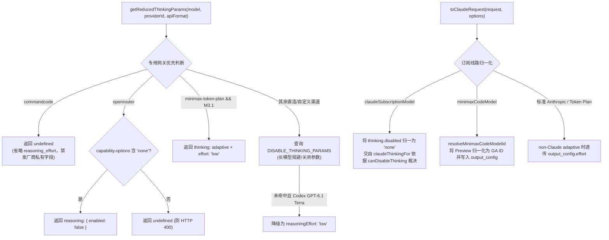

# Agent Note: 同步更新各内置供应商模型目录、推理契约与人民币计价表

Status: implemented

> 相关决策与参考链路：
> - 订阅线路演进见 [重新接入 WorkBuddy 与新增 OpenDesign 订阅线路及多账号号池](2026-11-14-workbuddy-opendesign-subscriptions.md)；
> - 能力表与价格数据基准分别维护于 `client/extension/ai/providers/models/defaults.ts`、`capabilities.ts`、`pricingData.json` 与 `pricing.ts`。

## Problem

截至 2026-11-14，随着各上游大模型供应商及聚合网关集中发版与模型更名，内置模型配置与能力表出现多处滞后与协议错位：

1. **订阅与 CLI 目录滞后**：
   - Codex（`codex-chatgpt`）新增 `gpt-6.1-terra`（500K 服务默认上下文，872K Codex 上限）；
   - Claude 订阅目录停留在 CLI `2.1.285`，缺少 `claude-haiku-5-5` 及 `claude-haiku-4-5-20251001` / `claude-opus-4-5-20251101` / `claude-sonnet-4-5-20250929`，且 `claude-opus-5.canDisableThinking` 与 `claudeThinkingFor` 在 `adaptive` 下的 `outputConfig` / `disabled` 处理不准确；
   - MiniMax Code 仍以 Preview 命名 `MiniMax-M3.1-Flash-Preview` 作为主模型 ID，未升级到 GA `MiniMax-M3.1-Flash`；
   - Command Code（`commandcode` / `commandcode-messages`）未同步至 `command-code@1.88.4` 109 模型全表及新增模态 `'file'` / 可见性标记 `hidden`；
2. **直连与聚合渠道目录及能力缺口**：
   - `openai`、`claude`、`tokenrhythm`、`minimax`、`minimax-token-plan`、`glm`、`qwen`、`google`、`openrouter` 缺少最新代际模型（如 Claude Opus/Sonnet/Haiku 5.5、GLM-5.3 系列、Gemini 4 家族与 3.7/3.8 Flash、Qwen 4/3.8 系列、MiniMax M3.1 Flash、Grok 4.7）；
   - `VISION_CAPABLE_MODELS`、`ALWAYS_THINKING_PREFIXES`、`MODEL_CONTEXT_TOKENS`、`getModelOutputTokens`、`getAnthropicModelFeatures` 及 `aiService.ts` 中的 GLM 思考回放正则未涵盖部分新模型；
3. **网关协议隔离与前缀排序隐患**：
   - `getReducedThinkingParams` 先前先于 `openrouter` / `commandcode` 执行 `getDisableThinkingParams`，导致 `z-ai/glm-5.3`、`anthropic/claude-haiku-5.5` 等携带前缀的网关模型误透传厂商私有 `thinking` 字段；
   - `pricingData.json` 与 `VISION_CAPABLE_MODELS` 采用前缀/子串顺序匹配，短前缀（如 `MiniMax-M3`、`glm-5.3`、`claude-opus-5`）若排在长 ID 之前会造成计价与多模态误判；
   - `claude-subscription` 在 `toClaudeRequest` 中未把上游 `thinking.type === 'disabled'` 交回 `claudeThinkingFor` 裁决，且 `minimax-token-plan` 的 `MiniMax-M3.1*` 需要同时发送 `thinking: { type: 'adaptive' }` 与 `output_config.effort`。

## Decision

对齐 `C:\Users\A\Documents\ChatGPT\dsh-chatgpt-subscription` 与 2026-11 各厂商规范，对内置供应商目录、协议塑形与计价体系实施全量同步：

### 1. 各线路目录与能力映射更新

- **Codex (`client/extension/ai/codex/oauthService.ts`)**：`CODEX_CHATGPT_MODELS` 加入 `'gpt-6.1-terra'` 并导出 `CODEX_CHATGPT_TERRA_CONTEXT_TOKENS = 500_000`；`CODEX_CHATGPT_MAX_CONTEXT_TOKENS` 为 `'gpt-6.1-terra'` 设定 `872_000` 上限，区别于直连 `openai` 的 `1_050_000`。
- **Claude 订阅 (`client/extension/ai/claudesub/types.ts`)**：`CLAUDE_CLI_VERSION` 升至 `'2.1.293'`；`CLAUDE_MODELS` 补齐至 17 条；`claudeThinkingFor` 统一在 `requestedEffort === 'none' && model.canDisableThinking` 时输出 `{ thinking: { type: 'disabled' } }`，并在 `adaptive` 模式下按 `requestedEffort` 有条件附带 `outputConfig: { effort }`。
- **MiniMax Code (`client/extension/ai/minimaxcode/types.ts`)**：主目录升级为 GA `'MiniMax-M3.1-Flash'`，新增单向兼容映射 `MINIMAX_CODE_RENAMED_MODEL_IDS`（`'MiniMax-M3.1-Flash-Preview' -> 'MiniMax-M3.1-Flash'`）及 `resolveMinimaxCodeModelId`，并在 `minimaxCodeModelDef` / `isMinimaxCodeModelId` / `toClaudeRequest` 中自动归一化旧 ID。
- **Command Code (`client/extension/ai/commandcode/modelCapabilities.ts`)**：完整同步 109 条模型记录与 `hidden` 标记；`commandCodeInputModalities` 过滤非图像文件模态 `'file'`，保持返回 `Array<'text' | 'image'>`；`defaults.ts` 仅暴露 `!m.hidden` 的公开模型，`commandcode-messages` 升级至 11 个 Claude 模型并默认 `'claude-sonnet-5-5'`。
- **直连与聚合目录 (`client/extension/ai/providers/models/defaults.ts` & `capabilities.ts`)**：
  - `openai` 新增 `'gpt-6.1-terra'`；`claude` 默认升至 `'claude-opus-5-5'`；`glm` 默认升至 `'glm-5.3'` 并纳入 `'glm-5.3-flash'` / `'glm-5.3-flashx'`；`qwen` 默认升至 `'qwen3.8-max'` 并补齐 `qwen4-max-preview` 与 `qwen3.8-*`；`google` 默认升至 `'gemini-3.8-flash'` 并收录 `gemini-4-*`、`gemini-3.7-flash`、`gemini-3.5-flash-lite`；`minimax` / `minimax-token-plan` 纳入 `'MiniMax-M3.1-Flash'`；`tokenrhythm` 补充 7 款新模型；`openrouter` 补充 14 款旗舰/高速模型；
  - `VISION_CAPABLE_MODELS` 按长 ID 优先排列，保证 `'glm-5.3-flash'` / `'glm-5.3-flashx'`（多模态）先于 `'glm-5.3'`（纯文本）命中；
  - `getAnthropicModelFeatures` 在保持 `sonnetVer === 5` 既有契约不变的前提下，使 `sonnetVer >= 5.5`、`haikuVer >= 5.5` 与 `opusVer >= 4.7` 均返回全 `true`；
  - `aiService.ts` 的 `tokenRhythmReasoningReplay` 正则扩展为 `glm-5(?:\.[123])?(?:-flashx?)?`。
- **经核查无需变动的供应商**：`deepseek`、`mimo`、`mimo-token-plan`、`kimi`、`kimi-code-plan`、`workbuddy-subscription`、`opendesign`、`opencode`、`siliconflow`、`github`、`together`、`deepinfra`、`ollama`、`custom` 均已符合最新模型基线，保持原样。

### 2. 网关优先协议隔离与请求塑形流程

在 `client/extension/ai/providers.ts` 中调整 `getReducedThinkingParams`、`THINKING_RULES` 与 `toClaudeRequest` 判定顺序：

### 3. 人民币计价与缓存折扣 (`pricingData.json` & `pricing.ts`)

- 在 `client/extension/ai/providers/models/pricingData.json` 按**长键在前**原则补入新模型与 `openrouter:*` 专属价格（确保 `claude-opus-5-5` 先于 `claude-opus-5`、`MiniMax-M3.1-Flash` 先于 `MiniMax-M3`、`glm-5.3-flashx` -> `glm-5.3-flash` -> `glm-5.3` 先于 `glm-5.2`）；
- 在 `client/extension/ai/providers/models/pricing.ts` 的 `getCacheDiscountFactor` 中新增 `gpt-6.1-terra` (`0.05`)、`glm-5.3-flashx` (`0.285`)、`glm-5.3-flash` (`0.2875`)、`glm-5.3` (`0.25`) 与 `minimax-m3.1` (`0.1`)。

## Alternatives considered

1. **继续保留 `MiniMax-M3.1-Flash-Preview` 作为主配置 ID**：否决。官方已将该条目升级为 GA `MiniMax-M3.1-Flash`，仅保留单向映射 `MINIMAX_CODE_RENAMED_MODEL_IDS` 可在不破坏用户已保存设置的前提下完成无缝迁移。
2. **维持 `getDisableThinkingParams` 在 `getReducedThinkingParams` 最前端优先匹配**：否决。当 `DISABLE_THINKING_PARAMS` 含带可选斜杠前缀的厂商模式时，直接前置匹配会使 `openrouter` / `commandcode` 发出各自网关不支持的私有 `thinking` / `thinking_config` 对象；先按网关做协议分流再查厂商直连规则可根除跨网关字段污染。
3. **将 `claude-haiku-5-5` 视同 `claude-opus-5-5` 一律禁止关闭思考**：否决。`claude-haiku-5-5` 官方明确支持在不指定 `xhigh`/`max` 时发送 `thinking: { type: 'disabled' }`，且其默认模式为不强制 `high` 的 `adaptive`；在 `CLAUDE_MODELS` 与 `claudeReasoningCapability` 中按实测契约单独建档才能兼顾关闭速度与正常思考默认档位。
4. **对 `gpt-6.1-terra` 在 `openai` 与 `codex-chatgpt` 之间强行统一默认上下文与 `none` 能力**：否决。Codex 订阅接口限制 `gpt-6.1-terra` 默认为 500K（扩展上限 872K）且不开放 `none`，而 OpenAI 直连 API 提供 1,050K 与 `none` 档位；按渠道区分才能避免直连能力缩水或订阅请求被拒。

## Consequences

- **能力与目录全面对齐**：覆盖 9 条更新供应商与 13 条保持最新基线供应商，前后端选择器、上下文预算、视觉上传门控、思考参数与费用估算均同步生效；
- **新增约束与维护纪律**：后续向 `pricingData.json`、`VISION_CAPABLE_MODELS` 与 `DISABLE_THINKING_PARAMS` / `THINKING_RULES` 添加细分变体时，必须将更长前缀或带后缀的规则置于基础款之前；
- **全量回归护栏**：更新并扩充 `codexOAuthService.test.ts`、`claudeSubscription.test.ts`、`minimaxCodeSubscription.test.ts`、`commandCodeCapabilities.test.ts`、`providers.test.ts`、`providerThinkingParams.test.ts` 与 `pricing.test.ts` 共 7 份单元测试（含 `providerThinkingParams.test.ts` 对全部 `BUILTIN_PROVIDERS` 模型思考选项的全量自动化校验）。
