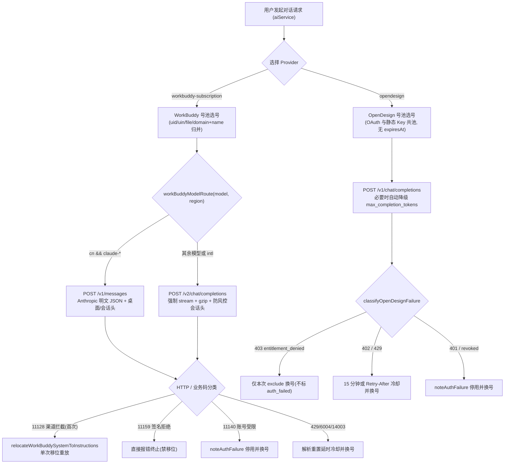

# Agent Note: 重新接入 WorkBuddy 与新增 OpenDesign 订阅线路及多账号号池

Status: implemented

> 相关决策与演化链路：
> - 号池共享底座、身份键归并与额度仪表规范见 [号池接入全部订阅线路与设置页草稿保护](../architecture/2026-10-04-subscription-pool-all-lines.md)；
> - 历史移除决定与反差记录见 [移除 WorkBuddy 与 OpenCode Go 两条订阅线路](../simplification/2026-10-21-remove-workbuddy-and-opencode-go-lines.md) 与 [移除 Antigravity 供应商与独占补全服务](../simplification/2026-11-12-remove-antigravity-provider-and-completion-services.md)；
> - 早期 WorkBuddy 网关基线结论（区域为凭据属性、`/v1/models` 404 等）继承自归档笔记 [接入 WorkBuddy / CodeBuddy 订阅线路](../../archived/feature/2026-10-04-workbuddy-subscription-line.md)。

## Problem

在完成 `antigravity` 线路及独占补全服务的移除后（[移除笔记](../simplification/2026-11-12-remove-antigravity-provider-and-completion-services.md)），仍存在两项直接影响用户体验的缺口：

1. 工作区保留过历史打包的 `.vsix` 残留文件；
2. 参照仓库 `C:\Users\A\Documents\ChatGPT\dsh-chatgpt-subscription` 已验证并演进出两项关键订阅能力：
   - **WorkBuddy / CodeBuddy（`workbuddy-subscription`）**：桌面端新版改为使用 `$wbEncrypted` AES-256-GCM 磁盘密文信封保存会话，网关启用桌面产品身份/会话指纹风控、并发拆散 `tool_calls` 校验、`/v2/chat/completions` gzip 强制流式及国区 `claude-*` `/v1/messages` 分流，同时对 `11128` 渠道拦截、`11159` thinking signature、`11140` 永久封控做了细粒度区分，并提供国区每日自动签到与多套餐额度查询；
   - **OpenDesign（`opendesign`）**：以 `https://amr-link.open-design.ai/v1` 为统一 OpenAI 兼容网关、以 AMR 控制面 `https://amr-api.open-design.ai/api/v1` 提供设备码授权（签发双密钥 `controlKey` + `runtimeKey`）及 5 小时 / 7 天 / 钱包美元额度窗口，并兼容用户在控制台粘贴的静态 API Key。

同时，两条线路都必须纳入本项目的 `SubscriptionPoolRegistry` / `OAuthAccountPool` 体系与设置页同构 UI，确保设置表单顶部控件、共享 `#subscriptionPoolGroup` 与底部账号折叠卡严格遵循既有视觉骨架，且维持 `keepDraft` 草稿保护与凭据零泄露边界。

## Decision

### 1. 清理历史构建残留并确认移除边界

- 清理工作区根目录遗留的历史 `.vsix` 构建包；
- `antigravity` 在 `BUILTIN_PROVIDERS`、请求流水线与设置 UI 中保持完全缺席（仅保留 `release/CHANGELOG.md` 历史版本叙述及防回退测试 `providers.test.ts`）。

### 2. WorkBuddy（`workbuddy-subscription`）全功能接入与防风控协议适配

在 `client/extension/ai/workbuddy/` 下落地 12 个内聚模块（`types.ts`、`identity.ts`、`atrest.ts`、`outboundIdentity.ts`、`credentials.ts`、`client.ts`、`fallbackModels.ts`、`modelCatalog.ts`、`quota.ts`、`checkin.ts`、`checkinService.ts`、`accountStatus.ts`）：

1. **桌面 `$wbEncrypted` 解封与防降级写回**：
   - `atrest.ts` 解析 64 位 Hex 或 44 位 `=` 结尾 Base64（对其 ASCII 做 SHA-256）形成 32 字节保护密钥，按官方 `WB-AAD\0` 组帧解密 `{ "$wbEncrypted": { scheme: "sym-v1", suite: 1, keyId, nonce, ciphertext, tag } }`；
   - 保存保护密钥前，若桌面目录存在 `.wb-key` 校验块，先校验 `keyId` 与密文一致性；
   - `workBuddyPoolCredentials` 严禁让未解封的 `$wbEncrypted` 密文进入号池；刷新桌面凭据回写磁盘（`writeBackWorkBuddyDesktopCredential`）时保留原始密封结构并原子替换，**绝不把原本加密的桌面文件降级成明文**。
2. **协议双轨路由与出站指纹卫士**：
   - **区域归属凭据**：`*.workbuddy.ai` / `*.codebuddy.ai` 走国际区 `https://www.<apex>`，其余走国区 `https://copilot.tencent.com`；
   - **协议分流（`workBuddyModelRoute`）**：国区 `claude-*` 模型走 `/v1/messages`（Anthropic Messages 明文 JSON 无 gzip，`anthropic-version: 2023-06-01` + Bearer），其余所有模型（含默认模型 `glm-5.3` 及国际区账号）走 `/v2/chat/completions`（强制 `stream: true`、`stream_options: { include_usage: true }`、gzip 压缩请求体、`cache_retention: 'long'`、首条中性 `system` 兜底）；
   - **防风控请求头（`outboundIdentity.ts`）**：聊天通道发送桌面端身份 UA（`WorkBuddy/5.9.3 ... CLI/2.165.0`）、基于 `accountKey` 混入种子的 5 个成组会话头（防切号跨账号 `conversation-id` 碰撞）与遥测/追踪头；控制面面（`/v3/config`、`/v2/plugin/*`、`/billing/meter/*`）保持 `CLI/2.63.2 CodeBuddy/2.63.2`；
   - **历史修复与敏感错误码区分**：`mergeSplitWorkBuddyToolCallBatches` 合并相邻拆散 `tool_calls`、`fillMissingWorkBuddyToolResults` 补齐缺失 `tool` 应答；`11128` 渠道拒绝且带自定义首条 `system` 时触发**仅一次** `<INSTRUCTIONS>` 单次移位自愈（`relocateWorkBuddySystemToInstructions`），`11159`（`thinking` 签名拒绝）严格阻断且**绝不**伪装成 `11128` 移位，`11140` 触发永久停用换号，`6004`/`14003`/429 按响应体重置时间或 `Retry-After` 冷却换号，`401` 先回读桌面磁盘是否已刷新，否则刷新 token 或换号。
3. **实时目录、额度与国区每日签到**：
   - `/v3/config` 实时拉取每区模型窗口/思考档位/倍率，按 `convergeWorkBuddyEffort` 收敛至标准档并合并 `FALLBACK_MODELS`（22 条，含国区 Claude 条目与 `glm-5.3` 默认值）；
   - `/billing/meter/get-user-resource` 汇总多套餐额度为 `cycle` 与 `package` 双进度条；
   - `checkinService.ts` 实现 `stellarisLanguageServices.ai.workbuddyAutoCheckin` 幂等国区每日自动签到与 `workbuddy-checkin.json` 状态落盘（国际区账号自动跳过，不虚报已签到）。

### 3. OpenDesign（`opendesign`）双模授权、目录融合与无伤号套餐切换

在 `client/extension/ai/opendesign/` 下落地 6 个模块（`types.ts`、`credentials.ts`、`errors.ts`、`oauth.ts`、`quota.ts`、`catalog.ts`）：

1. **设备码 OAuth + 静态 API Key 双模合流**：
   - 设备码授权（`POST /cli/device-authorizations` → 强制校验 `activationUrl` 为 `https://` 后打开浏览器 → 轮询 `/token`）签发成对密钥 `controlKey`（`vela_ctrl_…`，查额度/余额/控制面目录）与 `runtimeKey`（`sk-amr-…`，调用网关 `/v1/chat/completions` 与 `/v1/models`）；
   - 通过 UI 输入框或 `ApiKeyManager` 保存的控制台静态 Key 与 OAuth 账号共同入池（`opendesign` 号池）；`openDesignPoolCredentials` 与 `toOpenDesignPoolCredentials` **省略 `expiresAt`**（避免 `AccountPoolCore` 把 `expiresAt: 0` 误判为 1970 年已过期）。
2. **字段级三层模型目录融合与特殊能力边界**：
   - `catalog.ts` 对 AMR 控制面 `/api/v1/models`、网关 `/v1/models`（用 `canonicalOpenDesignModelKey` 对齐 `vela/` / `public_model_` 与连字符差异）及内置 41 模型目录 `OPENDESIGN_MODEL_CATALOG` 做**字段级合并**（而非整表覆盖）；
   - DeepSeek 系列（如 `deepseek-v4.1-flash`、`deepseek-v4-pro`）支持 `'none'` 作为独立思考关闭档；GPT 家族按 `openDesignWantsCompletionTokens` 发送 `max_completion_tokens`，遇到旧网关拒收 `max_tokens` 时本地自动降级切换重试一次。
3. **精细错误分类（不误伤账号）**：
   - `403 tier_*not_entitled` / `membership tier` 等套餐等级无权使用特定模型的拒绝只将该账号加入当次 `attemptedIds` 尝试池内更高套餐账号，**绝不触发 `noteAuthFailure`**；
   - `402` 或额度耗尽文本与 `429` 触发号池冷却（默认 15 分钟或遵循 `Retry-After`）并无缝换号；`401` 或 key 吊销文本触发 `noteAuthFailure`；
   - `quota.ts` 仅在携带 `controlKey` 时查 `workspaceId` → `/billing/coding-plan-usage`（5h/7d 窗口）+ `/billing/summary` + `/wallet/balance`；静态 Key 无控制面权限时静默省略额度区块。

### 4. 请求分流与号池单行移除清理流程

- **单行移除联动清理底层自管槽**：在 `aiService.removeSubscriptionPoolAccount(providerId, accountId)` 与 `chatSettings` 之间建立统一入口——移除 `workbuddy-subscription` 号池行时仅当 `creds.source === 'managed'` 才同步删除 `WorkBuddyCredentialStore` 托管条目（**外部桌面 `*.info` 原文件绝不删除**）；移除 `opendesign` 号池行时同步清理 `OpenDesignCredentialStore`，若匹配当前存储在 `ApiKeyManager` 中的静态 API Key 也一并清除，防止下次重扫/seed 时该账号「复活」。

### 5. 与设置页同构的 UI 呈现与草稿保护

- `providers.ts` 注册 `workbuddy-subscription`（`requiresApiKey: false`、`defaultModel: 'glm-5.3'`、`authKind: 'workbuddy-oauth'`）与 `opendesign`（`requiresApiKey: true`、`defaultModel: 'claude-sonnet-5.5'`、`authKind: 'opendesign-oauth'`）；
- `chatHtml.ts` 保持设置页既有布局一致性：
  - `workbuddy-subscription` 自动隐藏上方 API Key 输入组，展示登录区域选择（`cn` / `intl`）、浏览器登录、桌面端重扫、退出托管按钮，并在需要或已配置时按需展开 `#workbuddyAtRestGroup`（`$wbEncrypted` 保护密钥）与 `#workbuddyCheckinGroup`（国区每日签到）；
  - `opendesign` 保留上方静态 API Key 输入组，并在 `#opendesignAccountGroup` 提供设备码登录、刷新额度与全部退出；
  - 两者均使用 `
` 与共享 `#subscriptionPoolGroup`（单账号也展示且附带逐行 `SubscriptionAccountQuota` 仪表）；
- 扩展宿主仅向 Webview 发送安全摘要（`atRestKeyId` 指纹、账号状态、签到摘要、额度进度），绝不泄露任何明文 Token、API Key 或 32 字节保护密钥；
- `chatPanel.ts` 的 `settingsHasUnsavedDraft` 排除 `#workbuddyAccountGroup` 内仅属于实时动作控件而不落盘设置的交互字段，保证账号/签到/密钥状态刷新触发 `keepDraft` 路径时不会冲掉用户在设置表单里未保存的草稿。

## Alternatives considered

1. **在 `oauthAccountPool.ts` 中对静态/永不过期凭据统一填充 `expiresAt: 0`**：否决。`AccountPoolCore` 按绝对毫秒时间戳比较 `expiresAt`，`0`（1970-01-01）会被视为永久已过期，从而反复无效尝试续期或直接判死。改为省略 `expiresAt`（仅当 WorkBuddy 凭据确有非空 `refreshToken` 且 `expiresAt > 0` 时保留）。
2. **WorkBuddy 刷新桌面加密凭据后以明文写回原 `.info` 文件**：否决。明文降级覆盖不仅破坏用户桌面客户端的磁盘加密策略，还会使桌面端下次读取或校验 `.wb-key` 时失效。改为用 `sealWorkBuddyValue` 重新按 `WBEV1` 信封密封并原子替换写回。
3. **把 WorkBuddy 的 `11159`（thinking signature 校验失败）并入 `11128` 走 `<INSTRUCTIONS>` 移位重试**：否决。实测表明 `11159` 系思考块签名与消息上下文绑定问题，强行搬移 system 会混淆故障边界且白耗重试轮次，必须与 `11128` 严格隔离。
4. **OpenDesign 将 OAuth 与静态 API Key 拆分成两个独立的 Provider ID 或隔离号池**：否决。双 Provider 会分裂模型选择器与用户的历史配额切换习惯；同一台机器同时拥有设备码账号和控制台 Key 时，合并到单个 `'opendesign'` 号池并用稳定身份键去重，能直接享受统一轮转、403/429 换号与无感升级（若用户后续再配设备码可自然获得额度仪表）。
5. **移除号池中的账号行时仅调用 `subscriptionPools.removeAccount` 而不清理自管凭据槽**：否决。WorkBuddy 的托管存储与 OpenDesign 的 `OpenDesignCredentialStore` / `ApiKeyManager` 均参与下次 `seed`，不清自管槽会导致刚删除的账号立刻被重新 `seed` 回来。

## Consequences

- **多账号与双模可用性提升**：用户可在 WorkBuddy 混用本地桌面多账号（含 `$wbEncrypted` 加密目录）与浏览器授权账号；在 OpenDesign 混用多个设备码账号与静态 Key，享受 403/429 自动切号与共享进度条额度面板。
- **兼容性与安全性**：严格保留只读外部桌面 `*.info` 文件原则，不删除用户桌面登录态；所有 OAuth Token、API Key 与 32 字节保护密钥均停留在 SecretStorage 或桌面加密盘内，不进入 Webview；OpenDesign 设备授权强校验 `https://` 激活链接。
- **验证覆盖**：新建 `opendesignSubscription.test.ts`、`workbuddySubscription.test.ts` 与 `workbuddyBuiltinCatalog.test.ts`，并扩展 `providers.test.ts`、`providerThinkingParams.test.ts`、`subscriptionPools.test.ts`、`chatSettingsLayout.test.ts` 与 `settingsPageDraft.test.ts`，通过全套 `lint`、`compile`、`typecheck:test`、规则同步与性能基线检验；真实订阅账号的端到端实机联网联调仍需在具备对应账号的环境中进一步实测。
