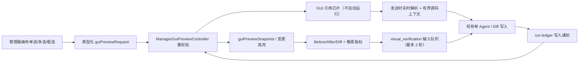

# Agent Note: 独立 Agent 管理器 GUI 预览、结构化选区与自主视觉验证

Status: implemented

## Problem

现有 GUI Preview 已能渲染和编辑 `.gui`，但独立 Agent Manager 的右侧只有“变更 / 运行 / 设置”。用户在对话中修改 GUI 时需要在独立面板之间切换，也无法把画布中的元素或区域准确转换成 Agent 上下文。直接把旧 Webview 嵌入管理器会破坏资源 URI、消息路由、选择状态和面板生命周期。

## Decision

1. **保留原有三栏管理器并增加平级“预览”Tab**：中央对话、左侧话题和原有“变更 / 运行 / 设置”继续复用。预览节点独立于会由 `innerHTML` 重建的变更列表，Tab 切换只隐藏而不销毁画布；运行事件不得把用户主动选择的预览自动切走。
2. **共享 GUI 核心而非嵌套旧 Webview**：`client/shared/guiPreview.ts` 统一元素、选区、快照和引用协议；`guiLayout.ts` 与 `guiVisuals.ts` 同时服务完整工作台和管理器。`GuiPreviewLoader` 统一解析、`.gfx` 索引、DDS/TGA 解码、50 MB 有界缓存和纹理路径包含校验。完整 `GuiPanel` 也改用该加载器。
3. **Host 是预览事实源**：`ManagerGuiPreviewController` 负责文件选择、固定/跟随、文档版本、选择重解析、快照恢复、源码跳转和完整工作台打开。每次附着到 manager Webview 都重新加载并为该 Webview 生成资源 URI；缩放、平移只留在本地画布。元素监听按渲染代际 abort，避免刷新累积。
4. **结构化圈选进入现有对话**：画布支持滚轮缩放、Alt/中键平移、单选、Ctrl 多选、逻辑坐标框选和双击源码。引用记录层级路径、名称、类型、起止行、文档版本和可选区域；父子同时命中时只保留后代，最多 32 项。点击“添加到对话”只插入芯片，不自动发送。
5. **发送时重新取证并限制体积**：`guiContext.ts` 在最新文档上重解析引用，歧义/失效项显式报告，单元素最多 4000 字符、整组最多 20000 字符。继续走 `ContextReferenceManager`、单 Agent runner、原文件工具、Diff 确认和画布外控件保护，不新增模型可见工具或 MCP schema。
6. **写盘刷新与草稿保护**：run-ledger 的 `.gui` 写入通知以防抖方式刷新 manager 与完整工作台；后者通过 `GuiPanel.refreshIfFile` 读取干净磁盘文档。所有普通 Agent 写工具在目标 `.gui` 存在未保存内存草稿时 fail closed，要求用户先保存，禁止磁盘与草稿互相覆盖。
7. **同回合自主视觉验证**：预览器用同一逻辑坐标帧生成 960×720 Before/After，RGBA 比较输出 Diff、变化比例和边界；没有基线时明确 After-only。Host 每个 run 最多捕获并注入两轮 `visual_verification`，复用现有输入队列把图片送入下一次模型调用，Agent 自主判断和修正而不是使用像素阈值硬判。Provider 不支持视觉时只发送指标。证据面板支持 Before/After/Diff 切换，话题私有固定文件保存最新证据并按 Webview 重建 URI，不改变 V4 checkpoint。

## Alternatives considered

- **iframe 嵌入完整 GUI Webview**：否决。两个 Webview 的 `acquireVsCodeApi`、CSP、资源根、纹理 URI 和消息生命周期不同，会形成不可控的隐式桥。
- **定时截图或只把截图发给模型**：否决。无法稳定映射到 PDX 源码，且重复名称和编辑后的行号会失效；结构化引用才是修改依据。
- **在管理器复制一份 GUI 渲染与加载代码**：否决。布局、九宫格/多帧纹理、缓存和安全规则会分叉，因此抽取共享核心并让完整工作台同步迁移。
- **管理器直接调用 `GuiPanel` 私有编辑方法**：否决。会绕过 Agent policy、Diff 确认和 GUI 隐藏控件保护；右侧只承担预览/检查/圈选，直接编辑仍留在完整工作台。
- **发送引用时自动保存脏文档**：否决。保存属于用户决定；未保存时允许查看和分析，但 Agent 写入必须拒绝。
- **新增 `verify_gui_preview` 模型工具并扩展 MCP schema**：否决。现有输入队列已支持运行中携带图片，内部 `visual_verification` 类型即可完成同回合回传，无需公开新工具或执行子模块发布。
- **按像素变化比例硬性决定通过/失败**：否决。合法的大面积布局调整也会高比例变化，像素指标只作为 Agent 证据，是否修正由 Agent 判断，最多两轮。
- **没有基线时伪造 Before 或自动开启新回合**：否决。明确返回 After-only；run 已结束只保留证据，不自动启动任务。
- **切换 Tab 时销毁并重建预览**：否决。会丢失选择、缩放和元素监听，并增加纹理重复解码。

## Consequences

- 独立 Agent Manager 形成“看预览 → 圈选 → 添加修改建议 → 审核 Diff → 查看刷新结果”的闭环，完整 GUI 工作台的预览/检查/编辑能力保持原入口。
- GUI 选择不再依赖名称或行号单一定位；路径失败且同名候选不唯一时会拒绝生成引用。
- 新增协议均在 `webviewProtocol.ts` / `hostProtocol.ts` 做运行时校验，文件路径和资源路径由 Host 解析，不接受 Webview 任意写文件。
- 相关 Owning Notes 已同步：[四 Tab 布局](../bug-fix/2026-09-06-manager-inspector-peer-tabs.md)、[管理器平级工作区](2026-09-05-chat-manager-ui-polish.md)、[双界面 Host 恢复](../bug-fix/2026-10-13-dual-surface-state-sync-catch-up.md)。
- 验证：`npm run compile`、`npm run typecheck:test`、`npm run build:docs` 通过；38 项既有目标测试及 13 项视觉目标测试通过；视觉状态机验证第三轮不注入、run 清理、After-only、输入队列和 Provider 退化。全量单元测试 2750 项通过，另有 1 项既有 Shader 文件计数差异（49/50，本次未改 Shader/规则）；`npm run test:rules-sync` 51 项和 `npm run test:perf` 通过。
- Headless Edge 在 1920×1080 与 1280×800 深色中文视口验证四 Tab、预览、单选/框选、引用芯片、变更高亮、视口保持和零控制台错误；原 `GuiPanel` 另完成 1920×1080 深色渲染与属性选择回归。真实离屏验收覆盖相同场景零差异、移动元素非零差异、有效变化边界、After-only 和证据面板，结果图片为 `artifacts/ui/visual-before.png`、`visual-after.png`、`visual-diff.png`。截图位于 `artifacts/ui/`。既有界面基线来自用户提供的同尺寸管理器截图，After 使用相同空状态及 GUI 快照场景。
