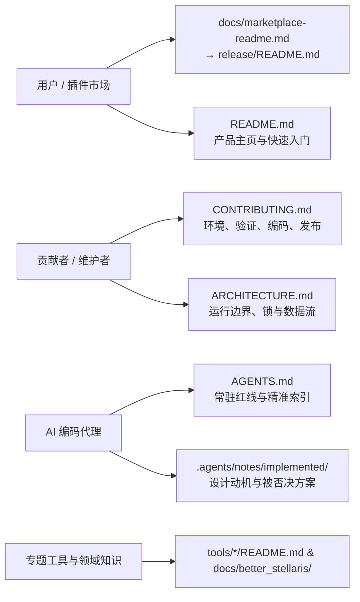

# Agent Note: 仓库文档重写收口与源码注释系统性清理

Status: implemented

## Problem

尽管前序提交刷新了部分文档与注释，但仓库文档体系与源码注释仍存在四类突出结构性问题：

1. **核心文档膨胀且违背“One Home Per Fact”**：
   - `README.md`（约 45 KB）演变为功能补丁追加墙，单段超 2,000 字符、塞满底层实现细节与“no longer / instead of”历史对比腔，同时全新检出命令漏掉了 `cwtools-shared` 预构建步骤。
   - `ARCHITECTURE.md`（约 53 KB）在舰船设计工作台与 Manager GUI 预览两节出现严重的抽象层级失衡与历史负向声明堆积。
   - `CONTRIBUTING.md`、`AGENTS.md` 与 `.agents/workflows/package.md` 在仓库边界、编码要求、打包与 OIDC 发布说明上大面积重复。
2. **公开死链与过期历史草稿残留**：
   - `docs/marketplace-readme.md`（及生成的 `release/README.md`）存在 6 处指向 `blob/master/` 的 404 死链（当前默认分支为 `main`）。
   - `docs/engine-perf-lint-handoff.md`、`docs/subscription-providers-plan.md`（含本机私人路径与已移除 `antigravity` 历史明细）、`docs/stellaris-targeting-weight-4.5.2.md`（含多代理/黑板/旧工具数/错误脚本名）均已完成落地并已有 Owning Notes，继续留在 `docs/` 中导致信息分裂。
   - `docs/better_stellaris/17_ship_targeting_weights.md:55` 存在与共享代码及自身后续章节矛盾的公式笔误（“两者相乘后取最大”）。
   - `tools/rules-sync/README.md` 双语严重失衡，`tools/perf/README-lsp.md` 混入一次性优化跑分流水账，多处技能文档硬编码个人盘符路径或代理端口。
3. **源码注释残留过时概念、内部追踪编号与语言撕裂**：
   - 约 15 个 TS/Webview 文件仍以在役口吻描述已退役的多代理/Sub-agent/Agent Teams/PTC/`REMOVED` 工具或 `CLAUDE.md`。
   - 90+ 处一次性内部开发编号（`plan §...`、`Batch X.Y`、`P0 design N`、`T2.2–T4.2`、`Fix #N`、`M4–M6 fix`、`W6 fix`、`Phase` 编号）脱离上下文后无自包含价值。
   - 英文主基座大文件（`aiService.ts`、`providers.ts`、`promptBuilder.ts`、`chatSettings.ts`、`tools/registry.ts`、`vanillaCompare.ts`、`chatPanel.css`、`agentManager.css`）突兀混入零星中文；部分核心高复杂度模块（`agentRuntime.ts`、`typedPdxWrite.ts`、`webAccess.ts`、`agentManager.ts`、`shipDesignPreview.ts`、`parse-log.ts`、`src/LSP/Parser.fs`）几乎零注释。

## Decision

按“信息归属唯一化 + 文档校验门禁加固 + 零运行时语义变动的注释清理”三条主线完成全仓整理：

1. **核心文档重写与门禁加固**：
   - 修复 `docs/marketplace-readme.md` 的 6 处 `blob/master/` → `blob/main/` 死链并重新生成 `release/README.md`。
   - 强化 `tools/build-github-docs.js`，新增 `blob/master/` 回归拦截与英/中三级及四级标题数量对等检查。
   - 重写精简 `README.md`（约 45 KB → ~15 KB）、`ARCHITECTURE.md`（约 53 KB → ~26 KB）、`CONTRIBUTING.md` 与 `AGENTS.md`，明确分工、消除历史对比腔、补全 `README.md` 的 `cwtools-shared` 预构建步骤，平权列出全部 7 条订阅线路。
2. **`docs/` 历史草稿收口与工具/技能指南刷新**：
   - 将原 `docs/engine-perf-lint-handoff.md` 中仍有用的成本标注工具与重锚流程独立抽离为 `tools/engine-cost/README.md`。
   - 移除已完结且信息完全被 Owning Notes 或权威文档吸收的 3 份文件：`docs/engine-perf-lint-handoff.md`、`docs/subscription-providers-plan.md`、`docs/stellaris-targeting-weight-4.5.2.md`，并将所有代码与技能引用统一切换至 `docs/better_stellaris/17_ship_targeting_weights.md` 与 `tools/engine-cost/README.md`。
   - 修正 `docs/better_stellaris/17_ship_targeting_weights.md:55` 为“两层互不相乘，各自独立 argmax”；在 `docs/stellaris-engine-performance-scan.md` 顶部补充 4.5 静态基线快照说明；大幅精简重写 `docs/cwtools-core-handoff.md`（仅保留现行 CLI 约束、验证门禁与未决观察）。
   - 补齐 `tools/rules-sync/README.md` 对等中文章节，精简 `tools/perf/README-lsp.md` 与 `.agents/workflows/package.md`，移除 `.agents/skills/*/SKILL.md` 中的硬编码本机路径、私人仓库名与个人代理端口。
3. **源码注释四层清理（严格不改运行时逻辑）**：
   - **过时/失真归零**：更新 `delegationScope.ts`、`inputQueue.ts`、`writeCoordinator.ts`、`agentHandoff.ts`、`experienceStore.ts`、`promptBuilder.ts`、`chatPanel.ts`、`tools/editFailure.ts`、`tools/fileTools.ts`、`tools/definitions.ts`、`types.ts`、`agentRunner.ts`、`agentTools.ts`、`webview/messageRenderer.ts`、`webview/chatPanel.ts`、`webview/chatPanel.css`、`client/test/unit/toolDefinitions.test.ts` 的失真或未标 `legacy` 注释。
   - **内部追踪标签与死代码归零**：剥离 90+ 处 `plan §`/`Batch`/`P0 design`/`T2–T4`/`Fix #`/`M4–M6 fix`/`W6 fix`/`Phase` 编号并保留其后的真实“Why”约束；清除 `fileExplorer.ts`、`extension.ts`、`Completion.fs`、`Program.fs` 的死代码注释与装饰 Emoji。
   - **单文件语言一致与零注释补强**：将英文主基座中的零星中文注释统一为简明英文，保留纯中文订阅/号池模块的高质量“Why”注释；为 `agentRuntime.ts`、`typedPdxWrite.ts`、`webAccess.ts`、`agentManager.ts`、`shipDesignPreview.ts`、`parse-log.ts`、`src/LSP/Parser.fs` 补充精炼职责与不变量头注释；精简 `extension.ts` 与 `guiPreview.ts` 热点复述废话。
   - 完整保留全部 14 处 `eslint-disable`、2 处 `@ts-ignore` 与 `tools/check-release.js` 白名单契约。

## Alternatives considered

1. **在 `docs/` 下保留 3 份已完成计划/交接文档并仅加顶部横幅**：此前已尝试在顶部加 `> [!IMPORTANT] 状态更新`，但正文数百行过时架构描述（多代理/黑板/antigravity/本机绝对路径）仍持续误导检索与新读者，因此选择抽离有效内容后直接移除，由对应 Owning Notes 承担历史归档职责。
2. **用自动化脚本批量删除所有短注释或统一翻译所有中文订阅模块**：风险高且收益为负——`minimaxcode/`、`claudesub/`、`workbuddy/`、`kimi/`、`pool/` 等近期纯中文模块的高密度协议“Why”注释本身质量极高，且自动化裁剪容易误伤 `eslint-disable`、`@ts-ignore` 或关键不变量，因此采用人工核实后的精准分文件清理。
3. **顺手修改 `eslint.config.mjs` 中已迁移的 `durableStorage.ts` 路径**：可能意外引入无关的 `no-explicit-any` 编译/检查失败，超出文档与注释优化任务边界，刻意留待独立代码卫生任务处理。

## Consequences

- **直接收益**：根文档总体积缩减约 45% 且完全消除双语漂移与 `blob/master/` 404 死链；`tools/build-github-docs.js` 自动守护双语标题结构与主分支外链；源码中所有一次性开发标签与多代理失真注释清零，核心盲区补齐了高信号职责头注释。
- **后续约束**：
  - 修改 5 份单源双语文档时须保持英/中 `###`/`####` 标题数量完全一致，否则 `npm run build:docs` 与 `check:release` 会报错拦截。
  - 新增代码注释应直接陈述当前不变量与“Why”，禁止引入临时计划编号（`plan §`、`Batch X.Y`、`Fix #N`）并在单文件内保持单一注释语言。
