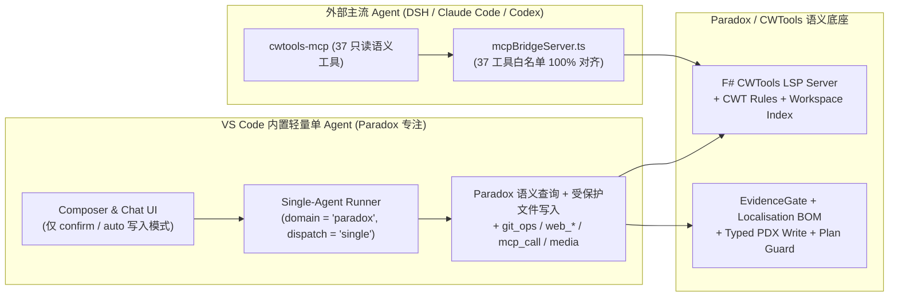

# Agent Note: 内置 Agent 架构瘦身与 Paradox 语义专注化（退役通用编码/混合领域、命令工具、沙箱审批与多 Agent 编排）

Status: implemented

## Problem

1. **内置 Agent 过度承担通用 Harness 职责**：`client/extension/ai/` 与 `client/webview/chat/`（含专项测试）累计膨胀至 12.7 万行 TypeScript 代码（占 `client/` 总量约 52%）。其中大量体积消耗在通用编码与混合领域（`general` / `hybrid`）、内置多 Agent 编排器（`orchestrator/`、DAG 调度、Peer Agent Teams 邮箱与 CAS 任务看板、Blackboard）、Shell 命令与进程工具（`run_command`、`manage_process`）以及配套的 OS 命令沙箱（`sandboxRunner`、`sandboxBroker`、`commandPreflight`）与权限审批系统（`permissionRequest`、`autoReviewer`、`permissionPolicy`）上。
2. **与外部主流 Agent（DSH / Claude Code / Codex）能力重叠且存在先天代差**：长程工程、Shell 执行与多子代理编排在外部主流 Agent 中具备更强的宿主生态（如 Code Mode / PTC、跨进程工具、逆向工具链联动），而在 VS Code 语言扩展内部重复维护整套重型 Harness 带来了高昂的维护税与跨平台沙箱/权限兼容负担。
3. **MCP 桥接只读语义工具白名单滞后**：`tools/generate-mcp-schema.cjs` 已导出 37 个只读 Paradox/Shader 语义工具，但扩展宿主侧 `client/extension/ai/mcpBridgeServer.ts` 的 `MCP_BRIDGE_TOOL_NAMES` 仅放行了 25 个，缺失了 7 个 Shader 分析工具及 `search_rule_capabilities`、`explain_scope`、`parse_pdx_fragment`、`query_inline_instantiation`、`analyze_pdx_flow`。

## Decision

### 1. 能力领域收敛为单一 Paradox 领域（保留全部订阅渠道池）

- **领域与调度协议**（`client/shared/agentSchedulingProtocol.ts`、`client/extension/ai/types.ts`、`client/extension/ai/agentProfile.ts`、`client/extension/ai/runner/scheduling.ts`）：
  - `AgentRuntimeDomain` 收敛为 `'paradox'`，`AgentDispatchMode` 收敛为 `'single'`，`AgentExecutionStrategy` 收敛为 `'auto' | 'single'`。
  - `AgentMode` 移除 `'utility'`、`'orchestrator'`、`'script'`，保留 `'build' | 'plan' | 'explore' | 'review' | 'gui_expert' | 'script_reviewer' | 'loc_translator' | 'loc_writer'`。
  - 向后兼容恢复：`normalizeSchedulingState()` 与 `normalizeAgentProfile()` 在读取历史持久化话题或 V4 检查点时，将旧 `'general' | 'hybrid'` 领域、`'parallel' | 'specialist'` 调度模式与 `'general-agent' | 'hybrid-agent' | 'general-coder'` Profile 自动平滑迁移为 `'paradox'`、`'single'` 与 `'paradox-agent'`，避免历史会话失效。
- **订阅渠道池保持不变**：`antigravity/`、`codex/`、`commandcode/`、`kimi/`、`minimaxcode/`、`claudesub/` 与 `pool/` 完整保留。
- **Composer UI**：从 `client/extension/ai/chatHtml.ts`、`client/webview/chatPanel.ts`、`client/extension/ai/chat/webviewProtocol.ts` 与 `client/extension/ai/chat/bridge.ts` 中移除 `#domainMenu`、`#quickDomainTrigger` 及 `switchSchedulingDomain` 协议消息。

### 2. 退役命令/进程工具与内置多 Agent 编排器

- **模型可见工具裁剪**（`client/extension/ai/tools/definitions.ts`、`client/extension/ai/tools/registry.ts`）：
  - 移除命令与进程工具：`run_command`、`manage_process`（及 `ToolEffect` 中的 `'shell'` 与 `'process'`）。
  - 移除多 Agent 编排与团队协作工具：`dispatch_agents`、`query_blackboard`、`merge_results`、`cancel_dispatch`、`team_send_message`、`team_members`、`team_close`、`team_task_create`、`team_task_list`、`team_task_update`。
  - 保留 `git_ops`、`web_search`、`web_open`、`web_find`、`mcp_call`、媒体转换/部署工具及全部 Paradox 语义查询与写入工具。
- **移除 `client/extension/ai/orchestrator/` 子系统**：删除 `orchestrator.ts`、`taskGraphEngine.ts`、`graphTeamExecutor.ts`、`teamRuntime.ts`、`teamTaskBoard.ts`、`teamMailbox.ts`、`blackboard.ts`、`qualityGate.ts`、`subAgentSandbox.ts` 等全部 23 个编排模块；`memoryTools.ts` 中的 `set_memory` 改为直接写入话题级内存与文件存储，不再依赖 `Blackboard` 实例。
- **移除多 Agent Profile 模型配置**：从 `release/package.json`、`chatSettings.ts`、`chatHtml.ts` 与 `client/webview/chatPanel.ts` 中移除 `stellarisLanguageServices.ai.orchestrator.agentModels` 及设置页 `#agentProfilesSection`（`agentModelRows`）。

### 3. 移除 OS 命令沙箱、权限请求卡片与 Auto-Review 审批模型（仅保留文件写入 Diff 确认切换）

- **移除沙箱与审批模块**：删除 `runner/sandboxRunner.ts`、`runner/sandboxBroker.ts`、`runner/commandPreflight.ts`、`runner/permissionPolicy.ts`、`runner/permissionRequest.ts`、`runner/autoReviewer.ts`、`runner/processRegistry.ts`。
- **移除权限请求交互与配置**：
  - 从 `agentTools.ts`、`externalTools.ts`、`agentRunner.ts`、`chatPanel.ts`、`webviewProtocol.ts`、`hostProtocol.ts` 中移除 `onPermissionRequest`、`permissionRequest`、`permissionResolved`、`permissionResponse` 与审批模型调用逻辑。
  - 从 `release/package.json` 与三语 NLS（`package.nls.json`、`package.nls.zh-cn.json`、`package.nls.zh.json`）中移除 `approvals.reviewer`、`approvals.reviewerProvider`、`approvals.reviewerModel`、`developer.disableSecuritySandbox`、`policy.preset`、`shell.commandRules`。
- **保留文件写入确认切换与核心安全护栏**：
  - 底部快速切换菜单（`#quickWriteModeTrigger` / `#writeModeMenu`）与设置页 `#agentWriteMode` 仅保留 **`confirm`（确认写入 — 写操作前出 Diff 确认卡片）** 与 **`auto`（自动写入 — 直接保存）** 两档切换（`runner/sessionPermissions.ts` 的 `QuickPermissionMode = 'confirm' | 'auto'`）。
  - 工作区路径包含性校验（`workspaceSandbox.ts`）、本地化 `.yml` 强制走 `write_localisation`（UTF-8 BOM 保护）、`EvidenceGate` 语义预检、单文件写锁与 Plan 模式 `plan_write_only` 门禁完整保留。

### 4. 系统提示词同步与 MCP 桥接/全功能执行层升级

- **系统提示词同步**（`prompt/sections/modePrompts.ts`、`prompt/sections/baseSystem.ts`、`prompt/sections/gameRoots.ts`、`promptBuilder.ts`）：
  - 移除所有 `run_command` Shell 说明、`agent_helper.py` 临时脚本说明、通用编码提示词（`buildGeneral*`、`buildUtilityModeSystemPrompt`）与多 Agent 编排/Blackboard/子代理提示词。
  - 递增 `PROMPT_TEMPLATE_VERSION` 至 `11`，使旧版本缓存的冻结提示词自动失效。
- **【一升】`cwtools-mcp` 与 `mcpBridgeServer.ts` 升级**：
  1. **只读语义工具全量对齐（39 个）**：`mcpBridgeServer.ts` 补齐缺失的 7 个 Shader 工具（`query_shader_*`、`explain_shader_reachability`、`validate_shader`、`compare_shader_with_vanilla`）及 `search_rule_capabilities`、`explain_scope`、`parse_pdx_fragment`、`query_inline_instantiation`、`analyze_pdx_flow`。
  2. **Paradox 领域受控写工具（`--allow-domain-writes` / `--enable-writes`，6 个）**：`cwtools-mcp` 与 `mcpBridgeServer.ts` 支持通过 `--allow-domain-writes` 显式开启 6 个 Paradox 专属受控写工具：`write_localisation`（保 UTF-8 BOM 与键值结构）、`typed_pdx_write`、`candidate_transaction`（带 CWTools 语法/规则预检门禁）、`convert_image_to_dds`、`convert_audio`、`deploy_mod_asset`。默认未开启时保持严格只读拒绝。
  3. **Paradox 领域 Skills 导出**：`mcpBridgeServer.ts` 与 `cwtools-mcp` 新增 `cwtools://skills/catalog` 与 `cwtools://skills/<name>` MCP Resources，自动发现并暴露内置、项目级（`.agents/skills` / `.cwtools/skills`）与用户级（`~/.cwtools/skills`）Paradox 技能。
- **【一打通】IDE 现场感知与可视化编辑器联动（2 个新工具）**：
  - `get_ide_context`：只读返回当前 VS Code 激活编辑器文件、语言、光标行列、选区文本、未保存脏缓冲区列表、当前文件实时诊断，以及已打开的 CWTools 可视化面板（GUI / Entity / Particle / Solar System / Tech Tree / Event Chain / Targeting Weight）及结构摘要。
  - `open_in_visual_editor`：在对应的 CWTools 可视化预览面板中打开或刷新指定文件（支持 `auto | gui | entity | particle | solar_system | tech_tree | event_chain | target_weight`），并返回解析后的节点/结构摘要。

> 本笔记取代并归档了以下历史笔记：
> - [`2026-10-14-run-command-platform-shell-resolution-and-paradox-coder-command.md`](../../archived/feature/2026-10-14-run-command-platform-shell-resolution-and-paradox-coder-command.md)
> - [`2026-10-17-command-sandbox-degrade-with-consent-and-subagent-command-capability.md`](../../archived/architecture/2026-10-17-command-sandbox-degrade-with-consent-and-subagent-command-capability.md)
> - [`2026-10-17-approval-reviewer-model-and-unsandboxed-review.md`](../../archived/architecture/2026-10-17-approval-reviewer-model-and-unsandboxed-review.md)
> - [`2026-09-18-agent-teams-peer-collaboration.md`](../../archived/feature/2026-09-18-agent-teams-peer-collaboration.md)
> - [`2026-09-18-dag-executor-convergence-on-team-board.md`](../../archived/architecture/2026-09-18-dag-executor-convergence-on-team-board.md)
> - [`2026-09-18-unified-multi-agent-entry-and-storage.md`](../../archived/architecture/2026-09-18-unified-multi-agent-entry-and-storage.md)

## Alternatives considered

1. **一并移除订阅渠道池（`antigravity`、`codex`、`commandcode`、`kimi`、`minimaxcode`、`claudesub`）**：否决。用户明确要求保留全部现有订阅渠道与多账号轮询能力，以便内置轻量 Agent 与行内补全直接复用现有账号体系。
2. **一并移除 `git_ops` 与 `web_search` / `web_open` / `web_find`**：否决。保留 `git_ops` 与网页搜索工具可支持 Paradox Mod 版本对比与查阅外部 Wiki/更新日志，且无需依赖 Shell 命令沙箱。
3. **连同文件写入 Diff 确认（`confirm` / `auto`）一并移除**：否决。用户希望移除复杂的命令/策略权限审批卡片与审批模型，但保留直观的文件写入前 Diff 确认开关。

## Consequences

- **代码体量与复杂度显著下降**：移除了 30 个运行时模块文件与 19 个专项旧测试文件，`client/extension/ai/` 净削减超过 1.6 万行高复杂度编排、命令沙箱与审批代码。
- **职责边界清晰**：内置 Agent 专注 Paradox / CWTools 语义辅助、本地化编写/翻译、GUI 与脚本检查及受控文件编辑；重型多 Agent 编排与跨工具工程交由外部 DSH / Claude Code / Codex 通过 37 工具全量对齐的 `cwtools-mcp` 桥接完成。
- **向后兼容**：旧会话中持久化的 `'general' | 'hybrid'` 领域与 `'parallel' | 'specialist'` 状态在加载时自动归一化为 `'paradox'` 与 `'single'`，不会破坏已有聊天历史。
