# Architecture / 架构

[English](#english) | [中文](#zh-cn) | [Project overview / 项目介绍](README.md) | [Contributing / 贡献指南](CONTRIBUTING.md) | [CWT rules / CWT 规则](docs/cwt-rule-config.md) | [Diagnostic codes / 诊断码](docs/diagnostic-codes.md) | [AI instructions](AGENTS.md)

## English

This document maps the runtime boundaries, shared services, and architectural invariants of Stellaris Language Serves. Design rationale, trade-offs, and rejected alternatives live in `.agents/notes/implemented/` rather than here.

Version numbers are intentionally absent; root `package.json` and `release/package.json` are the sole sources of truth.

### Runtime overview

The extension spans three runtime boundaries plus three independent submodules:

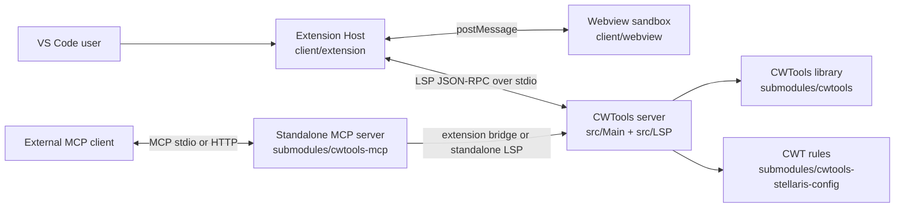

The Extension Host is the trust boundary: it owns VS Code APIs, filesystem I/O, process startup, SecretStorage, commands, and Webview lifecycles. Webviews only render and emit intents. The F# server owns Paradox syntax, CWT rules, Shader compile-unit analysis, and game semantics.

### Extension Host

`client/extension/` runs inside the VS Code Extension Host process.

| Area | Primary files / directories |
| --- | --- |
| Activation & commands | `client/extension/extension.ts` |
| Game profiles | `client/extension/gameProfiles.ts` |
| Workspace & mode detection | `workspaceGameDetection.ts`, `languageSelectors.ts` |
| Shared indexes | `client/extension/indexing/` |
| Path & filesystem helpers | `pathScope.ts`, `fileExtensions.ts`, `fsCaseInsensitive.ts` |
| Visual-editor hosts | `*Panel.ts`, `shipDesign/`, `staticGalaxyEditorProvider.ts` |
| Vanilla comparison & Workshop | `vanillaCompare.ts`, `workshopPanel.ts`, `workshopIgnore.ts` |
| AI runtime | `client/extension/ai/` |

Host code validates all Webview messages and external payloads at the boundary before executing operations. Path containment checks must use `pathScope.ts` (and `ai/workspaceSandbox.ts` for AI read policy) rather than ad-hoc prefix matching.

**Cross-layer path casing convention**:
- **F# server (`src/LSP/`, `src/Main/`)**: internal comparison/cache keys fold to uppercase (`ToUpperInvariant()`, see `PathIdentity.normalizePath`), matching upstream CWTools.
- **TypeScript client (`client/extension/`)**: internal index/lookup keys fold to lowercase (`toLowerCase()`, see `pathScope.ts`).
- User-facing display paths and OS filesystem API arguments always preserve original casing.

### Shared game profiles and indexes

`gameProfiles.ts` defines per-game capabilities (language IDs, folders, localisation formats, install hints, and feature flags). Game-varying features query the active profile instead of hardcoding Stellaris assumptions.

`client/extension/indexing/` provides incremental localisation and workspace-symbol indexes outside the F# semantic model, shared by UI previews and AI tools.

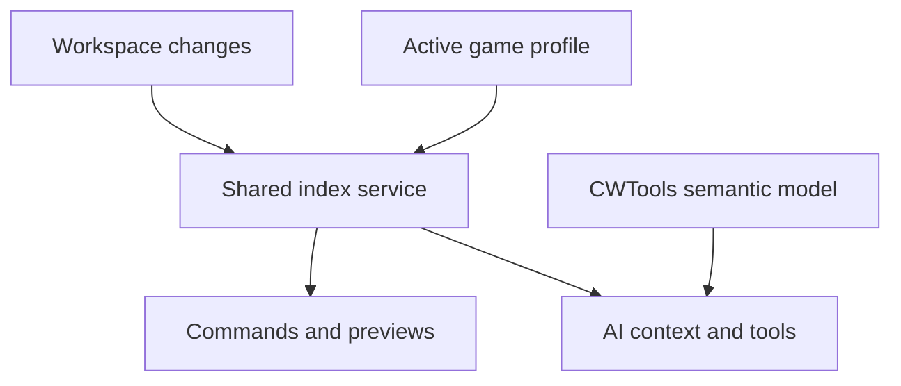

Caches must stay bounded, filesystem-derived results must be sorted deterministically where order matters, and partial or stale index status must be surfaced honestly to callers.

### Webview sandbox

`client/webview/` is bundled by Rollup and executes in VS Code's browser sandbox (chat, detached Agent Manager, Steam Workshop uploader, GUI, global ship design, solar system, static galaxy, event chain, tech tree, targeting weight, entity, and particle views).

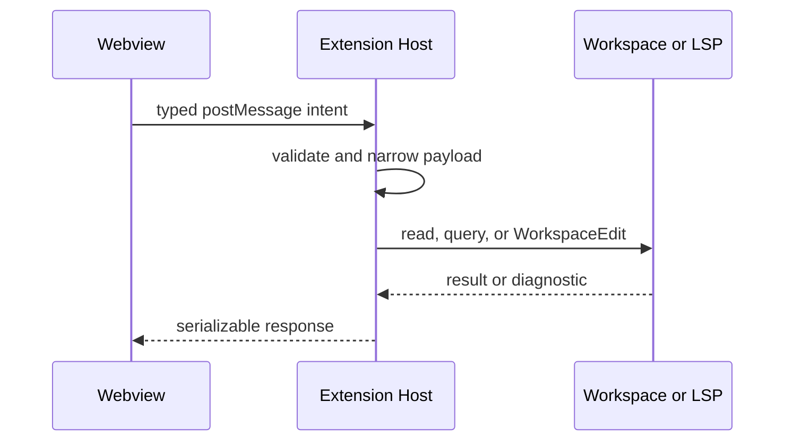

Webview invariants:
- No `vscode`, `fs`, `path`, `require()`, or Node-only APIs.
- Use VS Code theme variables and respect `prefers-reduced-motion`.
- Dispose renderers, GPU resources, textures, workers, listeners, and animation loops on close.
- Source write-back stays in the Host via minimal `WorkspaceEdit`s to preserve native undo, dirty state, and watchers.

#### Global ship design workbench

`ShipDesignPanel` (`client/extension/shipDesignPanel.ts`, `client/extension/shipDesign/`, and `client/shared/shipDesignProtocol.ts`) keeps edits inside a Host-owned `ShipDesignDraftSession` and applies a single `WorkspaceEdit` only on **Save**. All mutation intents (`set-component`, `drop-component`, `set-required-component`, `fill-empty-slots`) are revalidated by the Host against live draft state, workspace containment, and compatibility rules; the Webview never supplies write paths.

The 3D scene reuses `entityModelRuntime.ts`, addresses meshes via Host-resolved Webview resource URIs with byte-bounded caching, and incrementally rebuilds changed locator subtrees using ancestry keys. Unsaved drafts register as virtual dirty documents under the same fail-closed guard that prevents disk-based Agent writes from clobbering dirty GUI editors. See [the Ship Design Workbench Agent Note](.agents/notes/implemented/feature/2026-11-20-global-ship-design-workbench.md).

### Language server

The F# / .NET 10 server splits into:
- `src/LSP/` — reusable LSP protocol, JSON-RPC framing, document store, and tokenizer layer.
- `src/Main/` — CWTools server executable, game loader, refresh coordinator, and feature handlers.
- `submodules/cwtools/` — core parser, validator, scope/reference/completion engine, CWT meta-model, and Shader analysis.

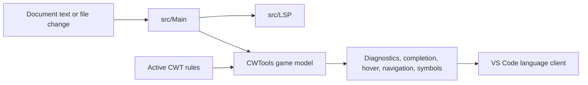

**Concurrency and locking**:
- Read requests run concurrently while model mutations require exclusive access via `gameStateLock`.
- `gameStateLock` is writer-preferring: a parked waiting writer blocks all incoming readers. Because batch validation holds read locks for seconds, deferrable background writers must acquire via `tryEnterGameStateWriteLock` (bounded polling) and yield pending work to the next cycle on contention; write-lock hold times must stay bounded.
- Incremental scripted-type refresh (currently implemented for Stellaris) must retain a guarded full-refresh fallback and match full-rebuild semantics.

### CWT document pipeline

`.cwt` files use the dedicated `cwt` language ID (`CWT0xx`–`CWT9xx` diagnostics; see [docs/diagnostic-codes.md](docs/diagnostic-codes.md)) and never enter `game.Complete` or `game.ValidateFile`.

Startup runs in one of two modes chosen by `determineServerStartMode` (`client/extension/languageSelectors.ts`) using evidence from `workspaceGameDetection.ts` (see [the workspace-detection Agent Note](.agents/notes/implemented/architecture/2026-11-10-evidence-based-workspace-detection.md)):
- **Full game mode**: workspace has game evidence; builds the game model while still routing `.cwt` files through the CWT pipeline.
- **CWT-only mode**: rules-only repository or standalone `.cwt` file; starts with `GameLanguage.CWT`, skips game guessing/vanilla cache/rules setup, and upgrades in place via `cwtools.reloadExtension` if game evidence appears.

Pipeline layers:
1. **Single-file meta-model** (`CWTools/Rules/CwtLanguage*.fs` + `src/Main/CwtLanguageFeatures.fs`): parses with `RulesParser.parseConfigWithMetadataDetailed`, validates root blocks/`##` directives/field expressions (`CWT0xx`–`CWT2xx`), and serves context completion.
2. **Project snapshot** (`CWTools/Rules/CwtProjectIndex.fs`): immutable, versioned overlay snapshot (open editors win over disk) producing deterministic cross-file symbols, navigation, and project diagnostics (`CWT301`, `CWT302`, `CWT401`). `## inject` paths are strictly containment-checked with symlink-cycle protection.
3. **Validated hot-swap** (`CWTools/Rules/CwtActivation.fs` + `src/Main/Program.fs`): atomically swaps validated manual-rules candidates into the game model under the write lock, bumping rules/model epochs. Invalid candidates (`CWT900`) or swap failures (`CWT901`) preserve the last-known-good model; `reloadrulesconfig` remains the manual fallback.

### Shader subsystem

`.shader` and `.fxh` share the compile-unit-aware `PdxShaderFeatures` surface in `submodules/cwtools/`. Includes, file precedence, platform conditions, and renderer contracts determine symbol meaning.

Do not add a parallel TypeScript Shader parser; Agent tools and MCP must query the LSP commands backed by `PdxShaderFeatures`. Because engine executables invoke some Effects directly, renderer contracts and audited ABI evidence govern safe edits—absent text references never prove an Effect is unused.

### AI subsystem

`client/extension/ai/` runs in the Extension Host and owns provider clients, multi-account subscription pools, chat/topic state, prompt assembly, tool policy/dispatch, Agent skills, and workspace memory.

#### Turn routing and state

The built-in Agent is a single-agent Paradox/CWTools assistant. Turns default to Execute (bounded inspection settles routine changes) unless the user pins a mode (`/plan`, `/execute`, `/explore`, `/review`, or `/mode <value>`). When user-owned design choices remain open, the Agent escalates via `enter_plan_mode`, narrowing authorization to `plan_write_only` so the plan guard blocks project writes for the rest of the turn; `exit_plan_mode` exits Plan without restoring write access (only user approval authorizes execution).

`AgentSchedulingState` is the sole persisted and host-to-Webview scheduling state; prompt/tool execution labels derive from it at call boundaries. `Implementation_Plan.md` carries one machine-readable `cwtools-plan` contract (with an optional Paradox blueprint payload). `.cwtools/project/profile.json` uses the V4 guidance-card schema rebuilt by `/init`.

#### Runner and tool enforcement

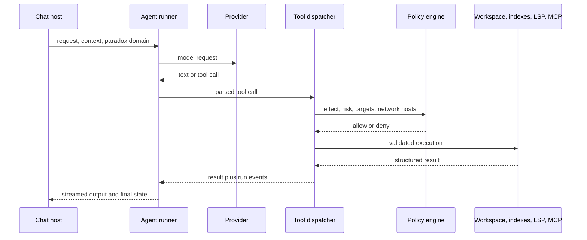

The tool registry (`client/extension/ai/tools/registry.ts`) is the source of truth for availability, effects, risk, and concurrency. Every call passes through `policyEngine.ts` before dispatch in `agentTools.ts`. File writes enforce path containment, per-file exclusion, sorted multi-file locking, plan-mode gates, `EvidenceGate` semantic prechecks, BOM-safe localisation handling, and user-selected `confirm` / `auto` mode.

Typed run events drive streaming, replay, checkpoints, and resume; new events require matching reducers and Webview renderers, and resume strictly enforces the V4 checkpoint contract. Long runs use bounded context compaction, budgets, and loop detection.

#### Manager GUI development preview

The detached Agent Manager mounts a persistent `.gui` Preview tab (`ManagerGuiPreviewController` + shared `GuiPreviewLoader`) alongside Changes, Run, and Settings. Element selections attach versioned, read-only source references via `ContextReferenceManager`. Disk-based Agent writes fail closed against dirty GUI drafts. After GUI writes, fixed-frame offscreen Before/After/Diff captures inject up to two `visual_verification` rounds into the active run (image + metrics for vision providers; metrics only otherwise), stored in bounded topic-private files outside V4 checkpoints. See [the Manager GUI preview Agent Note](.agents/notes/implemented/feature/2026-11-17-agent-manager-gui-development-preview.md).

#### Provider and secret boundary

Provider credentials, OAuth tokens, proxy credentials, and web-search keys live in VS Code SecretStorage. Provider clients normalize wire formats into the runner's unified message/tool model. Live web content, MCP payloads, and provider responses are treated as untrusted input.

### Standalone MCP server and native bridge

`submodules/cwtools-mcp/` is maintained and published independently as three strictly one-way packages:
- `cwtools-shared` — transport-free contracts, generated schemas/detection, `createToolCallHandler`, and shared pure formulas (including `targetingWeights.ts`, also consumed directly by the Extension Host).
- `cwtools-node` — Node host services (filesystem, LSP process, revalidation, project detection; no MCP SDK dependency).
- `cwtools-mcp` — MCP transport wiring and re-exports.

Both Bridge mode (connecting to an active VS Code Extension Host manifest) and Standalone mode (spawning its own LSP) enforce the same capability gate: unsupported or ambiguous workspaces expose no tools/resources and spawn no LSP; CWT-only workspaces expose only CWT-capable tools. Whitelisted domain-write tools (6 tools) are enabled by default; non-whitelisted writes are rejected.

The internal `cwtools.ai.getHostCapabilities` handshake verifies `{ protocolVersion, serverVersion, commands }` before model load; incompatible hosts fail explicitly with `backend_incompatible`. For non-MCP consumers, the extension also exposes bearer-authenticated `/cwtools/healthz` and `/cwtools/rpc` forwarding only allowlisted read-only commands and navigation/document LSP methods.

Never hand-edit `submodules/cwtools-mcp/packages/cwtools-shared/src/generated/`; regenerate via `npm run generate:mcp-schema` and `npm run generate:mcp-detection`.

### Build and release flow

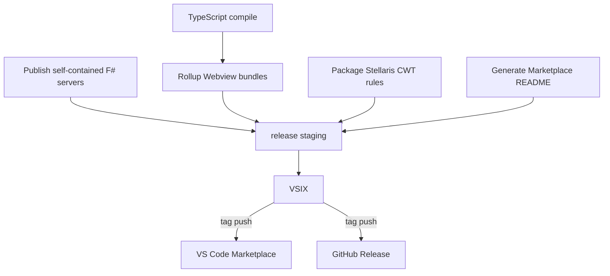

`npm run compile` builds Extension Host code and Webview bundles. `package.ps1` publishes self-contained `win-x64`, `linux-x64`, and `osx-x64` servers, packages Stellaris rules, stages `release/`, and builds the universal VSIX. Pushing a matching `v<version>` tag triggers `.github/workflows/release.yml` to build, verify, publish to the VS Code Marketplace via GitHub OIDC Trusted Publishing, and create/update the GitHub Release.

### Design constraints at a glance

| Constraint | Reason |
| --- | --- |
| Webviews never access Node.js or the filesystem | Preserves browser sandbox and a single trusted I/O boundary. |
| Every model-visible tool passes through policy | Keeps permissions, effects, locks, and audit events uniform. |
| Semantic capabilities originate in the LSP | Prevents Extension Host, AI, and MCP from drifting into separate parsers. |
| Shared outputs and caches stay deterministic and bounded | Keeps large mods responsive and tests reproducible. |
| Untrusted inputs are validated at every boundary | Prevents malformed messages or files from becoming trusted state. |
| Submodule commits stay independent | Preserves ownership, history, and separate release cycles. |
| User-facing English and Chinese stay in sync | Keeps both supported documentation and UI surfaces accurate. |

---

## 中文

本文说明 Stellaris Language Serves 的运行边界、共享服务与架构不变量。具体设计动机、权衡与被否决的备选方案归档在 `.agents/notes/implemented/`，不在此重复。

文档不重复维护版本号；根 `package.json` 与 `release/package.json` 是唯一来源。

### 运行时概览

扩展横跨三个运行边界与三个独立子模块：

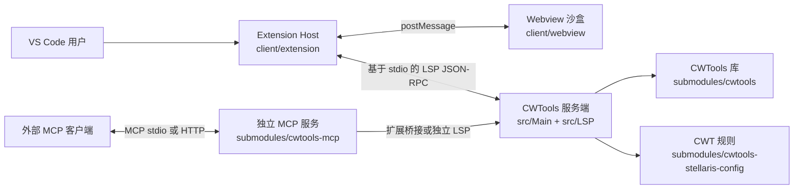

Extension Host 是信任边界：统一负责 VS Code API、文件 I/O、进程启动、SecretStorage、命令与 Webview 生命周期。Webview 仅负责渲染与交互意图提交。F# 服务端负责 Paradox 语法、CWT 规则、Shader 编译单元分析与游戏语义。

### Extension Host

`client/extension/` 运行在 VS Code Extension Host 进程中。

| 模块 | 主要文件 / 目录 |
| --- | --- |
| 激活与命令 | `client/extension/extension.ts` |
| 游戏 Profile | `client/extension/gameProfiles.ts` |
| 工作区与模式探测 | `workspaceGameDetection.ts`、`languageSelectors.ts` |
| 共享索引 | `client/extension/indexing/` |
| 路径与文件系统 helper | `pathScope.ts`、`fileExtensions.ts`、`fsCaseInsensitive.ts` |
| 可视化编辑器宿主 | `*Panel.ts`、`shipDesign/`、`staticGalaxyEditorProvider.ts` |
| 原版对比与创意工坊 | `vanillaCompare.ts`、`workshopPanel.ts`、`workshopIgnore.ts` |
| AI 运行时 | `client/extension/ai/` |

宿主代码在边界处校验所有 Webview 消息与外部 payload 后再执行操作。路径包含判断统一使用 `pathScope.ts`（AI 读取策略在 `ai/workspaceSandbox.ts`），不要手写前缀比对。

**跨层路径大小写约定**：
- **F# 服务端（`src/LSP/`、`src/Main/`）**：内部比较与缓存键统一折叠为大写（`ToUpperInvariant()`，见 `PathIdentity.normalizePath`），遵循上游 CWTools 约定。
- **TypeScript 客户端（`client/extension/`）**：内部索引与查找键统一折叠为小写（`toLowerCase()`，见 `pathScope.ts`）。
- 展示路径与传给操作系统 API 的路径始终保留原始大小写。

### 共享游戏 Profile 与索引

`gameProfiles.ts` 描述各游戏的差异（language ID、目录、本地化格式、安装提示与功能开关）。随游戏变化的功能必须查询当前 Profile，不硬编码 Stellaris 假设。

`client/extension/indexing/` 提供 F# 语义模型之外的增量本地化与工作区符号索引，由 UI 预览与 AI 工具共享。

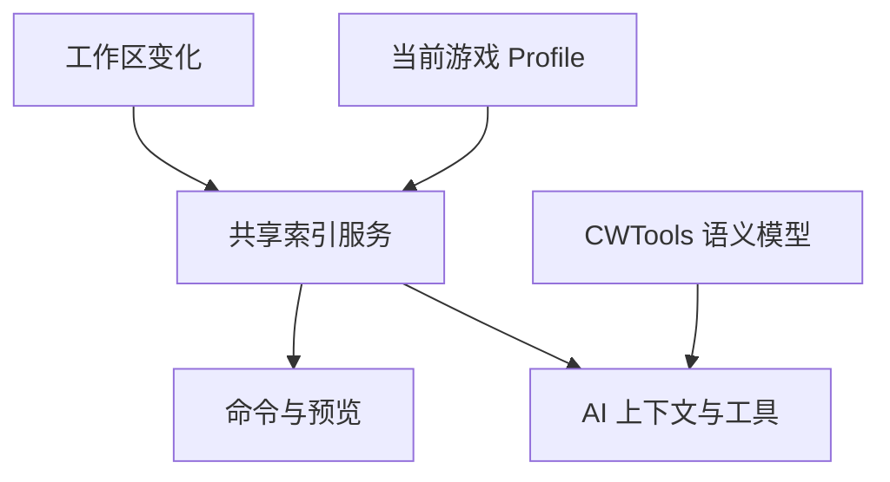

缓存必须有容量上限；依赖顺序的文件系统派生结果必须确定性排序；索引处于 partial 或 stale 状态时必须如实透传给调用方。

### Webview 沙盒

`client/webview/` 由 Rollup 打包，运行在 VS Code 浏览器沙盒中（聊天、独立 Agent Manager、Steam 创意工坊、GUI、全局舰船设计、恒星系、静态银河、事件链、科技树、索敌权重、实体与粒子视图）。

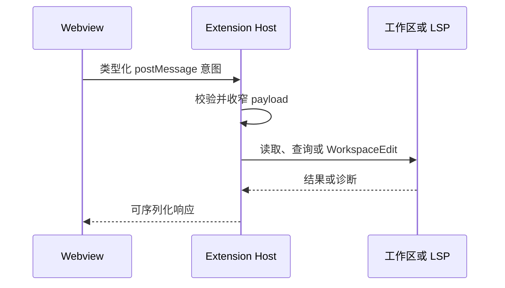

Webview 约束：
- 禁止导入 `vscode`、`fs`、`path`，禁止 `require()` 或调用 Node 专用 API。
- 使用 VS Code 主题变量并支持 `prefers-reduced-motion`。
- 关闭面板时正确释放渲染器、GPU 对象、贴图、worker、监听器与动画循环。
- 源码写回由宿主通过最小 `WorkspaceEdit` 完成，以保持原生撤销、dirty 状态与文件监听正常。

#### 全局舰船设计工作台

`ShipDesignPanel`（`client/extension/shipDesignPanel.ts`、`client/extension/shipDesign/` 与 `client/shared/shipDesignProtocol.ts`）将所有编辑限制在宿主侧 `ShipDesignDraftSession` 草稿中，仅在点击 **保存** 时以单次 `WorkspaceEdit` 写回文档。所有修改意图（`set-component`、`drop-component`、`set-required-component`、`fill-empty-slots`）均由宿主按实时草稿状态、工作区边界与兼容性规则复验；Webview 不提供写入路径。

3D 场景复用 `entityModelRuntime.ts`，通过宿主解析的 Webview 资源 URI 搭配字节上限缓存加载网格，并按祖先组合键仅增量重建变更节点子树。未保存草稿注册为虚拟脏文档，与 GUI 编辑器共用 fail-closed 保护，阻止 Agent 写磁盘覆盖草稿。详见 [全局舰船设计工作台 Agent Note](.agents/notes/implemented/feature/2026-11-20-global-ship-design-workbench.md)。

### 语言服务

F# / .NET 10 服务端分为三层：
- `src/LSP/` — 可复用的 LSP 协议、JSON-RPC 编解码、文档存储与词法层。
- `src/Main/` — CWTools 服务端入口、游戏加载器、刷新协调器与功能处理器。
- `submodules/cwtools/` — 核心解析、校验、作用域/引用/补全引擎、CWT 元模型与 Shader 分析。

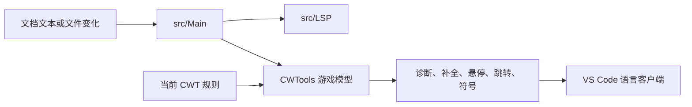

**并发与锁约束**：
- 只读请求可并发执行，模型变更需通过 `gameStateLock` 独占协调。
- `gameStateLock` 为写者优先锁：一旦有写者挂起等待，后续所有读者都会阻塞。因批量校验会连续持读锁数秒，可延迟后台写任务必须使用 `tryEnterGameStateWriteLock`（有界轮询），争用时保留待处理状态留待下周期；进入写锁后的持有时间必须有界。
- scripted type 增量刷新（当前仅 Stellaris 实现）必须保留受保护的全量刷新兜底，并与全量重建结果一致。

### CWT 文档管线

`.cwt` 文件属于独立的 `cwt` 语言（诊断码 `CWT0xx`–`CWT9xx`，见 [docs/diagnostic-codes.md](docs/diagnostic-codes.md)），不进入 `game.Complete` 或 `game.ValidateFile`。

启动模式由 `determineServerStartMode`（`client/extension/languageSelectors.ts`）结合 `workspaceGameDetection.ts` 的工作区证据决定（见 [工作区识别 Agent Note](.agents/notes/implemented/architecture/2026-11-10-evidence-based-workspace-detection.md)）：
- **Full game mode**：工作区有游戏证据时构建游戏模型，`.cwt` 文件仍走独立 CWT 管线。
- **CWT-only mode**：纯规则仓库或单独打开 `.cwt` 时以 `GameLanguage.CWT` 启动，跳过游戏猜测、原版缓存与规则源装配；若后续出现游戏证据则通过 `cwtools.reloadExtension` 原地重启升级。

管线三层：
1. **单文件元模型**（`CWTools/Rules/CwtLanguage*.fs` + `src/Main/CwtLanguageFeatures.fs`）：使用 `RulesParser.parseConfigWithMetadataDetailed` 解析，输出结构/表达式诊断（`CWT0xx`–`CWT2xx`）与上下文补全。
2. **跨文件项目快照**（`CWTools/Rules/CwtProjectIndex.fs`）：基于不可变、版本化 overlay 快照（未保存文档优先于磁盘）生成确定性符号索引、跳转与项目诊断（`CWT301`、`CWT302`、`CWT401`）；`## inject` 路径执行严格包含性校验与符号链接环保护。
3. **候选规则热替换**（`CWTools/Rules/CwtActivation.fs` + `src/Main/Program.fs`）：仅对当前配置的手动规则目录中校验通过的候选在写锁下原子替换并递增规则/模型 epoch；无效候选（`CWT900`）或替换失败（`CWT901`）保留 last-known-good 模型，`reloadrulesconfig` 保留为手动兜底。

### Shader 子系统

`.shader` 与 `.fxh` 共用 `submodules/cwtools/` 中编译单元感知的 `PdxShaderFeatures` 能力层；Include、文件优先级、平台条件与 renderer contract 共同决定符号语义。

不要在 TypeScript 中实现平行 Shader 解析器；Agent 与 MCP 应调用 `PdxShaderFeatures` 支撑的 LSP 命令。部分 Effect 由游戏可执行程序直接调用，安全修改依赖 renderer contract 与已审核 ABI 证据——缺少脚本文本引用不代表 Effect 未使用。

### AI 子系统

`client/extension/ai/` 运行在 Extension Host 中，负责 Provider 客户端、多账号订阅号池、聊天与话题状态、Prompt 构建、工具策略与分发、Agent 技能及工作区记忆。

#### 单轮路由与状态

内置 Agent 是专注 Paradox/CWTools 语义的单 Agent 助手。除用户显式固定模式（`/plan`、`/execute`、`/explore`、`/review` 或 `/mode <值>`）外，默认走 Execute，由有界只读检查确定普通修改；当存在属于用户的未决设计选择时，Agent 调用 `enter_plan_mode` 将授权收窄为 `plan_write_only`，使 plan guard 拦截本回合剩余项目写入；`exit_plan_mode` 只退出 Plan 而不恢复写权限，必须由用户批准后才能进入执行。

`AgentSchedulingState` 是唯一持久化并在宿主与 Webview 间传递的调度状态，Prompt/工具执行标签仅在调用边界派生。`Implementation_Plan.md` 只包含单个机器可读 `cwtools-plan` 合同（可附带 Paradox 蓝图载荷）。`.cwtools/project/profile.json` 采用由 `/init` 重建的 V4 guidance-card schema。

#### Runner 与工具策略执行

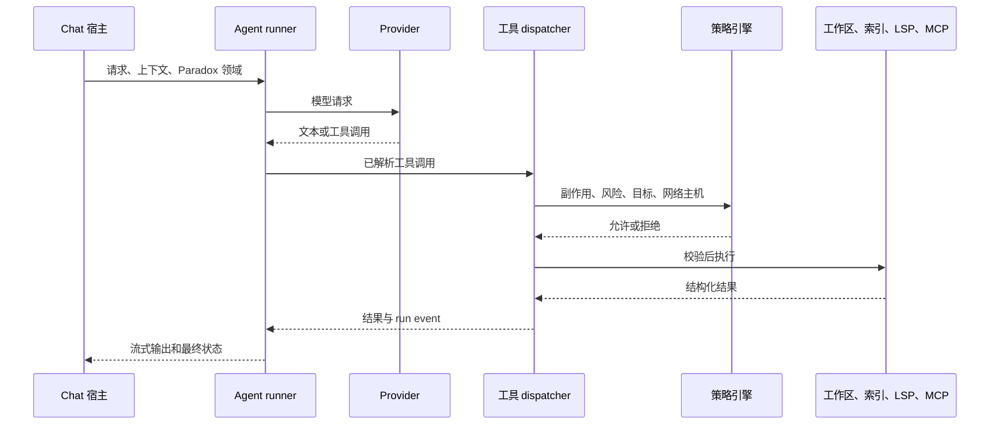

工具可用性、副作用、风险与并发策略以 `client/extension/ai/tools/registry.ts` 为准。所有工具调用在 `agentTools.ts` 分发前均须经过 `policyEngine.ts`；文件写入额外受路径包含、单文件写排他、排序多文件锁、Plan 模式门、`EvidenceGate` 语义预检、本地化 UTF-8 BOM 护栏与 `confirm` / `auto` 模式约束。

类型化 run event 驱动流式输出、重放、检查点与恢复；新增事件必须同步 reducer 与 Webview 渲染器，恢复严格校验 V4 检查点合同。长任务受有界上下文压缩、预算与循环检测保护。

#### 管理器 GUI 开发预览

独立 Agent Manager 在“变更 / 运行 / 设置”旁提供持久的 `.gui` 预览页（`ManagerGuiPreviewController` + 共享 `GuiPreviewLoader`）。元素选择通过 `ContextReferenceManager` 附带带版本号的只读源码引用；磁盘写入类 Agent 工具对未保存 GUI 草稿采取 fail-closed 拦截。GUI 写入后，固定坐标离屏 Before/After/Diff 捕获最多向当前回合注入两轮 `visual_verification` 证据（视觉 Provider 接收图片与像素指标，其余接收文本指标），证据存于话题私有有界文件中且不进入 V4 检查点。详见 [管理器 GUI 开发预览 Agent Note](.agents/notes/implemented/feature/2026-11-17-agent-manager-gui-development-preview.md)。

#### Provider 与 Secret 边界

Provider 凭据、OAuth 令牌、代理凭据与网页搜索 Key 均存储在 VS Code SecretStorage。各 Provider 客户端将差异化的线协议统一转换为 runner 的通用消息与工具调用模型。实时网页、MCP payload 与 Provider 响应均按不可信输入处理。

### 独立 MCP 服务与原生桥接

`submodules/cwtools-mcp/` 独立维护与发布，包含严格单向依赖的三个包：
- `cwtools-shared` — 传输无关契约、生成的 schema/探测代码、`createToolCallHandler` 以及共享纯计算公式（如 `targetingWeights.ts`，Extension Host 亦直接消费）。
- `cwtools-node` — Node 宿主服务（文件系统、LSP 进程、复验、项目探测，不依赖 MCP SDK）。
- `cwtools-mcp` — MCP 传输层接线与重导出。

Bridge 模式（复用已运行的 VS Code 扩展清单）与 Standalone 模式（自启 LSP）执行统一能力门禁：非支持或歧义工作区不暴露任何工具/资源且不启动 LSP；CWT-only 仅暴露 CWT 能力工具。6 个白名单领域写入工具默认启用，非白名单写入一律拒绝。

内部握手 `cwtools.ai.getHostCapabilities` 在游戏模型加载前校验 `{ protocolVersion, serverVersion, commands }`；不兼容宿主明确返回 `backend_incompatible`。面向非 MCP 消费者，扩展另在清单旁提供 bearer 认证的 `/cwtools/healthz` 与 `/cwtools/rpc`，仅转发白名单只读命令及 5 个导航/文档 LSP 方法。

不要手改 `submodules/cwtools-mcp/packages/cwtools-shared/src/generated/`；应运行 `npm run generate:mcp-schema` 与 `npm run generate:mcp-detection` 重新生成。

### 构建与发布流程

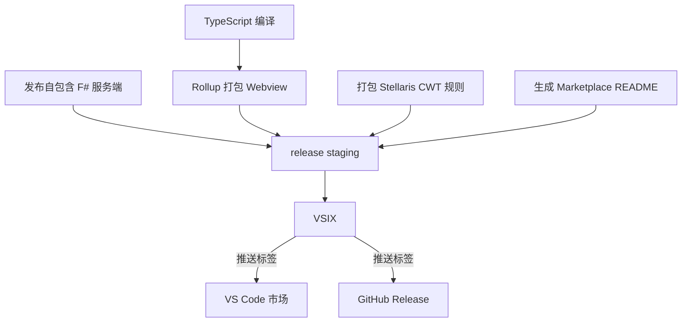

`npm run compile` 构建 Extension Host 与 Webview bundle；`package.ps1` 发布 `win-x64`、`linux-x64`、`osx-x64` 自包含服务端、打包 Stellaris 规则、暂存 `release/` 并输出通用 VSIX。推送与两份清单版本一致的 `v<version>` 标签会触发 `.github/workflows/release.yml`，自动完成构建、校验、通过 GitHub OIDC Trusted Publishing 发布到 VS Code 市场以及创建/更新 GitHub Release。

### 关键约束速查

| 约束 | 原因 |
| --- | --- |
| Webview 不访问 Node.js 或文件系统 | 保持浏览器沙盒与单一可信 I/O 边界。 |
| 模型可见工具全部经过策略引擎 | 统一权限、副作用、锁与审计事件。 |
| 语义能力先进入 LSP | 防止 Extension Host、AI 与 MCP 演化出多套解析器。 |
| 共享输出与缓存确定且有界 | 保证大型 Mod 响应速度与测试可复现。 |
| 在边界校验所有不可信输入 | 防止畸形消息或文件变成可信状态。 |
| 子模块提交保持独立 | 保留所有权、历史与独立发布周期。 |
| 用户可见英文与中文同步维护 | 保证双语文档与 UI 始终一致。 |
