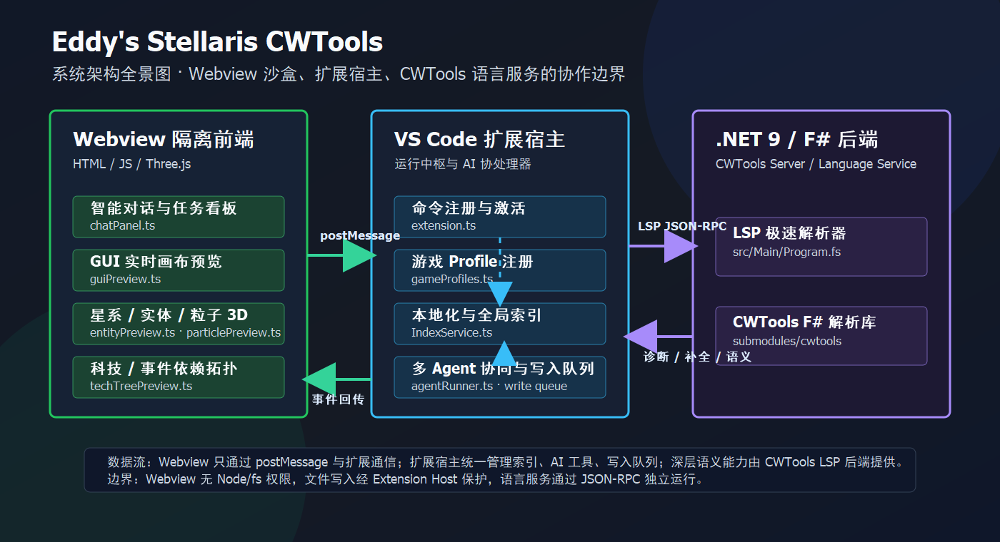

# Stellaris Language Serves

[English](#english) | [中文](#zh-cn) | [Contributing / 贡献指南](CONTRIBUTING.md) | [Architecture / 架构](ARCHITECTURE.md) | [CWT rules / CWT 规则](docs/cwt-rule-config.md) | [Diagnostic codes / 诊断码](docs/diagnostic-codes.md) | [AI instructions](AGENTS.md)

<a id="english"></a>

## English

Stellaris Language Serves is a VS Code extension for Paradox modding. It combines the CWTools language server with visual editors, vanilla comparison, Shader support, and an optional AI workspace.

[](https://dotnet.microsoft.com/)
[]()

Most language features work across supported Paradox game profiles. The visual tools and bundled rules are developed primarily for Stellaris.

### What it includes

| Area | What you can do |
| --- | --- |
| Script editing | Get diagnostics, completion, hover information, navigation, references, symbols, CodeLens, and inlay hints for Paradox script and localisation. Stellaris hovers also carry reverse-engineered engine cost and hardcoded-behaviour notes for the script command under the cursor. |
| Visual tools | Preview and edit Stellaris GUI files, solar systems, static galaxies, particles, entities, technology trees, and event chains. Ship top-icon DDS sheets can be rendered from a ship set's models. |
| Shader editing | Work with `.shader` and `.fxh` files using compile-unit-aware diagnostics, navigation, completion, formatting, rename, and semantic highlighting. |
| CWT rule editing | Edit `.cwt` rule files with their own language id: parser/structure diagnostics (CWT0xx), directive and field-expression validation (CWT1xx/CWT2xx), project-wide undefined-reference and duplicate-type checks (CWT3xx), context completion for root blocks/directives/field expressions/symbols, cross-file navigation, and safe hot-swap of validated edits from the configured manual rules folder into the game model (CWT9xx). A rules-only repository starts the server in CWT-only mode without a game install and never activates a game model; a game workspace keeps full mode. |
| Vanilla comparison | Compare a mod file with its vanilla counterpart and migrate the block under the cursor. |
| Steam Workshop | Upload the current mod to the Steam Workshop: create a new item or update an existing one, with tags, preview image, visibility, and change note. Requires the Steam client running and signed in to an account that owns the game. |
| AI workspace | Use a general coding agent or a Paradox/CWTools-aware agent with explicit permissions, project indexing, Agent skills, and optional MCP servers. |
| External MCP | Connect Codex, Claude Code, or another MCP client to the separate read-only `cwtools-mcp` package. |

The extension also supports Hearts of Iron IV, Europa Universalis IV and V, Crusader Kings II and III, Imperator: Rome, Victoria II and 3, and custom CWT projects. Game-specific coverage depends on the active profile and available rules.

### Install

1. Download the latest `.vsix` from [Releases](https://github.com/Aa728848/cwtools-vscode/releases).
2. In VS Code, run `Extensions: Install from VSIX...` and select the file.
3. When prompted, choose the vanilla game folder. CWTools uses it to build its initial cache.

The packaged extension includes its language-server binaries. The .NET SDK is only needed when building the project locally.

### Common workflows

#### Edit Paradox script

Open a supported mod workspace as a folder. Diagnostics and navigation become available after the language server has loaded the project and vanilla data.

#### Open a visual editor

Use the editor-title action or the file context menu:

- `.gui`: GUI canvas and property editor
- `solar_system_initializers/*.txt`: 3D solar-system preview
- `map/setup_scenarios/*.txt`: static-galaxy preview and position editor
- `.asset` and `.gfx`: entity, animation, and particle previews
- technology and event files: dependency graphs

Edits made by a visual editor use VS Code workspace edits, so they participate in normal undo and redo. Some previews are intentionally approximate; for example, runtime-generated hyperlanes are never presented as exact source data.

#### Generate ship top-icon sheets from models

Stellaris draws the ship-size icons in the ship designer and fleet view from `gfx/interface/icons/ship_parts/ship_sizes/ship_sizes_top.dds`, one 80×40 frame per size. `Generate Ship Icon Sheet from Models` renders that sheet from the models themselves, so a mod ship set no longer has to borrow vanilla art.

Run the command from the Command Palette (or the editor-title button inside a mod workspace), pick a graphical culture, then a category group and the ship sizes inside it, and confirm the destination. Each size is resolved the way the game resolves it: the size's `icon` selects the sprite frame, `common/section_templates` names the section entity for every slot, and that entity's `pdxmesh` names the `.mesh` file. Sections are merged in their authored coordinates (no locator translation — vanilla section art is already positioned in hull space), projected top-down, and written as uncompressed ARGB8888 DDS at the sprite sheet's declared `noOfFrames` width, so the file drops in without editing any `.gfx`.

Frames are drawn as the vanilla icon frame: a 1px transparent gutter, a 1px accent border, a vertical panel gradient, and a near-black silhouette lit by a soft glow in the accent colour. Both `ship_sizes_top.dds` and its `..._top_damaged.dds` companion are written; the damaged sheet uses the red variant of the same palette, so the outline is identical and only the colours differ. Sizes are grouped by their `class` (military, military stations, starbases, civilian hulls, and so on), and sizes that resolve to no model are left out of the lists instead of producing empty frames.

Slots that offer several section templates use the first candidate by default; choose **Choose each slot manually** to override any of them. When a model cannot be resolved at all (missing `pdxmesh`, unmodelled slot, or a name that does not follow the `<culture>_<entity>` convention), use the **manual model entry** at the top of the size list: it stores an entity name or a `.mesh` path per ship size in `stellarisLanguageServices.shipIcons.meshOverrides` in the workspace settings, and that size resolves through the override from then on. Clearing the entry restores the automatic chain.

When several sizes share one icon key, only one of them can keep that frame: the rest are packed into free frames, and once the sheet is full it is widened instead of dropping ships, with the counts reported. The command also writes a paste-ready `spriteTypes` block to the `CWTools Ship Icons` output channel — the two sheet sprites with the produced `noOfFrames`, a `GFX_<ship_size>_top` / `_top_damaged` pair per size, and a list of the `icon =` values to copy into the matching `ship_size` blocks so each ship reaches its own frame. Replace an existing definition instead of adding a duplicate.

Hulls whose geometry lives on entities referenced through `attach` are collected too, down to four levels with cycle protection, so a model assembled from parts renders whole. A `attach`-referenced mesh that carries only locators is skipped and reported once, in locator wording.

Collision proxies and alpha/additive effect planes are excluded from the silhouette, because including them would inflate the outline. Frames that reference a mesh that cannot be read stay blank instead of shifting the other sizes, and every skip and warning is listed in the `CWTools Ship Icons` output channel.

#### Compare with vanilla

Use the `Compare with Vanilla` CodeLens on a matching mod file. `Migrate Block from Vanilla` replaces the current block while preserving the coordinates of other pending edits.

#### Upload to the Steam Workshop

Open a mod workspace (a folder with a `descriptor.mod`), then run `Upload Mod to Steam Workshop` from the Command Palette or the editor title button. The form opens in the dedicated `Steam Workshop` view in the activity bar, pre-filled from `descriptor.mod`; for an update, the current description is also read back from the Workshop page. Confirm the title, description, tags, preview image, visibility, and change note, then upload.

A mod whose `descriptor.mod` has no `remote_file_id` is uploaded as a new Workshop item (private by default), and the new item id is written back to `remote_file_id`; later uploads update that item. The Steam client must be running and signed in to an account that owns the game. For games whose Steam App ID is not known to the extension, set `stellarisLanguageServices.workshop.appIdOverride`.

Steam uploads everything in the folder it is given, so the extension first builds a filtered copy of the mod in a temporary staging directory and uploads that. The mod's own `.gitignore` and `.steamignore` files are applied with git's own rules, including negation and per-directory scoping; version-control and editor metadata (`.git`, `.github`, `.vscode`, `.idea`, and similar) is always excluded. Add patterns to `stellarisLanguageServices.workshop.extraIgnorePatterns` for build output or local-only files that no ignore file covers, or set `stellarisLanguageServices.workshop.useIgnoreFiles` to false to upload the mod folder verbatim. The result reports how many files were uploaded and how many the rules kept out; a mod with nothing to exclude is uploaded directly, with no copy at all.

#### Generate aura localisation

Auras in `common/component_templates/*.txt` need a tooltip string of their own. Put the cursor inside a `friendly_aura` or `hostile_aura` block and run `Generate Aura Localisation for This Block`, or run `Generate Aura Localisation for All Auras in This File` to convert every aura in the file at once. Both commands are available from the Command Palette, the editor context menu, and the lightbulb.

The generated lines open in a read-only `cwtools://auraloc` buffer, ready to paste into the matching localisation `.yml`:

```yaml
SRA_Aura_5_1:0 "§Y防御性光环§!\n对盟友舰船效果：\n $MOD_SHIP_SHIELD_DAMAGE_MULT$：§G+50%§!\n $MOD_SHIP_ARMOR_DAMAGE_MULT$：§G+50%§!\n $MOD_SHIP_HULL_DAMAGE_MULT$：§G+50%§!"
```

Every `modifier` entry becomes `$MOD_<KEY>$` followed by its value: `_mult` keys and fractional values are rendered as percentages (`0.5` → `§G+50%§!`), other values keep their written form, and negative values are shown in red. `damage_per_day` follows as labelled lines (daily damage, shield/armor/hull damage, accuracy, penetration, size factor). The localisation key is taken from `stack_info.id`, falling back to `name`.

Nothing is written to disk, and the aura script is not modified: paste the lines yourself, and reference the generated key from the aura's `modifier` (`custom_tooltip = <KEY>`) if you want to replace the auto-generated tooltip. When nothing can be generated (the cursor is outside every aura block, the block has no key, or the file does not parse), the same buffer shows the reason as `#` comment lines.

#### Use the AI panel

Open `AI: Open Chat Panel` from the Command Palette. The composer lets you keep routing automatic or restrict a turn to the Paradox/CWTools or general-coding domain. Provider credentials are stored through VS Code SecretStorage; tool access still follows the selected sandbox and approval policy.


The ChatGPT-subscription-compatible Codex provider uses a browser sign-in flow and the extension's own agent runtime. It is an integration with an upstream compatibility endpoint, not a public stable API, so upstream changes can require extension updates. The Codex picker uses a built-in model catalog, not an account entitlement list; OpenAI API and Codex subscription availability can differ.

Antigravity is also available in AI Settings. Select **Antigravity (Google OAuth)**, sign in with Google, then refresh the account to load its models and quota. The extension stores OAuth tokens in VS Code SecretStorage and supports streaming text, image input, and tool calls through Antigravity's Gemini transport. Complete account setup in Antigravity first. This provider uses fixed upstream compatibility endpoints; API keys, custom endpoints, and utility calls are unavailable.

According to the [Antigravity model availability table](https://antigravity.google/docs/models), Claude Opus 5.5 and Sonnet 5.5 (Thinking) require Google AI Ultra or a non-trial Google AI Pro subscription. Claude 4.6 and GPT-OSS remain available to eligible accounts until their announced removal on November 2, 2026. Refresh the account after a plan change; the built-in model list does not bypass upstream access checks.

The chat catalog combines Gemini 3.1 Pro runtime aliases into `gemini-3.1-pro` and hides editor-only `tab_` models. The Pro reasoning setting still selects the runtime model. For inline completion, enable it in AI Settings and select Antigravity with `tab_flash_lite_preview`. The extension adapts native next-edit output to insertion-only ghost text. Run **Stellaris AI: Jump to Next Edit (Antigravity)** from the Command Palette to use `tab_jump_flash_lite_preview` without applying its predicted edit. See [setup and protocol details](docs/antigravity-tab-protocol.md).

Codex subscription and Antigravity (Gemini OAuth) share **AI Settings → Subscription channel proxy**. Choose **Auto detect**, **Custom proxy**, or **Direct connection**, then click **Save proxy** before signing in or testing. Custom mode accepts HTTP, HTTPS, and SOCKS5 addresses (for example `http://127.0.0.1:7890` or `socks5://127.0.0.1:1080`), with optional `username:password@` authentication stored in VS Code SecretStorage. Leave the address empty to keep the saved proxy. Auto mode checks VS Code `http.proxy`, `HTTPS_PROXY` / `HTTP_PROXY` / `ALL_PROXY` (including lowercase variants), then Windows/macOS manual system proxy settings; PAC is not evaluated. Without a detected proxy it connects directly. A configured proxy failure is reported without a direct fallback. Changes apply to subsequent token, account, quota and chat requests; active streams continue with their existing connection. Browser sign-in uses the browser's own proxy settings.

Agent behavior can be customized from the user home directory: skills live in `~/.cwtools/skills` (project-level `.agents/skills` and `.cwtools/skills` still apply), agent profiles in `~/.cwtools/agents`, and additional MCP servers can be declared in `~/.cwtools/mcp.json` (user level) or `.cwtools/mcp.json` (project level, Claude-style `mcpServers` JSON; project-level servers need one-time approval before first connection). Extra AI providers (endpoint, model list, API key via environment-variable reference) can be declared in `~/.cwtools/providers.json`, and per-sub-agent model assignments in `~/.cwtools/agent-models.json`. Global instructions that apply to every workspace live in `~/.cwtools/CWTOOLS.md`. The agent can also save a reusable skill into the project itself (`save_skill` writes `.agents/skills/<name>/SKILL.md`, the same layout Kimi Code discovers, so saved skills are portable across agents) and load it on demand with `run_skill`. `run_command` resolves its shell per platform — PowerShell 7 (`pwsh`) is preferred on Windows with Windows PowerShell as fallback, and `bash` is preferred on macOS/Linux. When the first task starts without a project knowledge database, the agent auto-initializes it in the background (`stellarisLanguageServices.ai.autoInitProjectKnowledge`). Completed runs distill reusable lessons into a workspace experience store and recall them on similar future tasks (`stellarisLanguageServices.ai.experience.enabled`, human-readable projection at `.cwtools/experience.md`).

#### Connect an external MCP client

`cwtools-mcp` is maintained and released separately. It exposes read-only semantic queries and normally reuses the language server already running in VS Code.

```sh
codex mcp add cwtools -- npx -y cwtools-mcp --stdio
```

```sh
claude mcp add cwtools --scope user -- npx -y cwtools-mcp --stdio
```

See the [cwtools-mcp repository](https://github.com/Aa728848/cwtools-mcp) for standalone mode and manual configuration.

### Architecture



The main runtime boundaries are:

- `client/extension/`: VS Code Extension Host code and filesystem access
- `client/webview/`: browser-sandboxed panels and visual editors
- `src/LSP/` and `src/Main/`: the F#/.NET language server
- `submodules/cwtools/`: the upstream CWTools library
- `submodules/cwtools-stellaris-config/`: Stellaris CWT rules
- `submodules/cwtools-mcp/`: the separately released read-only MCP server

Webviews communicate with the Extension Host through messages and do not access Node.js or the filesystem directly. The [architecture guide](ARCHITECTURE.md) covers the data flows and maintenance boundaries in detail.

### Develop

You need Node.js 20+, npm 10+, the .NET 10 SDK, Git with submodule support, and VS Code 1.90+.

```bash
git clone --recurse-submodules https://github.com/Aa728848/cwtools-vscode.git
cd cwtools-vscode
npm install
npm run compile
npm run test:unit
```

Useful checks:

| Command | Purpose |
| --- | --- |
| `npm run lint` | Lint Extension Host and Webview code. |
| `npm run compile` | Compile TypeScript and bundle Webviews. |
| `npm run test:unit` | Run unit tests. |
| `dotnet build src/LSP/` | Build the reusable LSP layer. |
| `dotnet build src/Main/` | Build the server executable. |
| `npm run verify` | Run the broad local quality gate. |
| `npm run build:docs` | Validate bilingual docs and generate the Marketplace README. |

Read [CONTRIBUTING.md](CONTRIBUTING.md) before changing code, packaging the extension, or editing a submodule. CWT rule authors should start with the [rule configuration guide](docs/cwt-rule-config.md).

### License

Released under the [MIT License](LICENSE.md). This project builds on [CWTools](https://github.com/cwtools) and the work of the Paradox modding community.

---

<a id="zh-cn"></a>

## 中文

Stellaris Language Serves 是一款面向 Paradox Mod 开发的 VS Code 扩展。它把 CWTools 语言服务、可视化编辑器、原版对比、Shader 支持和可选的 AI 工作区放在同一个插件中。

[](https://dotnet.microsoft.com/)
[]()

语言服务覆盖多个受支持的 Paradox 游戏 Profile；可视化工具和随插件提供的规则主要围绕 Stellaris 开发。

### 主要功能

| 范围 | 可以做什么 |
| --- | --- |
| 脚本编辑 | 为 Paradox 脚本和本地化提供诊断、补全、悬停信息、跳转、引用、符号、CodeLens 和嵌入提示。Stellaris 的悬停还会附带光标所在脚本命令的引擎开销与硬编码行为说明（来自反编译分析）。 |
| 可视化工具 | 预览或编辑 Stellaris GUI、恒星系、静态银河、粒子、实体、科技树和事件链；也可以从舰船模型渲染舰船顶部图标 DDS 表。 |
| Shader 编辑 | 按真实编译单元处理 `.shader` 和 `.fxh`，提供诊断、跳转、补全、格式化、重命名和语义高亮。 |
| CWT 规则编辑 | 用独立的 `cwt` 语言编辑 `.cwt` 规则文件:解析/结构诊断(CWT0xx)、指令与字段表达式校验(CWT1xx/CWT2xx)、项目级未定义引用与重复类型检查(CWT3xx)、根块/指令/字段表达式/符号的上下文补全、跨文件跳转,以及把当前配置的手动规则目录中验证通过的编辑安全热替换进游戏模型(CWT9xx)。纯规则仓库以 CWT-only 模式启动服务,无需游戏安装且不会激活游戏模型;游戏工作区保持 full mode。 |
| 原版对比 | 将 Mod 文件与原版对应文件对比，并迁移光标所在的代码块。 |
| Steam 创意工坊 | 把当前 Mod 上传到 Steam 创意工坊：可新建物品或更新已有物品，支持标签、预览图、可见性与更新说明。需要 Steam 客户端已运行并登录拥有该游戏的账号。 |
| AI 工作区 | 使用通用编码 Agent 或了解 Paradox/CWTools 的 Agent，并通过权限、项目索引、工作流和可选 MCP 服务控制执行范围。 |
| 外部 MCP | 通过独立发布的只读 `cwtools-mcp`，让 Codex、Claude Code 等客户端查询 CWTools 语义信息。 |

语言服务还支持 Hearts of Iron IV、Europa Universalis IV 和 V、Crusader Kings II 和 III、Imperator: Rome、Victoria II 和 3，以及自定义 CWT 项目。具体能力取决于当前 Profile 和可用规则。

### 安装

1. 从 [Releases](https://github.com/Aa728848/cwtools-vscode/releases) 下载最新 `.vsix`。
2. 在 VS Code 中运行 `Extensions: Install from VSIX...`，选择下载的文件。
3. 首次提示时选择原版游戏目录，CWTools 会据此建立缓存。

发布的扩展已经包含语言服务端；只有本地构建项目时才需要 .NET SDK。

### 常用方式

#### 编辑 Paradox 脚本

把受支持的 Mod 目录作为工作区打开。语言服务完成项目和原版数据加载后，诊断、补全和跳转等功能会自动启用。

#### 打开可视化编辑器

使用编辑器标题栏按钮或文件右键菜单：

- `.gui`：GUI 画布和属性编辑
- `solar_system_initializers/*.txt`：3D 恒星系预览
- `map/setup_scenarios/*.txt`：静态银河预览和位置编辑
- `.asset`、`.gfx`：实体、动画和粒子预览
- 科技与事件文件：依赖关系图

可视化编辑器通过 VS Code 工作区编辑写回文件，因此可以正常撤销和重做。部分预览只能近似表达游戏运行时结果；例如，运行时随机生成的超空间航道不会被当成精确数据展示。

#### 从模型生成舰船顶部图标表

舰船设计器和舰队视图里的舰船尺寸图标来自 `gfx/interface/icons/ship_parts/ship_sizes/ship_sizes_top.dds`，每个尺寸占 80×40 的一帧。`从模型生成舰船顶部图标表` 直接按模型重新渲染这张表，因此自制舰船组不必再借用原版图标。

在命令面板运行该命令（Mod 工作区里也可以点编辑区右上角的按钮），选择图形文化，再选择类别分组与其中的舰船尺寸，最后确认输出位置。命令按游戏的同一套规则解析每个尺寸：尺寸的 `icon` 决定精灵帧号，`common/section_templates` 给出各槽位的分段实体，该实体的 `pdxmesh` 指向对应 `.mesh`。所有分段的几何会在其自带的船体坐标中合并（不施加 locator 平移——原版分段美术本身就是按船体坐标摆放的），做顶部正交投影，再按精灵表声明的 `noOfFrames` 宽度写成未压缩 ARGB8888 DDS，因此文件可以直接替换、无需改动任何 `.gfx`。

每一帧按原版图标的画法绘制：1px 透明留白、1px 亮边框、面板竖向渐变，以及被同色系柔和光晕包围的近黑剪影。命令会同时写出 `ship_sizes_top.dds` 和 `..._top_damaged.dds`；破损态使用同一套配色的红色变体，因此轮廓完全一致，只有颜色不同。尺寸按其 `class` 分类（军舰、军用空间站、星港、民用船体等），解析不出模型的尺寸不会出现在列表里，也不会留下空白帧。

同一槽位有多个分段模板时默认取第一个候选，需要精确控制时选择 **手动指定** 逐槽覆盖。若某个尺寸完全解析不出模型（缺 `pdxmesh`、槽位没有对应分段，或命名不符合 `<culture>_<entity>` 约定），使用尺寸列表顶部的 **手动指定模型**：它把「实体名或 `.mesh` 路径」按尺寸写进工作区设置里的 `stellarisLanguageServices.shipIcons.meshOverrides`，之后该尺寸就按这条覆盖解析；清空该条目即可恢复自动解析。

当多个尺寸共用一个图标键时，只有一条能保住该帧：其余会被排进空闲帧，整张放满后改为加宽而不是丢弃，并在报告里给出各级数量。命令还会把一段可直接粘贴的 `spriteTypes` 写进 `CWTools Ship Icons` 输出通道——两条 sheet 精灵（带本次实际 `noOfFrames`）、每个尺寸一对 `GFX_<尺寸名>_top` / `_top_damaged`，以及一份需要复制进对应 `ship_size` 的 `icon =` 清单，让每艘船都能落到自己的帧。若同名定义已存在，请替换而不是重复添加。

几何挂在 `attach` 子实体上的船体也会被收集（最多四层、带环检测），因此由零件拼装的模型能完整渲染；只含 locator 的 `attach` 网格会被跳过，并以 locator 措辞合并成一条报告。

物理碰撞代理与 alpha/additive 特效面片不会进入剪影，否则会把轮廓撑大。引用到的 `.mesh` 读取失败的帧保持空白而不是让其他尺寸错位，所有跳过与告警都会列在 `CWTools Ship Icons` 输出通道里。

#### 与原版对比

在有原版对应文件的 Mod 文件中使用 `Compare with Vanilla` CodeLens。`Migrate Block from Vanilla` 会替换当前代码块，并避免其他待处理修改的行号失效。

#### 上传到 Steam 创意工坊

打开 Mod 工作区（包含 `descriptor.mod` 的文件夹），然后从命令面板或编辑器标题按钮运行 `上传 Mod 到 Steam 创意工坊`。表单位于活动栏独立的 `Steam 创意工坊` 视图中，会按 `descriptor.mod` 预填；更新已有物品时还会从工坊页面读出当前描述一并预填。确认标题、描述、标签、预览图、可见性与更新说明后即可上传。

`descriptor.mod` 没有 `remote_file_id` 的 Mod 会作为新工坊物品上传（默认私有），新物品 id 会回写到 `remote_file_id`，之后的上传即为更新该物品。上传要求 Steam 客户端已运行并登录拥有该游戏的账号。对于扩展尚未内置 Steam App ID 的游戏，可设置 `stellarisLanguageServices.workshop.appIdOverride`。

Steam 会把它拿到的整个文件夹一并上传，因此扩展会先在临时暂存目录中生成一份过滤后的副本，再上传该副本。Mod 自带的 `.gitignore` 与 `.steamignore` 会按 git 自身的规则生效，包括否定规则与按目录作用域的规则；版本控制与编辑器元数据（`.git`、`.github`、`.vscode`、`.idea` 等）始终被排除。对于任何忽略文件都未覆盖的构建产物或仅本地使用的文件，可在 `stellarisLanguageServices.workshop.extraIgnorePatterns` 中追加规则；也可将 `stellarisLanguageServices.workshop.useIgnoreFiles` 设为 false 以原样上传整个 Mod 文件夹。上传结果会报告实际上传了多少文件、规则排除了多少项；没有任何可排除内容的 Mod 会直接上传原目录，完全不做拷贝。

#### 生成光环本地化

`common/component_templates/*.txt` 中的光环需要自己的 Tooltip 文本。把光标放在 `friendly_aura` 或 `hostile_aura` 块内，运行 `生成光环本地化（光标所在块）`；或运行 `生成光环本地化（当前文件全部光环）`，一次转换文件中的全部光环。两个命令都可以从命令面板、编辑器右键菜单和灯泡菜单调用。

生成结果会显示在只读的 `cwtools://auraloc` 缓冲区中，可直接粘贴进对应的本地化 `.yml`：

```yaml
SRA_Aura_5_1:0 "§Y防御性光环§!\n对盟友舰船效果：\n $MOD_SHIP_SHIELD_DAMAGE_MULT$：§G+50%§!\n $MOD_SHIP_ARMOR_DAMAGE_MULT$：§G+50%§!\n $MOD_SHIP_HULL_DAMAGE_MULT$：§G+50%§!"
```

`modifier` 中的每条修正都会生成 `$MOD_<键名>$` 加数值：`_mult` 结尾的键和小数值按百分比渲染（`0.5` → `§G+50%§!`），其余按原值输出，负值使用红色。随后是 `damage_per_day` 的逐项标签（每日伤害、护盾/装甲/船体伤害、命中率、穿透、体积伤害系数）。本地化键取自 `stack_info.id`，缺失时回退到 `name`。

该功能不会写入任何文件，也不会修改光环脚本：请自行粘贴生成的行；如果想覆盖自动生成的 Tooltip，可在光环的 `modifier` 中用 `custom_tooltip = <键名>` 引用它。当无法生成时（光标不在任何光环块内、光环块没有键名、文件语法有误），同一个缓冲区会以 `#` 注释行显示原因。

#### 使用 AI 面板

从命令面板运行 `AI: Open Chat Panel`。输入区可以保持自动路由，也可以把当前请求限制在 Paradox/CWTools 或通用编码领域。Provider 凭据通过 VS Code SecretStorage 保存；工具调用仍受当前沙盒和审批策略约束。


兼容 ChatGPT 订阅的 Codex Provider 通过浏览器登录，并使用插件自己的 Agent 运行时。它依赖上游兼容端点，不属于公开稳定 API；如果上游流程变化，插件可能需要同步更新。Codex 选择器使用内置模型目录，不代表账户已获授权；OpenAI API 与 Codex 订阅的可用模型可能不同。

AI 设置也支持 Antigravity。选择 **Antigravity (Google OAuth)**，使用 Google 登录后刷新账户，即可加载模型和额度。扩展将 OAuth Token 存入 VS Code SecretStorage，通过 Antigravity 的 Gemini 协议支持流式文本、图片输入和工具调用。请先在 Antigravity 中完成账户设置。该供应商使用固定的上游兼容端点，不提供 API Key、自定义端点或辅助调用。

根据 [Antigravity 官方模型可用性表](https://antigravity.google/docs/models)，Claude Opus 5.5 和 Sonnet 5.5（Thinking）需要 Google AI Ultra 或非试用的 Google AI Pro 订阅。Claude 4.6 和 GPT-OSS 在官方公告的 2026 年 11 月 2 日下线前仍向符合条件的账户开放。变更套餐后请刷新账户；内置模型列表不会绕过上游权限检查。

聊天模型列表将 Gemini 3.1 Pro 的后台别名合并为 `gemini-3.1-pro`，隐藏仅供编辑器使用的 `tab_` 模型；推理强度仍决定实际后台模型。在 AI 设置中启用行内补全，选择 Antigravity 和 `tab_flash_lite_preview`，即可将原生下一次编辑输出适配为光标处的灰字补全。在命令面板运行 **Stellaris AI：跳转到下一处编辑（Antigravity）**，可使用 `tab_jump_flash_lite_preview` 定位下一处编辑，只移动光标。详见[配置与协议说明](docs/antigravity-tab-protocol.md)。

Codex 订阅与 Antigravity（Gemini OAuth）共用 **AI 设置 → 订阅渠道代理**。选择 **自动检测**、**自定义代理** 或 **直连**，登录或测试前点击 **保存代理**。自定义模式支持 HTTP、HTTPS、SOCKS5 地址（例如 `http://127.0.0.1:7890` 或 `socks5://127.0.0.1:1080`），可用 `用户名:密码@` 提供认证，凭据保存在 VS Code SecretStorage。地址留空会保留已保存的代理。自动模式依次检测 VS Code `http.proxy`、`HTTPS_PROXY` / `HTTP_PROXY` / `ALL_PROXY`（含小写形式）、Windows/macOS 系统手动代理；不解析 PAC。未检测到代理时直连，已配置的代理连接失败时会报错，不会回退直连。修改对后续令牌、账户、额度和聊天请求生效，进行中的流式回复继续使用原连接。浏览器登录页面遵循浏览器自身的代理设置。

Agent 行为可从用户主目录定制：技能放在 `~/.cwtools/skills`（项目级 `.agents/skills` 与 `.cwtools/skills` 仍然生效），Agent 档案放在 `~/.cwtools/agents`，额外的 MCP 服务器可声明在 `~/.cwtools/mcp.json`（用户级）或 `.cwtools/mcp.json`（项目级，Claude 风格 `mcpServers` JSON；项目级服务器首次连接前需一次性批准）。额外的 AI 供应商（端点、模型列表、API Key 用环境变量名引用）可声明在 `~/.cwtools/providers.json`，子代理的模型指派可写在 `~/.cwtools/agent-models.json`。对所有工作区生效的全局指令放在 `~/.cwtools/CWTOOLS.md`。Agent 还可以把可复用技能直接保存进项目（`save_skill` 写入 `.agents/skills/<name>/SKILL.md`，与 Kimi Code 相同的目录约定，保存的技能可跨 agent 通用），并通过 `run_skill` 按需加载。`run_command` 按平台解析 shell——Windows 优先 PowerShell 7（`pwsh`），回退 Windows PowerShell；macOS/Linux 优先 `bash`。当首个任务启动且项目知识数据库不存在时，Agent 会在后台自动初始化（`stellarisLanguageServices.ai.autoInitProjectKnowledge`）。已完成的任务会把可复用的做法与坑沉淀到工作区经验库，并在后续相似任务开始时自动召回（`stellarisLanguageServices.ai.experience.enabled`，人读投影在 `.cwtools/experience.md`）。

#### 连接外部 MCP 客户端

`cwtools-mcp` 独立维护和发布，只提供语义查询，默认复用 VS Code 中已经运行的语言服务。

```sh
codex mcp add cwtools -- npx -y cwtools-mcp --stdio
```

```sh
claude mcp add cwtools --scope user -- npx -y cwtools-mcp --stdio
```

独立模式和手动配置见 [cwtools-mcp 仓库](https://github.com/Aa728848/cwtools-mcp)。

### 架构


主要运行边界如下：

- `client/extension/`：VS Code Extension Host 代码和文件系统访问
- `client/webview/`：运行在浏览器沙盒中的面板与可视化编辑器
- `src/LSP/`、`src/Main/`：F#/.NET 语言服务
- `submodules/cwtools/`：上游 CWTools 库
- `submodules/cwtools-stellaris-config/`：Stellaris CWT 规则
- `submodules/cwtools-mcp/`：独立发布的只读 MCP 服务

Webview 只通过消息与 Extension Host 通信，不能直接访问 Node.js 或文件系统。详细数据流和维护边界见[架构文档](ARCHITECTURE.md)。

### 参与开发

本地开发需要 Node.js 20+、npm 10+、.NET 10 SDK、支持 submodule 的 Git，以及 VS Code 1.90+。

```bash
git clone --recurse-submodules https://github.com/Aa728848/cwtools-vscode.git
cd cwtools-vscode
npm install
npm run compile
npm run test:unit
```

常用检查：

| 命令 | 用途 |
| --- | --- |
| `npm run lint` | 检查 Extension Host 和 Webview 代码。 |
| `npm run compile` | 编译 TypeScript 并打包 Webview。 |
| `npm run test:unit` | 运行单元测试。 |
| `dotnet build src/LSP/` | 构建可复用 LSP 层。 |
| `dotnet build src/Main/` | 构建语言服务端。 |
| `npm run verify` | 运行较完整的本地质量检查。 |
| `npm run build:docs` | 校验双语文档并生成 Marketplace README。 |

修改代码、打包扩展或调整子模块前，请阅读 [CONTRIBUTING.md](CONTRIBUTING.md)。编写 CWT 规则请从[规则配置指南](docs/cwt-rule-config.md)开始。

### 许可证

本项目采用 [MIT License](LICENSE.md)。感谢 [CWTools](https://github.com/cwtools) 以及 Paradox Mod 社区的贡献。
