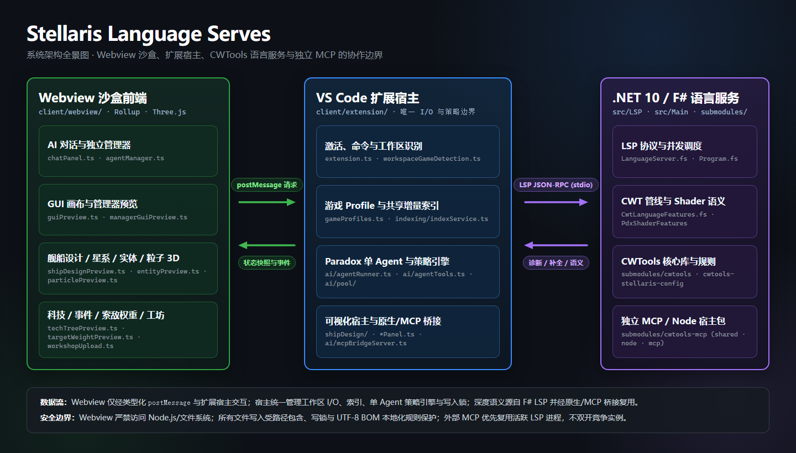

# Stellaris Language Serves

[English](#english) | [中文](#zh-cn) | [Contributing / 贡献指南](CONTRIBUTING.md) | [Architecture / 架构](ARCHITECTURE.md) | [CWT rules / CWT 规则](docs/cwt-rule-config.md) | [Diagnostic codes / 诊断码](docs/diagnostic-codes.md) | [AI instructions](AGENTS.md)

<a id="english"></a>

## English

Stellaris Language Serves is a VS Code extension for Paradox modding. It combines the CWTools language server with visual editors, vanilla comparison, Shader support, Steam Workshop publishing, and an optional AI workspace.

[](https://dotnet.microsoft.com/)
[]()

Core language features cover Stellaris, Hearts of Iron IV, Europa Universalis IV and V, Crusader Kings II and III, Imperator: Rome, Victoria II and 3, and custom CWT projects. Bundled rules and visual tools primarily target Stellaris.

### Feature overview

| Area | Capabilities |
| --- | --- |
| Script & localisation | Diagnostics, completion, hover (with Stellaris engine-cost and hardcoded-behaviour notes), go-to-definition, references, symbols, CodeLens, inlay hints, and aura tooltip localisation generation. |
| Visual editors | Interactive views for Stellaris GUI, global ship designs, 3D solar systems, static galaxies, entities, animations, particles, technology trees, event chains, weapon targeting weights, and ship top-icon DDS sheets. |
| Shader editing | Compile-unit-aware diagnostics, navigation, completion, formatting, rename, and semantic highlighting for `.shader` and `.fxh` files. |
| CWT rule authoring | Dedicated `cwt` language support (`CWT0xx`–`CWT9xx` diagnostics, context completion, cross-file navigation, validated hot-swap into the game model, and CWT-only mode without a game install). |
| Vanilla & Workshop | File/block vanilla diffing, selective block migration, and `.gitignore`/`.steamignore`-aware Steam Workshop uploading. |
| Built-in AI & MCP | Single-agent Paradox/CWTools assistant (`EvidenceGate`, `confirm`/`auto` writes, skills, memory, GUI preview verification) plus the standalone `cwtools-mcp` server for external agents. |

### Install

Install from the [Visual Studio Marketplace](https://marketplace.visualstudio.com/items?itemName=ForeverSkywalker.foreverskywalker-stellaris-cwtools) (updates automatically), or install a `.vsix` from [Releases](https://github.com/Aa728848/cwtools-vscode/releases) via `Extensions: Install from VSIX...`.

When prompted on first launch, select your vanilla game directory so CWTools can build its initial cache. Packaged releases include the language-server binaries for Windows, macOS, and Linux; the .NET SDK is only needed for local development.

### Key workflows

#### Script editing & aura localisation

Open a supported mod folder as a VS Code workspace. Diagnostics and navigation activate once project and vanilla indexes finish loading.

- **Vanilla diff & migration**: run **Compare File with Vanilla**, **Compare Block with Vanilla**, **Migrate Block from Vanilla**, or **Migrate Changed Blocks from Vanilla** from the editor title bar or context menu.
- **Aura localisation**: place the cursor inside a `friendly_aura` or `hostile_aura` block in `common/component_templates/*.txt` and run **Generate Aura Localisation for This Block** (or **for All Auras in This File**) to produce paste-ready `.yml` tooltip lines in a read-only `cwtools://auraloc` preview buffer.

#### Visual editors & Stellaris asset tools

Open a supported file and invoke the editor-title button or context menu:

- `.gui` — GUI canvas and property editor
- `common/global_ship_designs/*.txt` — **Ship Design Workbench**: 3D locator-based hull/section/weapon assembly, slot and required-core editing (click-to-place, drag-and-drop, Fill all), tier/origin-filtered component library, Host-owned drafts (applied only on **Save**), static stat readouts with provenance, and deterministic offline loadout generation
- `solar_system_initializers/*.txt` — 3D solar-system layout and orbit preview
- `map/setup_scenarios/*.txt` — static-galaxy preview with coordinate and explicit-hyperlane editing
- `.asset` / `.gfx` — entity, animation, material, and particle previews
- Technology & event files — dependency graphs
- `common/component_templates/*.txt` — weapon targeting-weight analysis
- **Generate Ship Icon Sheet from Models** — renders normal and `_damaged` `ship_sizes_top.dds` sheets directly from resolved ship-set `.mesh` models (including nested `attach` parts and workspace `meshOverrides`) and prints ready-to-paste `spriteTypes` / `icon =` blocks to the `CWTools Ship Icons` output channel

Visual edits apply through VS Code workspace edits so undo and redo behave normally. Previews explicitly distinguish source-backed data from runtime estimates.

#### Upload to Steam Workshop

Open a workspace containing `descriptor.mod` and run **Upload Mod to Steam Workshop** (requires the Steam client running and signed in). The Steam Workshop view pre-fills metadata from `descriptor.mod` and existing Workshop items, stages a filtered copy honoring `.gitignore`, `.steamignore`, and `stellarisLanguageServices.workshop.extraIgnorePatterns`, and writes the new `remote_file_id` back on first upload. Set `stellarisLanguageServices.workshop.appIdOverride` for games without a built-in Steam App ID.

#### External agents via MCP

The extension no longer includes a built-in Agent, Provider pool, or inline AI completion. Use the separately published [`cwtools-mcp`](https://github.com/Aa728848/cwtools-mcp) server or the DSH native plugin:

- **Bridge or Standalone**: reuse the active VS Code CWTools host, or start an independent LSP with the same project detection and capability gates.
- **Project initialization**: `initialize_project` generates the V4 project profile and V7 SQLite knowledge pack without a chat command; incremental refresh is supported.
- **Domain workflows**: semantic/rule/asset/Shader queries, whitelisted writes, Archetype extraction, and Paradox skills are shared across MCP and DSH.
- **IDE evidence**: an active editor host can return IDE context, open visual editors, and capture bounded GUI Before/After/Diff artifacts. The external Agent controls its own plan and verification loop.

```sh
codex mcp add cwtools -- npx -y cwtools-mcp --stdio
claude mcp add cwtools --scope user -- npx -y cwtools-mcp --stdio
```

### Architecture at a glance



- `client/extension/` — VS Code Extension Host, filesystem/LSP/MCP host boundaries
- `client/webview/` — browser-sandboxed panels and visual editors (`postMessage` only)
- `src/LSP/`, `src/Main/` — F# / .NET 10 language server
- `submodules/cwtools/`, `submodules/cwtools-stellaris-config/`, `submodules/cwtools-mcp/` — upstream library, Stellaris rules, and standalone MCP packages

See [ARCHITECTURE.md](ARCHITECTURE.md) for data flows, locking rules, and subsystem boundaries.

### Develop

Prerequisites: Node.js 20+, npm 10+, .NET 10 SDK, Git (with submodules), and VS Code 1.90+.

```bash
git clone --recurse-submodules https://github.com/Aa728848/cwtools-vscode.git
cd cwtools-vscode
npm install
(cd submodules/cwtools-mcp && npm ci && npm run build -w cwtools-shared)
npm run compile
npm run test:unit
```

See [CONTRIBUTING.md](CONTRIBUTING.md) for the full verification matrix, submodule workflows, CWT rule tooling, and VSIX packaging/release steps.

### License

Released under the [MIT License](LICENSE.md). Built on [CWTools](https://github.com/cwtools) and the Paradox modding community.

---

<a id="zh-cn"></a>

## 中文

Stellaris Language Serves 是一款面向 Paradox Mod 开发的 VS Code 扩展，整合了 CWTools 语言服务、可视化编辑器、原版对比、Shader 支持与 Steam 创意工坊上传。

[](https://dotnet.microsoft.com/)
[]()

核心语言能力覆盖 Stellaris、Hearts of Iron IV、Europa Universalis IV / V、Crusader Kings II / III、Imperator: Rome、Victoria II / 3 及自定义 CWT 项目；内置规则与可视化工具主要围绕 Stellaris 开发。

### 功能概览

| 模块 | 核心能力 |
| --- | --- |
| 脚本与本地化 | 诊断、补全、悬停（含 Stellaris 反编译引擎开销与硬编码行为说明）、跳转、引用、符号、CodeLens、嵌入提示与光环 Tooltip 本地化生成。 |
| 可视化编辑器 | Stellaris GUI、全局舰船设计、3D 恒星系、静态银河、实体/动画/粒子、科技树、事件链、武器索敌权重分析与舰船顶部图标 DDS 表渲染。 |
| Shader 编辑 | 按真实编译单元提供 `.shader` / `.fxh` 诊断、跳转、补全、格式化、重命名与语义高亮。 |
| CWT 规则编写 | 独立的 `cwt` 语言支持（`CWT0xx`–`CWT9xx` 诊断、上下文补全、跨文件跳转、校验通过后安全热替换，以及无需游戏安装的 CWT-only 模式）。 |
| 原版对比与工坊 | 文件/代码块原版差异对比、按块或批量迁移，以及遵循 `.gitignore`/`.steamignore` 的 Steam 创意工坊上传。 |
| 外部 Agent 与 MCP | 通过独立 `cwtools-mcp` 或 DSH 原生插件提供 Paradox/CWTools 语义查询、项目初始化、受控写入、技能与按需 GUI 视觉证据。 |

### 安装

推荐从 [Visual Studio 市场](https://marketplace.visualstudio.com/items?itemName=ForeverSkywalker.foreverskywalker-stellaris-cwtools) 安装（自动更新），或从 [Releases](https://github.com/Aa728848/cwtools-vscode/releases) 下载 `.vsix` 后运行 `Extensions: Install from VSIX...` 手动安装。

首次启动时按提示选择原版游戏目录，CWTools 会据此建立初始缓存。发布包已内置 Windows、macOS、Linux 三平台语言服务端；只有本地开发构建时才需要安装 .NET SDK。

### 常用工作流

#### 脚本编辑与光环本地化

将受支持的 Mod 目录作为工作区打开，待项目与原版索引加载完成后即可使用诊断与导航功能。

- **原版对比与迁移**：在编辑器标题栏或右键菜单运行 **与原版对比文件**、**与原版对比代码块**、**从原版迁移当前代码块** 或 **从原版迁移所有变更块**。
- **光环本地化**：在 `common/component_templates/*.txt` 的 `friendly_aura` 或 `hostile_aura` 块内运行 **生成光环本地化（光标所在块）**（或 **当前文件全部光环**），即可在只读 `cwtools://auraloc` 预览页获得可直接粘贴进 `.yml` 的本地化条目。

#### 可视化编辑器与 Stellaris 资产工具

打开对应文件后，通过编辑器标题栏按钮或右键菜单启动：

- `.gui` — GUI 画布与属性编辑器
- `common/global_ship_designs/*.txt` — **舰船设计工作台**：基于真实 locator 的 3D 船体/区段/武器组装、槽位与核心组件编辑（点击放置、拖放、填充全部）、按等级与来源筛选的组件库、Host 草稿机制（点击 **保存** 才写回文档）、带来源标注的静态数值面板，以及确定性离线配装生成
- `solar_system_initializers/*.txt` — 3D 恒星系布局与轨道预览
- `map/setup_scenarios/*.txt` — 静态银河预览与坐标/显式超空间航道编辑
- `.asset` / `.gfx` — 实体、动画、材质与粒子预览
- 科技与事件文件 — 依赖关系图
- `common/component_templates/*.txt` — 武器索敌权重分析
- **从模型生成舰船顶部图标表** — 从舰船组 `.mesh` 模型直接渲染正常态与 `_damaged` 态 `ship_sizes_top.dds` 精灵表（支持多层 `attach` 子实体与 `meshOverrides` 覆盖），并在 `CWTools Ship Icons` 输出通道打印可直接粘贴的 `spriteTypes` / `icon =` 定义

所有可视化改动均通过 VS Code 工作区编辑应用，支持常规撤销与重做；预览会明确区分源码数据与运行时近似估算。

#### 上传到 Steam 创意工坊

打开含 `descriptor.mod` 的 Mod 工作区并运行 **上传 Mod 到 Steam 创意工坊**（需 Steam 客户端已运行并登录）。工坊视图会自动预填 `descriptor.mod` 与已有工坊条目信息，按 `.gitignore`、`.steamignore` 和 `stellarisLanguageServices.workshop.extraIgnorePatterns` 过滤暂存后上传，并在首次上传后回写 `remote_file_id`。未内置 Steam App ID 的游戏可通过 `stellarisLanguageServices.workshop.appIdOverride` 指定。

#### 连接外部 Agent

扩展已不再内置 Agent、Provider 号池或行内 AI 补全。请使用独立发布的 [`cwtools-mcp`](https://github.com/Aa728848/cwtools-mcp) 或 DSH 原生插件：

- **Bridge 或 Standalone**：复用当前 VS Code CWTools 宿主，或在同一套项目识别与能力门禁下启动独立 LSP。
- **项目初始化**：`initialize_project` 无需聊天命令即可生成 V4 项目画像和 V7 SQLite 知识库，并支持增量刷新。
- **领域工作流**：语义、规则、资产、Shader 查询、白名单写入、Archetype 提取和 Paradox 技能在 MCP 与 DSH 间共享。
- **IDE 证据**：活跃编辑器宿主可提供 IDE 上下文、打开可视化编辑器并生成有界 GUI Before/After/Diff artifact；计划与核对回合并由外部 Agent 自主管理。

```sh
codex mcp add cwtools -- npx -y cwtools-mcp --stdio
claude mcp add cwtools --scope user -- npx -y cwtools-mcp --stdio
```

### 架构速览


- `client/extension/` — VS Code Extension Host、文件系统/LSP/MCP 宿主边界
- `client/webview/` — 浏览器沙盒面板与可视化编辑器（仅经 `postMessage` 通信）
- `src/LSP/`、`src/Main/` — F# / .NET 10 语言服务端
- `submodules/cwtools/`、`submodules/cwtools-stellaris-config/`、`submodules/cwtools-mcp/` — 上游核心库、Stellaris 规则与独立 MCP 包

详细数据流、锁约束与子系统边界见 [ARCHITECTURE.md](ARCHITECTURE.md)。

### 参与开发

环境要求：Node.js 20+、npm 10+、.NET 10 SDK、支持 submodule 的 Git、VS Code 1.90+。

```bash
git clone --recurse-submodules https://github.com/Aa728848/cwtools-vscode.git
cd cwtools-vscode
npm install
(cd submodules/cwtools-mcp && npm ci && npm run build -w cwtools-shared)
npm run compile
npm run test:unit
```

完整的验证矩阵、子模块流程、CWT 规则工具与 VSIX 打包发布说明见 [CONTRIBUTING.md](CONTRIBUTING.md)。

### 许可证

本项目采用 [MIT License](LICENSE.md)。基于 [CWTools](https://github.com/cwtools) 及 Paradox Mod 社区成果构建。
